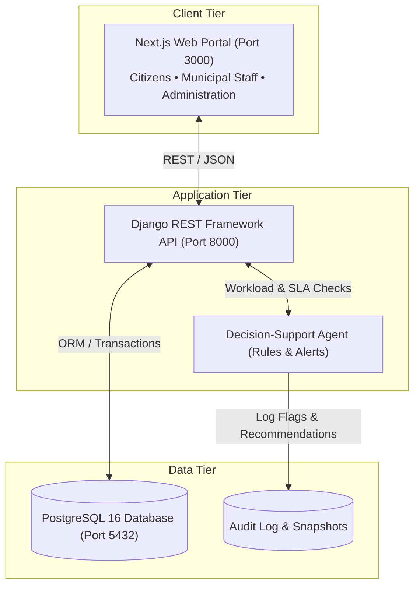
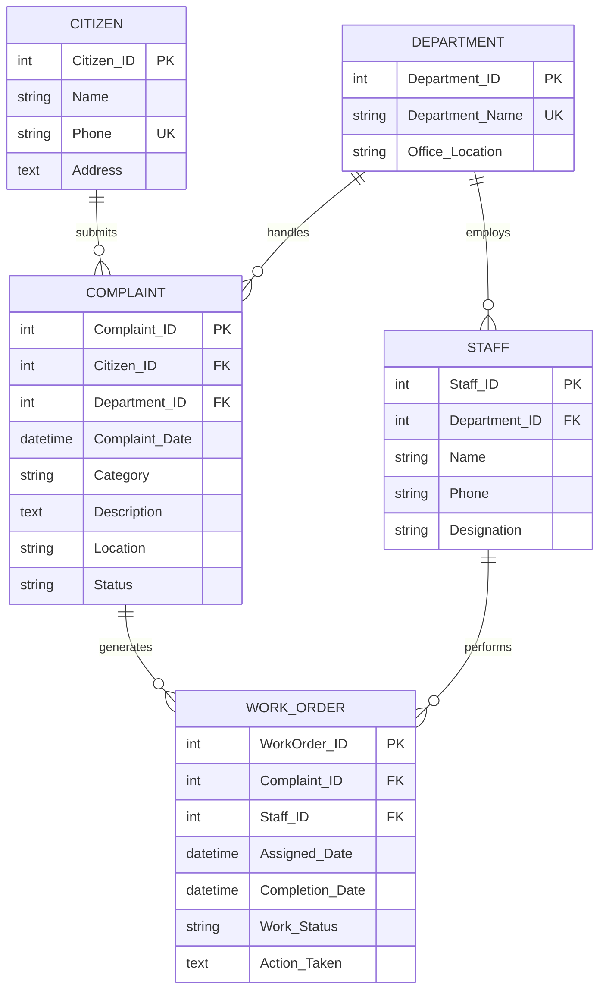
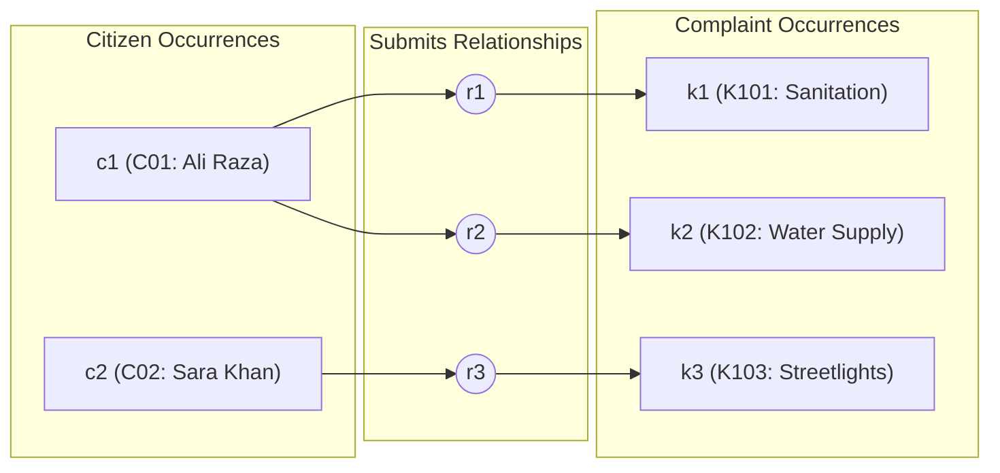
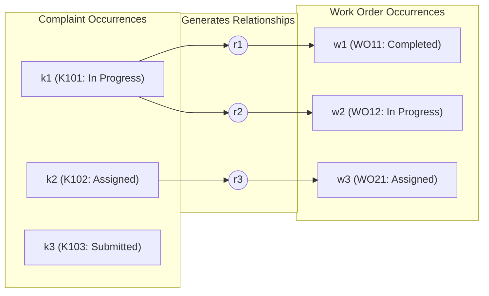
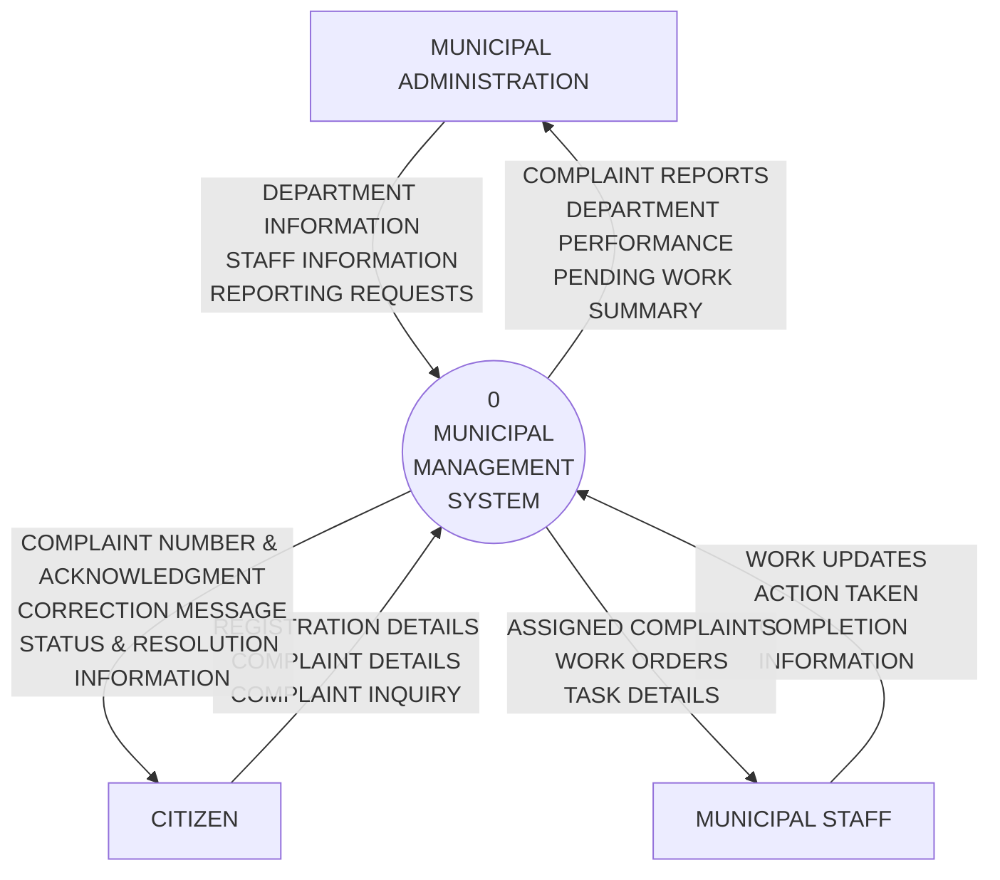
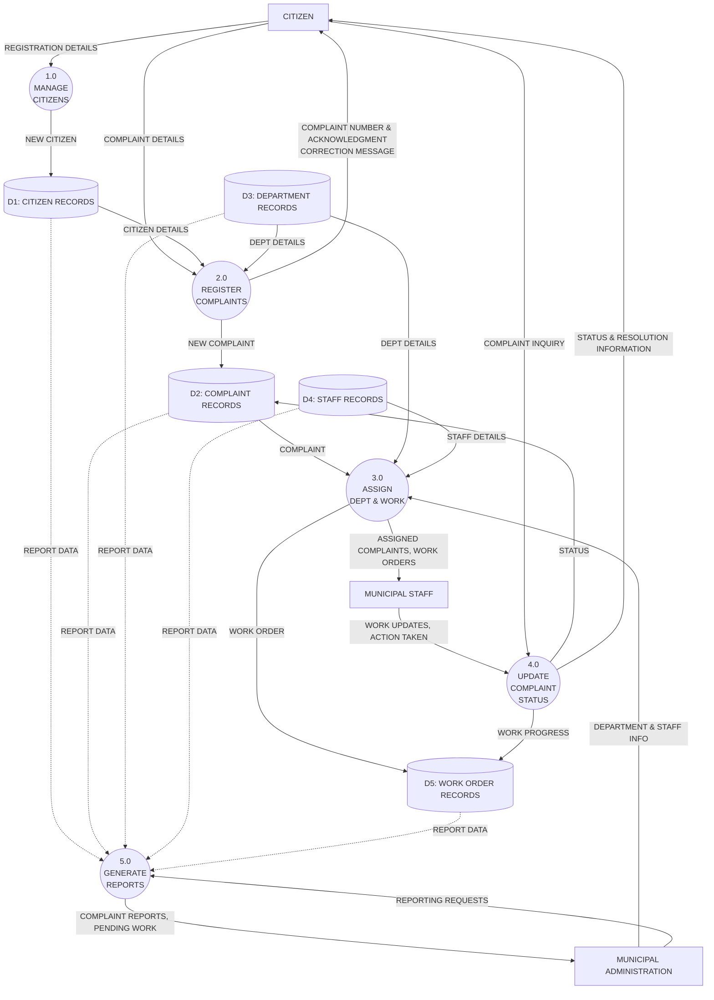
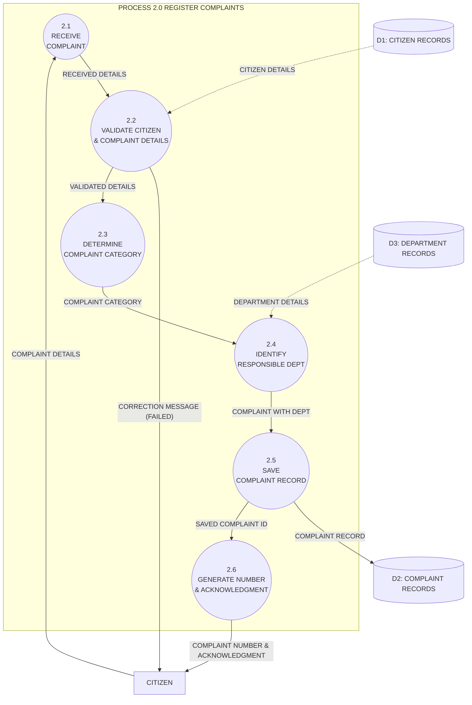

# Municipal Complaint Management System (MCMS)

[](https://github.com/Asad101001/municipal-complaint-system/actions)
[](LICENSE)
[](frontend/)
[](backend/)
[](database/)

**Academic & Engineering Standard**: University of Karachi — BS Computer Science — Database Management Systems (DBMS)  
A centralized, three-tier enterprise database and municipal management system designed to track public complaints from submission to verified resolution. Built with **Next.js**, **Django REST Framework (DRF)**, and **PostgreSQL**, complete with a rule-based **Decision-Support Agent** for proactive backlog alerting and workload rebalancing.

> 📚 **Complete Documentation**:
> - 📊 [Entity-Relationship Diagram (ERD)](docs/erd.md)
> - 🕸️ [Semantic Net (Occurrence Level)](docs/semantic_net.md)
> - 🌐 [DFD Level 0 (Context Diagram)](docs/dfd_level_0.md)
> - 🔀 [DFD Level 1 (Diagram 0)](docs/dfd_level_1.md)
> - 🔍 [DFD Level 2 (Process 2.0)](docs/dfd_level_2.md)
> - 📑 [Master System Diagrams & Data Dictionary](docs/SYSTEM_DIAGRAMS.md)
> - 📋 [Software Requirements Specification (SRS)](docs/SRS.md)
> - 🏗️ [System Design Specification (SDS)](docs/SDS.md)
> - 🎯 [Product Requirements Document (PRD)](docs/PRD.md)

---

## 1. System Architecture



---

## 2. Entity-Relationship Diagram (ERD)

Core five-entity design using Crow's foot notation:



### Cardinality Matrix
- **1 Citizen submits N Complaints** (`1 : N`): Mandatory on Complaint side (`||` Exactly One).
- **1 Department handles N Complaints** (`1 : N`): Mandatory on Complaint side.
- **1 Department employs N Staff** (`1 : N`): Mandatory on Staff side.
- **1 Complaint generates N Work Orders** (`1 : N`): Optional on Complaint side (0..N, work orders exist only after work is assigned).
- **1 Staff member performs N Work Orders** (`1 : N`): Mandatory on Work Order side.

---

## 3. Semantic Net (Occurrence Level)

Illustrates declared `1:N` relationships through sample populations rather than abstract rules:

### Figure A: 1:N Submits Relationship
*Citizen `c1` submits two complaints (`k1`, `k2`); citizen `c2` submits complaint `k3`. Each complaint has exactly one citizen.*



### Figure B: 1:N Generates Relationship
*Complaint `k1` has generated two work orders (`w1`, `w2`); `k2` has generated one work order (`w3`); newly-submitted complaint `k3` has none yet.*



---

## 4. Data Flow Diagrams (DFD)

### Level 0: Context Diagram
*Global boundary with one central process, external entities only, and no data stores.*



---

### Level 1: Diagram 0 (Main Processes & Data Stores)
*Decomposes the system into 5 main processes and 5 persistent stores with balanced flows.*



---

### Level 2: Decomposition of Process 2.0 (Register Complaints)
*Shows sub-processes 2.1 to 2.6 with input validation error branches and store interactions.*



---

## 5. Repository Structure

```
├── .github/
│   ├── workflows/
│   │   └── ci.yml                     # Continuous integration workflow
│   ├── ISSUE_TEMPLATE/
│   │   ├── bug_report.yml             # GitHub bug report issue template
│   │   └── feature_request.yml        # Feature request issue template
│   └── pull_request_template.md       # Standardized PR template
├── backend/                           # Django REST Framework backend
│   ├── Dockerfile
│   ├── requirements.txt
│   ├── .env.example
│   └── README.md
├── frontend/                          # Next.js web application
│   ├── Dockerfile
│   ├── package.json
│   ├── .env.example
│   └── README.md
├── database/
│   ├── schema.sql                     # PostgreSQL DDL schema with constraints & indexes
│   └── seed_data.sql                  # Pre-generated synthetic municipal dataset
├── docs/                              # Project specifications & briefing materials
│   ├── Briefing Docs.pdf              # Original project briefing document
│   ├── erd.md                         # Entity-Relationship Diagram (Crow's foot)
│   ├── semantic_net.md                # Semantic Net (Occurrence Level - Fig A & B)
│   ├── dfd_level_0.md                 # DFD Level 0 (Context Diagram)
│   ├── dfd_level_1.md                 # DFD Level 1 (Diagram 0)
│   ├── dfd_level_2.md                 # DFD Level 2 (Process 2.0 Decomposition)
│   ├── SYSTEM_DIAGRAMS.md             # Master System Diagrams & Data Dictionary
│   ├── PRD.md                         # Product Requirements Document
│   ├── SRS.md                         # Software Requirements Specification
│   └── SDS.md                         # System Design Specification
├── scripts/
│   └── seed_synthetic_data.py         # Synthetic data generator script
├── .editorconfig
├── .gitattributes
├── .gitignore
├── docker-compose.yml                 # Multi-container orchestration (DB, API, UI)
├── LICENSE                            # MIT License
└── README.md
```

---

## 6. Functional Requirements Matrix

| Requirement | Module | DFD Process | Implementation Target |
|---|---|---|---|
| **FR-01** | Citizens | `1.0 MANAGE CITIZENS` | `POST/GET /api/citizens/` |
| **FR-02** | Validation | `2.2 VALIDATE DETAILS` | DRF Serializers & Next.js form errors |
| **FR-03** | Categorization | `2.3 & 2.4 CATEGORIZE` | `POST /api/complaints/categorize/` |
| **FR-04** | Registration | `2.5 & 2.6 SAVE & ACK` | `POST /api/complaints/` |
| **FR-05** | Work Orders | `3.0 ASSIGN DEPT & WORK` | `POST /api/work-orders/` |
| **FR-06** | Status Updates | `4.0 UPDATE STATUS` | `PATCH /api/work-orders/{id}/` |
| **FR-07** | Inquiry | `4.0 LIVE TRACKING` | `GET /api/complaints/track/?id=...` |
| **FR-08** | Reporting | `5.0 GENERATE REPORTS` | `GET /api/reports/` |
| **FR-09** | Decision Support | Agent / Rules Engine | `GET /api/agent/alerts/` |

---

## 7. Quickstart Guide

### Option A: One-Command Start (Docker Compose)

```bash
git clone https://github.com/Asad101001/municipal-complaint-system.git
cd municipal-complaint-system

# Copy environment template
cp .env.example .env

# Build and start all services (PostgreSQL 16, Django DRF, Next.js 15)
docker compose up --build
```

- **Frontend Portal**: [http://localhost:3000](http://localhost:3000)
- **Backend API**: [http://localhost:8000](http://localhost:8000)
- **PostgreSQL**: `localhost:5432` (`municipal_db`)

---

### Option B: Local Setup

#### 1. Database Setup
```bash
psql -U postgres -d municipal_db -f database/schema.sql
psql -U postgres -d municipal_db -f database/seed_data.sql
```

#### 2. Backend Setup (DRF)
```bash
cd backend
python -m venv venv
.\venv\Scripts\activate   # On Windows
# source venv/bin/activate  # On Linux/macOS

pip install -r requirements.txt
cp .env.example .env
python manage.py migrate
python manage.py runserver
```

#### 3. Frontend Setup (Next.js)
```bash
cd frontend
npm install
cp .env.example .env.local
npm run dev
```

---

## 8. Synthetic Data Generator

Generate fresh synthetic test data across Citizens, Departments, Staff, Complaints, Work Orders, and Audit Logs:

```bash
python scripts/seed_synthetic_data.py database/seed_data.sql
```

---

## License
Distributed under the MIT License. See [LICENSE](LICENSE) for more details.
