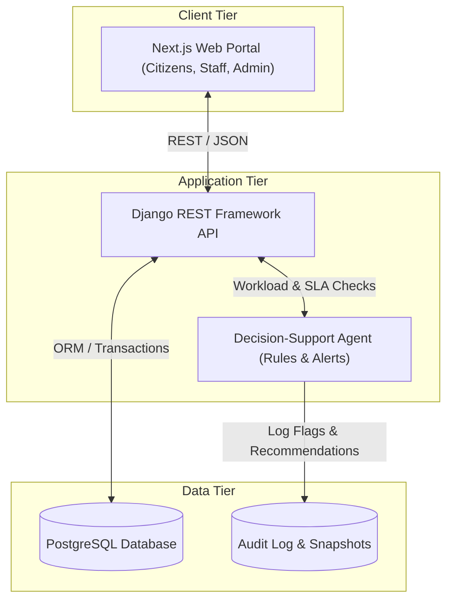
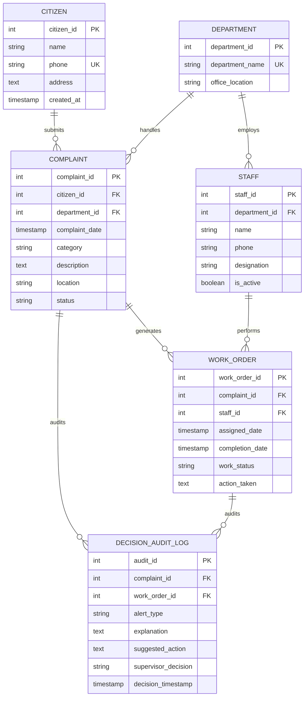

# Municipal Complaint Management System (MCMS)

[](https://github.com/Asad101001/municipal-complaint-system/actions)
[](LICENSE)
[](frontend/)
[](backend/)
[](database/)

A centralized, three-tier enterprise database and municipal management system designed to track public complaints from submission to verified resolution. Built with **Next.js**, **Django REST Framework (DRF)**, and **PostgreSQL**, complete with a rule-based **Decision-Support Agent** for proactive backlog alerting and workload rebalancing.

---

## Architecture Overview



---

## Database Design & Relational Model



### Key Cardinalities & Constraints
- **One Citizen submits many Complaints** (`1 : N`): Enforces mandatory citizen registration and ownership.
- **One Department handles many Complaints & employs many Staff** (`1 : N`): Clear organizational accountability.
- **One Complaint generates many Work Orders** (`1 : N`): Accommodates multi-phase resolution (inspection, remediation, verification).
- **One Staff member performs many Work Orders** (`1 : N`): Staff workload visibility.
- **Data Integrity**: Primary keys, unique constraints on phone/department, foreign key integrity with protected deletions, and check constraints on workflow statuses.

---

## Repository Structure

```
├── .github/
│   ├── workflows/
│   │   └── ci.yml                     # Continuous integration workflow
│   ├── ISSUE_TEMPLATE/
│   │   ├── bug_report.yml             # GitHub bug report issue template
│   │   └── feature_request.yml        # Feature request issue template
│   └── pull_request_template.md       # Standardized PR template
├── backend/                           # Django REST Framework backend
│   ├── Dockerfile
│   ├── requirements.txt
│   ├── .env.example
│   └── README.md
├── frontend/                          # Next.js web application
│   ├── Dockerfile
│   ├── package.json
│   ├── .env.example
│   └── README.md
├── database/
│   ├── schema.sql                     # PostgreSQL DDL schema with constraints & indexes
│   └── seed_data.sql                  # Pre-generated synthetic municipal dataset
├── docs/                              # Project specifications & briefing materials
│   ├── Briefing Docs.pdf              # Original project briefing document
│   ├── PRD.md                         # Product Requirements Document
│   ├── SRS.md                         # Software Requirements Specification
│   └── SDS.md                         # System Design Specification
├── scripts/
│   └── seed_synthetic_data.py         # Synthetic data generator script
├── .editorconfig
├── .gitattributes
├── .gitignore
├── docker-compose.yml                 # Multi-container orchestration (DB, API, UI)
├── LICENSE                            # MIT License
└── README.md
```

---

## Functional Requirements Coverage

| Requirement | Module | Description | Implementation Target |
|---|---|---|---|
| **FR-01** | Citizens | Create and update citizen records | `POST/GET /api/citizens/` |
| **FR-02** | Validation | Comprehensive payload validation and actionable error messages | DRF Serializers & Next.js form states |
| **FR-03** | Categorization | Route complaints to responsible department automatically or manually | `POST /api/complaints/categorize/` |
| **FR-04** | Registration | Atomic transaction saving complaint and returning tracking ID | `POST /api/complaints/` |
| **FR-05** | Work Orders | Generate work orders and assign staff | `POST /api/work-orders/` |
| **FR-06** | Status Updates | Record actions taken, timestamps, and step transitions | `PATCH /api/work-orders/{id}/` |
| **FR-07** | Inquiry | Real-time citizen tracking via complaint number or phone | `GET /api/complaints/track/?id=...` |
| **FR-08** | Reporting | Department metrics, resolution timelines, and pending backlogs | `GET /api/reports/` |
| **FR-09** | Decision-Support | Flag overdue items and workload imbalances with supervisor audit trail | `GET /api/agent/alerts/` |

---

## Getting Started

### Option A: One-Command Start (Docker Compose)

The easiest way to run the database, backend, and frontend together:

```bash
# Clone the repository
git clone https://github.com/Asad101001/municipal-complaint-system.git
cd municipal-complaint-system

# Copy environment variables
cp .env.example .env

# Build and start all services
docker compose up --build
```

- **Frontend Portal**: [http://localhost:3000](http://localhost:3000)
- **Backend API**: [http://localhost:8000](http://localhost:8000)
- **PostgreSQL**: `localhost:5432` (database: `municipal_db`)

---

### Option B: Local Development

#### 1. Database Setup
```bash
# Start PostgreSQL locally and load schema + seed data
psql -U postgres -d municipal_db -f database/schema.sql
psql -U postgres -d municipal_db -f database/seed_data.sql
```

#### 2. Backend Setup (DRF)
```bash
cd backend
python -m venv venv
# Windows:
.\venv\Scripts\activate
# Unix/macOS:
source venv/bin/activate

pip install -r requirements.txt
cp .env.example .env
python manage.py migrate
python manage.py runserver
```

#### 3. Frontend Setup (Next.js)
```bash
cd frontend
npm install
cp .env.example .env.local
npm run dev
```

---

## Synthetic Data Generator

To test the application under realistic workloads, generate synthetic citizens, departments, complaints, and work orders using the bundled script:

```bash
python scripts/seed_synthetic_data.py database/seed_data.sql
```

---

## Decision-Support Agent Rules
The decision-support system runs transparent, deterministic checks without autonomous dispatch:
1. **SLA Overdue Rule**: Flags complaints remaining in `Submitted` status for $> 72$ hours.
2. **Workload Imbalance Rule**: Identifies staff members with $\ge 4$ active work orders when department peers have fewer than 2.
3. **Cluster Detection**: Detects $\ge 3$ complaints in the same location zone within 48 hours for infrastructure alerts.
4. **Human-in-the-Loop**: Requires administrative approval before applying consequential actions. All approvals and rejections are logged to `DECISION_AUDIT_LOG`.

---

## Contributing
1. Fork the Project.
2. Create your Feature Branch (`git checkout -b feature/FR-05-work-orders`).
3. Commit your Changes (`git commit -m 'feat: add work order assignment serializer'`).
4. Push to the Branch (`git push origin feature/FR-05-work-orders`).
5. Open a Pull Request using our [PR Template](.github/pull_request_template.md).

---

## License
Distributed under the MIT License. See [LICENSE](LICENSE) for more information.
