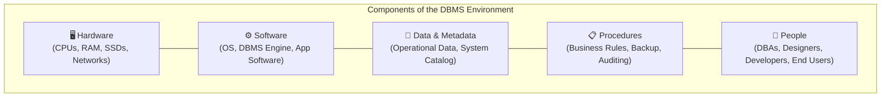

# Chapter 1 — Foundational Database Concepts & Paradigms

**Course**: Database Management Systems (DBMS)  
**Instructor / Compiler**: Dr. S. M. Khalid — University of Karachi (BS Computer Science)  
**Source Handout**: `course-work/Chapter #1.pdf` (107 pages)

---

## 1. Scope & Pedagogical Objectives

Chapter 1 introduces the fundamental motivation for modern database technology, contrasting historical file-processing approaches with the centralized, self-describing database management paradigm.

### Core Learning Objectives
1. Understand the limitations and operational failure modes of traditional file-processing systems.
2. Define the core concepts: *Data*, *Information*, *Metadata*, *Database*, *DBMS*, and *Database System*.
3. Analyze the major components of a database environment.
4. Explain how DBMS services achieve data independence, integrity control, and concurrent sharing.
5. Map foundational principles directly to real-world municipal and enterprise software engineering.

---

## 2. Evolution: Traditional File Processing vs. Database Approach

| Evaluated Dimension | Traditional File Processing System | Modern Database Management System (DBMS) |
|---|---|---|
| **Data Definition** | Hardcoded within individual application source code files. | Centralized in an authoritative, self-describing System Catalog / Data Dictionary. |
| **Data Redundancy** | High duplication; identical fields stored across separate department files. | Controlled and minimized; single source of truth across all user views. |
| **Data Inconsistency** | Frequent update anomalies when files diverge or desynchronize. | Guaranteed via declarative ACID transactions and referential integrity constraints. |
| **Data Isolation** | Data trapped in proprietary, ad-hoc binary/text file formats. | Standardized data definition and manipulation via high-level query languages (SQL). |
| **Program-Data Independence** | **None**: Modifying file structures requires recompiling all application code. | **High**: Internal storage structures change without breaking application programs. |
| **Concurrency Control** | Primitive or non-existent file locks leading to lost updates. | Multi-version concurrency control (MVCC) and robust locking protocols. |
| **Security & Privacy** | Operating system file-level permissions only; coarse-grained. | Fine-grained discretionary and role-based access control (RBAC). |

---

## 3. The Five Classical Limitations of File Processing

1. **Separation and Isolation of Data**:
   - Data stored in separate files makes cross-department queries (e.g., matching citizen profiles with department work orders) exceedingly difficult without custom file-merging utilities.
2. **Duplication of Data (Redundancy)**:
   - Duplicating resident records wastes storage and causes inconsistent addresses and contact details across municipal departments.
3. **Data Dependence**:
   - Physical file organization (record length, field order, byte offsets) is embedded into application logic. Changing a field size breaks every consuming script.
4. **Incompatible File Formats**:
   - Different programming languages and departments produce incompatible file structures, obstructing data exchange.
5. **Fixed Queries & Proliferation of Application Programs**:
   - Every new reporting requirement necessitates writing a new bespoke program from scratch.

---

## 4. Key Definitions & Concepts

* **Data**: Raw, unprocessed facts, figures, and symbols lacking contextual meaning.
* **Information**: Processed, structured, and contextualized data that yields knowledge and supports operational decision-making.
* **Metadata**: "Data about data" — structural definitions, data types, lengths, constraints, and relationships stored inside the DBMS catalog.
* **Database**: A shared, integrated collection of logically related data, together with a description of this data, designed to meet the information needs of an organization.
* **Database Management System (DBMS)**: A software suite that enables users to define, create, maintain, and control access to the database.
* **Database Application**: A software program that interacts with the database by issuing appropriate requests (queries, updates, transactions) to the DBMS.

---

## 5. Major Components of the Database Environment

1. **Hardware**: Physical computing infrastructure (servers, persistent storage arrays, network switches).
2. **Software**: The DBMS software layer, the underlying operating system, and application programs.
3. **Data**: Both operational enterprise facts and the self-describing system catalog / metadata.
4. **Procedures**: Formal instructions, operational rules, logging guidelines, and disaster-recovery protocols.
5. **People**: Distinct human roles including Data Administrators (DA), Database Administrators (DBA), Database Designers, Application Developers, and End Users.

---

## 6. Traceability to the MCMS Project

In the **Municipal Complaint Management System (MCMS)**:
- Citizen records, complaints, departments, staff, and work orders are centralized within PostgreSQL/SQLite rather than dispersed across disconnected spreadsheet files.
- Declarative foreign keys (`ON DELETE RESTRICT`, `ON DELETE CASCADE`) prevent orphaned tickets and enforce referential integrity automatically.
- Program-data independence allows modifying database indices and internal query optimization without touching Next.js React frontend components.
