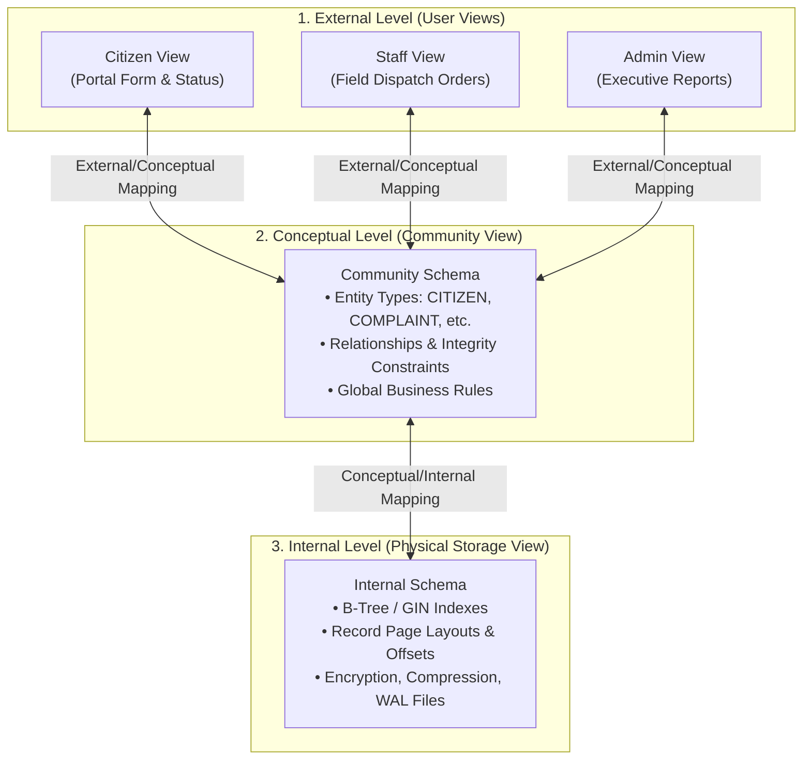
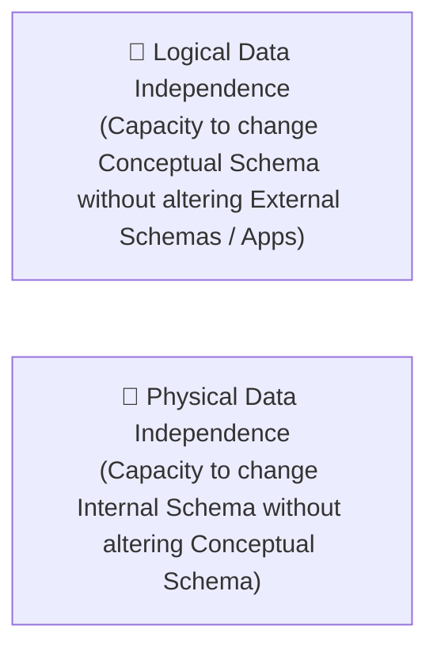

# Chapter 2 — Data Models, Architecture & DBMS Capabilities

**Course**: Database Management Systems (DBMS)  
**Instructor / Compiler**: Dr. S. M. Khalid — University of Karachi (BS Computer Science)  
**Source Handout**: `course-work/Chapter #2.pdf` (96 pages)

---

## 1. Scope & Pedagogical Objectives

Chapter 2 establishes the core theoretical pillars of data modeling, the standard **ANSI-SPARC Three-Level Architecture**, the principle of **Data Independence**, the core services provided by enterprise DBMS software, and the taxonomy of modern database systems.

### Core Learning Objectives
1. Explain the purpose and operation of the ANSI-SPARC Three-Level Architecture.
2. Differentiate between **Logical Data Independence** and **Physical Data Independence**.
3. Survey the major data model families (Hierarchical, Network, Relational, Object-Relational, NoSQL).
4. Enumerate and describe the 20 fundamental services and functions provided by a robust DBMS.
5. Understand the classification of database platforms by user scale, deployment topology, and workload profile.

---

## 2. ANSI-SPARC Three-Level Architecture

The ANSI-SPARC architecture provides a structured framework that decouples user perceptions of data from its physical byte-level storage on disks.

### The Three Architectural Levels
1. **External Level (User Views)**:
   - What individual user groups see. Tailored subsets of data presenting only what is relevant to a specific role, hiding irrelevant or sensitive fields.
2. **Conceptual Level (Logical Community Schema)**:
   - The entire logical structure of the database as seen by the database designer and organization. Represents all entities, relationships, attributes, and constraints without physical storage details.
3. **Internal Level (Physical Storage)**:
   - How the database is physically stored on computer storage media. Deals with page layouts, allocation units, record clustering, indexes, hashing algorithms, and data compression.

---

## 3. Two Pillars of Data Independence

Data independence is the immunity of user applications to changes in the definition and organization of data.

| Dimension | Logical Data Independence | Physical Data Independence |
|---|---|---|
| **Boundary** | Between External Level and Conceptual Level. | Between Conceptual Level and Internal Level. |
| **Modification Example** | Adding a new entity type or attribute (e.g., adding a `feedback_rating` to complaints). | Changing index algorithms (e.g., creating a B-Tree index on `Complaint_Date`) or migrating storage drives. |
| **Impact on Applications** | Existing application views remain untouched; only new views consume the new fields. | Zero impact on application queries or conceptual schemas; pure performance optimization. |
| **Difficulty Level** | Harder to achieve due to semantic coupling with queries. | Easily achieved by standard relational DBMS engines. |

---

## 4. Major Data-Model Families

1. **Relational Model (Codd, 1970)**:
   - Data represented mathematically as relations (tables of tuples). Governed by declarative relational calculus/algebra. The industry standard for transactional consistency.
2. **Hierarchical Model (Tree Structure)**:
   - 1:N parent-child relationships where each child has exactly one parent (e.g., IBM IMS). Rigid and difficult to model many-to-many associations.
3. **Network Model (Graph Structure - CODASYL)**:
   - Supports complex M:N relationships via record types and owner-member sets, but requires manual pointer navigation in application code.
4. **Object-Oriented & Object-Relational Models**:
   - Encapsulates state and behavior (methods) within object classes; bridges impedance mismatch with OOP languages (e.g., PostgreSQL composite types).
5. **Contemporary NoSQL & Multi-Model Families**:
   - Document stores (MongoDB/JSON), Key-Value caches (Redis), Column-Family stores (Cassandra), and Graph databases (Neo4j).

---

## 5. Core Functions and Services of a DBMS

A professional DBMS provides 20 core operational services:
1. **Data Definition**: DDL language to define schemas, constraints, and tables.
2. **Data Manipulation**: DML language to query, insert, update, and delete records.
3. **System Catalog & Data Dictionary**: Centralized repository of metadata.
4. **Data-Storage & File Management**: Managing physical pages, extents, and blocks.
5. **Data Integrity Management**: Enforcing domain, entity, and referential constraints.
6. **Security, Privacy & Authorization**: User credentials, RBAC, and encryption.
7. **Transaction Management (ACID)**: Atomicity, Consistency, Isolation, and Durability.
8. **Concurrency Control**: Managing simultaneous access without race conditions.
9. **Backup and Recovery**: Point-in-time recovery, logs, and snapshot capabilities.
10. **Views & Data Abstraction**: Virtual tables providing security and customized perspectives.
11. **Query Optimization**: Cost-based execution planning and index selection.
12. **High Availability & Fault Tolerance**: Replication, failover clusters, and clustering.
13. **Data Transformation & Presentation**: Formatting, encoding, and collation support.
14. **Active Database Features / Triggers**: Automatic reaction to state changes.
15. **User Interfaces & Query Tools**: Graphical and command-line interfaces.
16. **Application Programming Interfaces**: Drivers (JDBC, ODBC, psycopg2).
17. **Organizational Services**: Auditing, license tracking, and maintenance logs.
18. **Distributed Database Support**: Distributed transactions and two-phase commit.
19. **Scalability & Resource Management**: Connection pooling, buffer cache tuning.
20. **Self-Describing Extensibility**: Support for user-defined types and extensions.

---

## 6. Classification of Databases

- **By Scale & Scope**: Single-user, Workgroup, Enterprise.
- **By Workload Type**:
  - **OLTP (Online Transaction Processing)**: High concurrency, small reads/writes, normalized schemas (e.g., MCMS complaint registration).
  - **OLAP (Online Analytical Processing)**: Heavy read aggregation, dimensional/star schemas, decision support.
- **By Deployment Topology**: Centralized, Client-Server (2-tier, 3-tier), Distributed, Cloud-managed / Serverless.

---

## 7. Traceability to the MCMS Project

In the **Municipal Complaint Management System (MCMS)**:
- **External Views**: Built using React/Next.js (Citizen Public Portal vs. Municipal Staff Portal).
- **Conceptual Schema**: Defined via Django ORM models (`Citizen`, `Complaint`, `Department`, `Staff`, `WorkOrder`).
- **Internal Schema**: Managed transparently by SQLite/PostgreSQL with automatic indexing on primary keys and foreign keys.
- **OLTP Compliance**: Fully compliant with transaction management to ensure complaints and work orders commit atomically.
