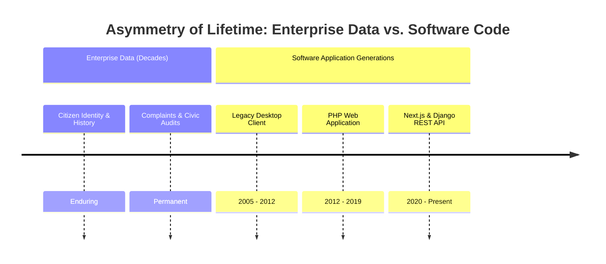
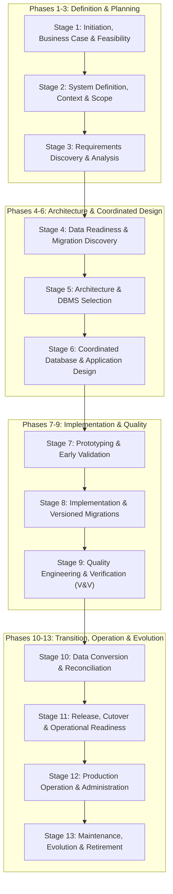

# Chapter 3 — Engineering Database Applications & Lifecycle Management

**Course**: Database Management Systems (DBMS)  
**Instructor / Compiler**: Dr. S. M. Khalid — University of Karachi (BS Computer Science)  
**Source Handout**: `course-work/Chapter #3.pdf` (66 pages)

---

## 1. Scope & Pedagogical Objectives

Chapter 3 shifts focus from abstract database theory to the disciplined engineering of dependable transaction-processing database applications throughout their complete operational lifecycle.

### Core Learning Objectives
1. Understand why database applications require a specialized lifecycle distinct from generic software development.
2. Master the **Modern Thirteen-Stage Reference Lifecycle** for database applications.
3. Understand governance, roles, responsibilities, and separation of duties.
4. Analyze data readiness, profiling, and legacy conversion.
5. Study the professional software-house implementation perspective (CI/CD, versioned database migrations, low-downtime Expand-Migrate-Contract pattern, observability).

---

## 2. Fundamental Principle: Data Lifetime vs. Application Lifetime

One of the central insights emphasized by Dr. S. M. Khalid is the **fundamental temporal asymmetry** between application software and corporate data:

> *"Interfaces, programming languages, application frameworks, and even DBMS products may be replaced several times while the underlying business facts remain valuable."*

- **Application code** is ephemeral and regularly rewritten or refactored.
- **Enterprise data** is durable, historical, and irreplaceable.
- Database application engineering must prioritize schema integrity, data provenance, and controlled migrations so that software changes never strand or corrupt durable data assets.

---

## 3. The Modern Thirteen-Stage Reference Lifecycle

### Detailed Breakdown of the 13 Stages

1. **Stage 1 — Initiation, Business Case & Feasibility**:
   - Defining problem statements, organizational mission, economic/technical feasibility, build vs. buy decisions.
2. **Stage 2 — System Definition, Scope & Stakeholders**:
   - Establishing system boundary, external interfaces, user views, and transactional domains.
3. **Stage 3 — Requirements Discovery, Analysis & Acceptance**:
   - Eliciting functional requirements, data requirements, and explicit business rules.
4. **Stage 4 — Data Readiness & Migration Discovery**:
   - Data profiling, legacy data quality assessment, master data management, and migration scoping.
5. **Stage 5 — Architecture & Technology/DBMS Selection**:
   - Objective, evidence-based selection of database engines, caching layers, and client-server topology.
6. **Stage 6 — Coordinated Database & Application Design**:
   - Conceptual data modeling (ERD), process modeling (DFD), transaction boundary definition, and interface design.
7. **Stage 7 — Prototyping & Early Validation**:
   - Building interactive prototypes to validate user views and confirm usability before full production coding.
8. **Stage 8 — Implementation & Controlled Database Change**:
   - Writing application code, automated unit tests, and version-controlled database migration scripts.
9. **Stage 9 — Verification, Validation & Quality Engineering**:
   - Verification ("Did we build the system right?") and Validation ("Did we build the right system?"). Core testing suites: unit, integration, performance, SLA, and regression.
10. **Stage 10 — Data Conversion, Migration & Reconciliation**:
    - Extract, Transform, Load (ETL) routines, data cleansing, dry-run rehearsals, and balance reconciliation.
11. **Stage 11 — Release, Deployment, Cutover & Operational Readiness**:
    - Environment promotion (Dev -> Staging -> Prod), cutover checklists, rollback procedures, and Go/No-Go gates.
12. **Stage 12 — Operation, Administration & Observability**:
    - Health monitoring, query performance monitoring, automated backups, security patching, and SLA enforcement.
13. **Stage 13 — Maintenance, Evolution & Eventual Retirement**:
    - Governed database evolution, schema expansion, backward-compatible updates, and archival/retirement strategies.

---

## 4. Professional Software-House Implementation Best Practices

### 4.1 Expand-Migrate-Contract Pattern for Zero-Downtime Schema Evolution
To alter a production database without service interruption:
1. **Expand**: Add new nullable columns or tables alongside existing columns without removing anything. Deploy code that writes to both old and new columns.
2. **Migrate**: Run a background batch script to backfill data from old structures into new structures.
3. **Contract**: Update application code to read solely from the new schema, verify stability, and subsequently drop deprecated columns/tables.

### 4.2 CI/CD and Versioned Database Migrations
- Schema changes are never applied manually on production servers.
- Every migration is an immutable, versioned code artifact (e.g., Django migration files `0001_initial.py`, `0002_add_index.py`) committed to version control and applied deterministically during automated pipelines.

---

## 5. Traceability to the MCMS Project

In the **Municipal Complaint Management System (MCMS)**:
- **Stages 1–3**: Established civic mission, citizen/admin/staff user roles, and complaint handling workflows.
- **Stages 5–6**: Selected PostgreSQL/SQLite + Django REST Framework + Next.js; coordinated ERD and DFD designs.
- **Stage 8**: Applied version-controlled Django migrations (`0001_initial.py`) for deterministic reproducibility.
- **Stage 9**: Created comprehensive automated test suites (9/9 unit tests passing for citizen profiles, complaint registration, work order dispatch, and SLA validation).
