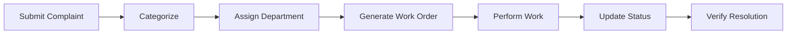

# Product Requirements Document (PRD)

## Project: Municipal Complaint Management System (MCMS)

**Academic & Engineering Standard**: University of Karachi — BS Computer Science — Database Management Systems  
**Related Specifications**: [SRS.md](SRS.md) | [SDS.md](SDS.md) | [SYSTEM_DIAGRAMS.md](SYSTEM_DIAGRAMS.md)

---

### 1. Purpose
Centralize municipal complaints from citizen submission to verified resolution, providing transparent tracking, fair workload distribution, and auditability across departments.

---

### 2. User Roles
- **Citizen**:
  - Submit complaints with relevant metadata (category, location, description).
  - Track complaint status and view resolution history.
- **Municipal Staff**:
  - Receive work order assignments.
  - Record work updates, actions taken, and mark completion.
- **Administration / Supervisor**:
  - Manage municipal departments and staff profiles.
  - Review operational and performance reports.
  - Review and approve consequential actions flagged by the decision-support system.

---

### 3. Core Workflow

1. **Submit Complaint**: Citizen registers an issue via portal (`Process 1.0 & 2.1`).
2. **Categorize**: Complaint is validated and classified by problem category (`Process 2.2 & 2.3`).
3. **Assign Department**: Routed to appropriate department (`Process 2.4 & 2.5`).
4. **Generate Work Order**: Department supervisor generates a work order and assigns staff (`Process 3.0`).
5. **Perform Work**: Municipal staff inspects and executes the required field work.
6. **Update Status**: Work updates, timestamps, and actions taken are logged (`Process 4.0`).
7. **Verify Resolution**: Final verification and resolution notification to citizen (`Process 4.0`).

---

### 4. Core Features
- **Complaint Tracking**: End-to-end lifecycle monitoring with unique tracking identifiers (`Complaint_ID`).
- **Staff Management**: Departmental staff roster, contact info, and role assignment (`STAFF` entity).
- **Work Assignments**: Granular work order generation linked directly to complaints (`WORK_ORDER` entity).
- **Inspections & Status History**: Complete chronological history of updates and field logs.
- **Reports & Summaries**: Department performance metrics, resolution times, and pending work (`Process 5.0`).
- **Role-Based Access Control (RBAC)**: Enforced boundaries between Citizens, Staff, and Admins.
- **Operational Alerts & Auditing**: Transparent operational alerts with detailed audit logging (`DECISION_AUDIT_LOG`).

---

### 5. Decision-Support Agent
- **Capabilities**:
  - Flag overdue complaints based on SLA thresholds (> 72h).
  - Identify workload imbalances across staff and departments ($\ge 4$ active tasks).
  - Detect repeated issues within the same geographical zone or category.
  - Highlight recurring failures or reopenings.
- **Governance**:
  - Applies transparent, deterministic rules.
  - Explains rationale behind each alert.
  - Requires supervisor/human approval for consequential actions (reassignment, escalation, closure).
  - Maintains immutable decision audit logs.

---

### 6. Success Criteria
- Accurate, relational records with zero orphaned entities.
- Traceable complaint lifecycle status transitions.
- Visible, explainable alerts for overdue and unresolved issues.
- Reliable, aggregated reporting for administrative oversight.

---

### 7. Scope Boundaries
- **In Scope**: Complaint submission, categorization, work order generation, staff assignment, status tracking, reporting, decision support alerts.
- **Out of Scope**: Payment gateways, live GPS tracking, autonomous dispatch, external live telematics integrations, and automated fraud accusations.
- **Project Testing**: Uses synthetic municipal datasets for realistic demonstration and validation.
