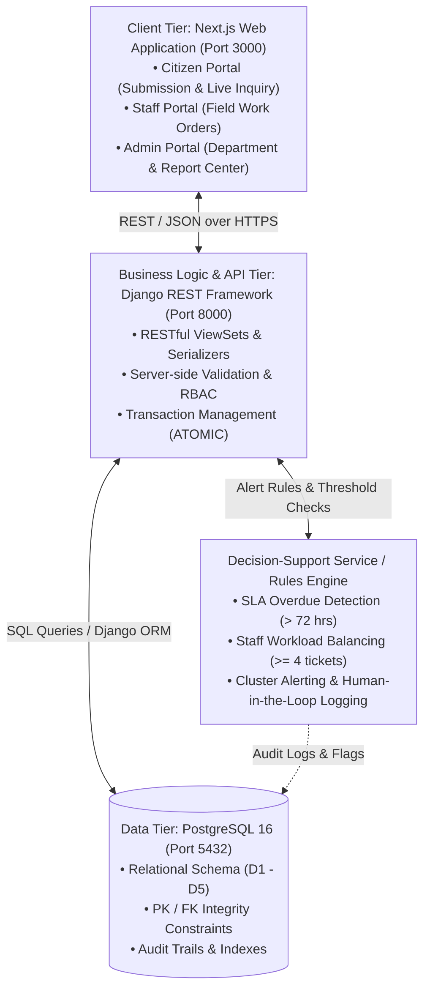
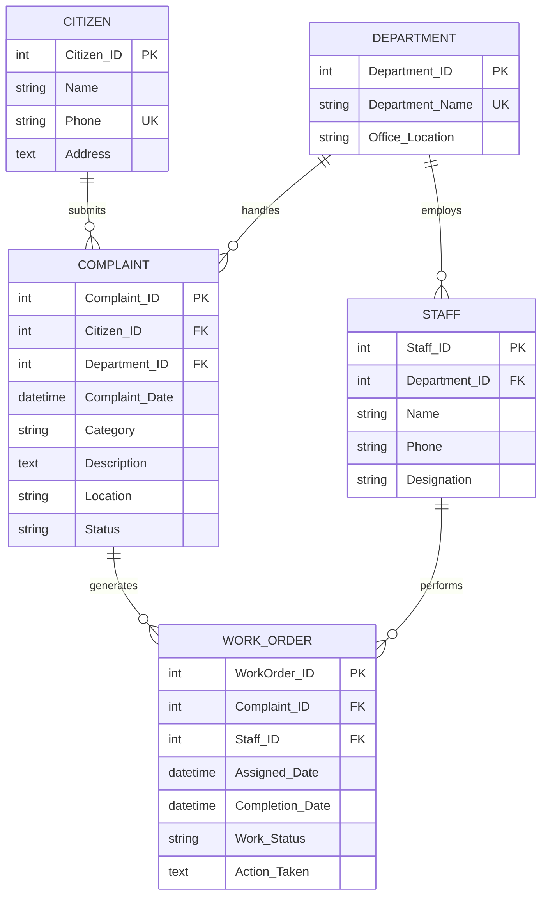

# System Design Specification (SDS)

## Project: Municipal Complaint Management System (MCMS)

**Academic & Engineering Standard**: University of Karachi — BS Computer Science — Database Management Systems  
**System Diagrams & Specifications**:
- 📊 [Entity-Relationship Diagram (ERD)](diagrams/erd.md)
- 🕸️ [Semantic Net (Occurrence Level)](diagrams/semantic_net.md)
- 🌐 [DFD Level 0 (Context Diagram)](diagrams/dfd_level_0.md)
- 🔀 [DFD Level 1 (Diagram 0)](diagrams/dfd_level_1.md)
- 🔍 [DFD Level 2 (Process 2.0)](diagrams/dfd_level_2.md)
- 📑 [Full Master System Diagrams Reference](diagrams/README.md)

---

## 1. Architectural Overview

The Municipal Complaint Management System is architected as a modular three-tier client-server enterprise application with strict separation of concerns, transactional integrity, and rule-based decision support.



- **Client Tier (Presentation)**: Next.js reactive frontend providing citizen portal, staff portal, and administrative dashboard.
- **Application Tier (Business Logic)**: Django REST Framework exposing secure RESTful endpoints, validating incoming payloads, and enforcing RBAC.
- **Data Tier (Persistence)**: PostgreSQL relational database maintaining relational integrity, indexes, triggers, and audit tables.

---

## 2. Database Entities & Relational Schema (ERD)

The relational schema implements the exact five core entities defined in the curriculum ERD design:



### 2.1 Entity Relationship Cardinality Matrix

| Parent Entity | Relationship | Child Entity | Cardinality | Participation | Foreign Key in Child | Delete Rule |
|---|---|---|---|---|---|---|
| `CITIZEN` | submits | `COMPLAINT` | `1 : N` | Mandatory on Complaint (1..1) | `COMPLAINT.Citizen_ID` | `RESTRICT` |
| `DEPARTMENT` | handles | `COMPLAINT` | `1 : N` | Mandatory on Complaint (1..1) | `COMPLAINT.Department_ID` | `RESTRICT` |
| `DEPARTMENT` | employs | `STAFF` | `1 : N` | Mandatory on Staff (1..1) | `STAFF.Department_ID` | `RESTRICT` |
| `COMPLAINT` | generates | `WORK_ORDER` | `1 : N` | Optional on Complaint (0..N) | `WORK_ORDER.Complaint_ID` | `CASCADE` |
| `STAFF` | performs | `WORK_ORDER` | `1 : N` | Mandatory on Work Order (1..1) | `WORK_ORDER.Staff_ID` | `RESTRICT` |

> Detailed occurrence-level networks (Figures A & B) and valuation sets are documented in [SYSTEM_DIAGRAMS.md § 2](SYSTEM_DIAGRAMS.md#2-semantic-net-occurrence-level).

---

## 3. Data Flow Architecture

The data flow specifications govern how data enters, transitions through processes, updates persistent stores, and outputs to stakeholders:

### 3.1 DFD Hierarchy
- **Level 0 (Context Diagram)**: Models the central `0 MUNICIPAL MANAGEMENT SYSTEM` communicating with external entities (`CITIZEN`, `MUNICIPAL ADMINISTRATION`, `MUNICIPAL STAFF`).
- **Level 1 (Diagram 0)**: Decomposes into 5 core processes:
  - `1.0 MANAGE CITIZENS` (writes to `D1: CITIZEN RECORDS`)
  - `2.0 REGISTER COMPLAINTS` (reads `D1`, `D3`; writes `D2: COMPLAINT RECORDS`)
  - `3.0 ASSIGN DEPARTMENT AND WORK` (reads `D2`, `D3`, `D4`; writes `D5: WORK ORDER RECORDS`)
  - `4.0 UPDATE COMPLAINT STATUS` (reads/writes `D2`, `D5`)
  - `5.0 GENERATE REPORTS` (reads `D1` through `D5`)
- **Level 2 (Process 2.0 Decomposition)**: Decomposes complaint registration into sub-processes `2.1` through `2.6`, demonstrating validation error branches (`CORRECTION MESSAGE`) and atomic creation.

> Full visual diagrams and data dictionaries are available in [SYSTEM_DIAGRAMS.md § 3-6](SYSTEM_DIAGRAMS.md#3-data-flow-diagram-dfd--level-0-context-diagram).

---

## 4. Physical Database Schema & Constraints

Implemented in [`database/schema.sql`](../database/schema.sql):

```sql
-- D1: CITIZEN
CREATE TABLE CITIZEN (
    citizen_id SERIAL PRIMARY KEY,
    name VARCHAR(100) NOT NULL,
    phone VARCHAR(20) NOT NULL UNIQUE,
    address TEXT NOT NULL,
    created_at TIMESTAMP WITH TIME ZONE DEFAULT CURRENT_TIMESTAMP NOT NULL
);

-- D3: DEPARTMENT
CREATE TABLE DEPARTMENT (
    department_id SERIAL PRIMARY KEY,
    department_name VARCHAR(100) NOT NULL UNIQUE,
    office_location VARCHAR(200) NOT NULL
);

-- D4: STAFF
CREATE TABLE STAFF (
    staff_id SERIAL PRIMARY KEY,
    department_id INT NOT NULL REFERENCES DEPARTMENT(department_id) ON DELETE RESTRICT,
    name VARCHAR(100) NOT NULL,
    phone VARCHAR(20) NOT NULL,
    designation VARCHAR(100) NOT NULL,
    is_active BOOLEAN DEFAULT TRUE NOT NULL
);

-- D2: COMPLAINT
CREATE TABLE COMPLAINT (
    complaint_id SERIAL PRIMARY KEY,
    citizen_id INT NOT NULL REFERENCES CITIZEN(citizen_id) ON DELETE RESTRICT,
    department_id INT NOT NULL REFERENCES DEPARTMENT(department_id) ON DELETE RESTRICT,
    complaint_date TIMESTAMP WITH TIME ZONE DEFAULT CURRENT_TIMESTAMP NOT NULL,
    category VARCHAR(100) NOT NULL,
    description TEXT NOT NULL,
    location VARCHAR(255) NOT NULL,
    status VARCHAR(50) NOT NULL DEFAULT 'Submitted',
    CONSTRAINT chk_complaint_status CHECK (
        status IN ('Submitted', 'Categorized', 'Assigned', 'In Progress', 'Resolved', 'Verified', 'Closed', 'Rejected')
    )
);

-- D5: WORK_ORDER
CREATE TABLE WORK_ORDER (
    work_order_id SERIAL PRIMARY KEY,
    complaint_id INT NOT NULL REFERENCES COMPLAINT(complaint_id) ON DELETE CASCADE,
    staff_id INT NOT NULL REFERENCES STAFF(staff_id) ON DELETE RESTRICT,
    assigned_date TIMESTAMP WITH TIME ZONE DEFAULT CURRENT_TIMESTAMP NOT NULL,
    completion_date TIMESTAMP WITH TIME ZONE NULL,
    work_status VARCHAR(50) NOT NULL DEFAULT 'Assigned',
    action_taken TEXT NULL,
    CONSTRAINT chk_work_status CHECK (
        work_status IN ('Assigned', 'In Progress', 'Completed', 'On Hold', 'Cancelled')
    )
);

-- DECISION SUPPORT AUDIT LOG
CREATE TABLE DECISION_AUDIT_LOG (
    audit_id SERIAL PRIMARY KEY,
    complaint_id INT NULL REFERENCES COMPLAINT(complaint_id) ON DELETE SET NULL,
    work_order_id INT NULL REFERENCES WORK_ORDER(work_order_id) ON DELETE SET NULL,
    alert_type VARCHAR(100) NOT NULL,
    explanation TEXT NOT NULL,
    suggested_action TEXT NOT NULL,
    supervisor_decision VARCHAR(50) DEFAULT 'Pending' NOT NULL,
    decided_by_staff_id INT NULL REFERENCES STAFF(staff_id) ON DELETE SET NULL,
    decision_timestamp TIMESTAMP WITH TIME ZONE NULL,
    created_at TIMESTAMP WITH TIME ZONE DEFAULT CURRENT_TIMESTAMP NOT NULL
);
```

---

## 5. Decision-Support Agent Implementation

### 5.1 Rules Engine Specification
The decision-support agent executes transparent heuristics without autonomous execution:

1. **SLA Overdue Detection**:
   - Calculation: `Age(Complaint) = NOW() - Complaint_Date`
   - Condition: If `Status IN ('Submitted', 'Categorized')` and `Age > 72 hours`, trigger `Overdue Alert`.
2. **Workload Imbalance**:
   - For each active technician `s_i` in `STAFF`, count active work orders `ActiveJobs(s_i)`.
   - Condition: If `ActiveJobs(s_i) >= 4` and another staff member `s_j` in the same department has `ActiveJobs(s_j) <= 1`, trigger `Workload Imbalance Alert`.
3. **Zone Clustering**:
   - Condition: If `Count(Complaints in Zone Z within 48 hours) >= 3` for the same category, trigger `Recurring Incident Cluster Alert`.

### 5.2 Supervisor Approval Workflow
All consequential actions (e.g., job reassignment, expedited escalation) require human supervisor sign-off. Every decision is recorded immutably in `DECISION_AUDIT_LOG` with supervisor staff ID and timestamp.
