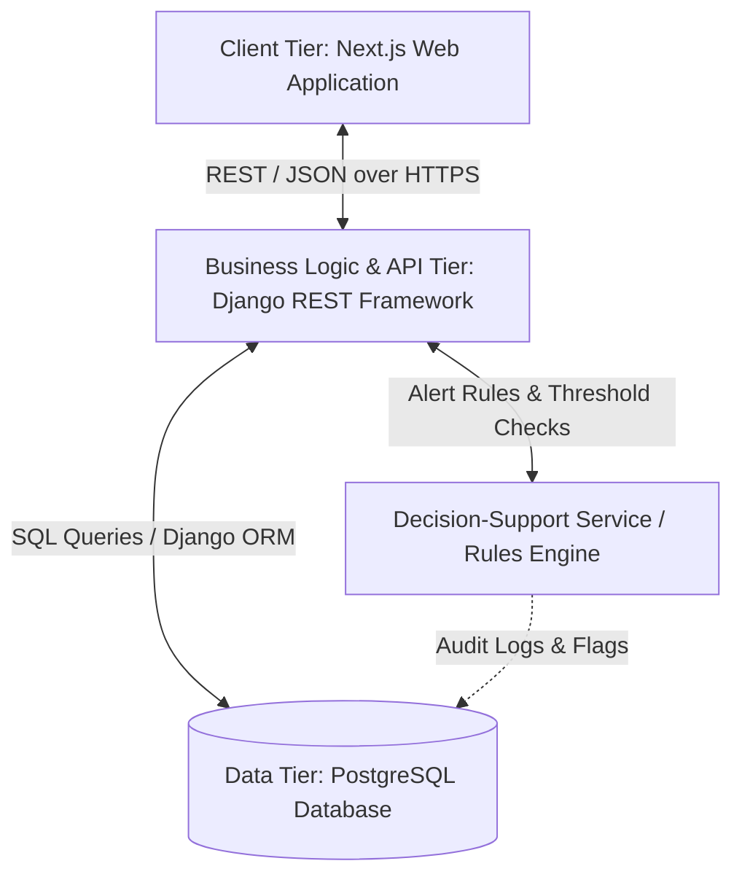
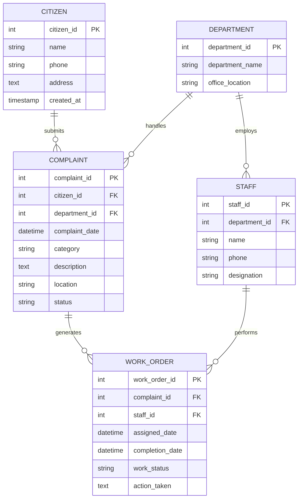

# System Design Specification (SDS)

## Project: Municipal Complaint Management System

### 1. Architectural Overview
A three-tier client-server architecture designed for high maintainability, clear separation of concerns, and robust transactional integrity:

- **Client Tier (Presentation)**: Next.js reactive frontend providing citizen portal, staff portal, and administrative dashboard.
- **Application Tier (Business Logic)**: Django REST Framework exposing secure RESTful endpoints, validating incoming payloads, and enforcing RBAC.
- **Data Tier (Persistence)**: PostgreSQL relational database maintaining relational integrity, indexes, triggers, and audit tables.

---

### 2. Database Entities & Relational Schema

---

### 3. Relationships & Cardinality Rules
1. **One Citizen submits many Complaints** (1 : N): Every complaint must be tied to a valid registered citizen.
2. **One Department handles many Complaints and employs many Staff** (1 : N): Complaints must be routed to a specific department responsible for that domain.
3. **One Complaint generates many Work Orders** (1 : N): A complaint can trigger multiple work orders (e.g., initial inspection, repair, re-inspection).
4. **One Staff member performs many Work Orders** (1 : N): Staff members can be assigned multiple sequential work orders.

---

### 4. Data Flow Rules & Constraints
- External users (citizens, staff, administrators) interact solely through authenticated API processes.
- No direct external-entity-to-database connections.
- Transactional integrity: All status transitions (e.g. resolving a complaint upon work order completion) execute within database transactions (`ATOMIC`).
- Foreign keys specify explicit `ON DELETE` rules (e.g., `PROTECT` on departments and citizens to prevent orphaned complaint histories).

---

### 5. API Design Standards
- Standard REST conventions: `GET`, `POST`, `PUT`, `PATCH`, `DELETE`.
- Predictable JSON payloads and standard HTTP response status codes:
  - `200 OK`: Successful retrieval / update
  - `201 Created`: Successful creation
  - `400 Bad Request`: Payload validation error with descriptive fields
  - `401 / 403`: Unauthorized / Forbidden
  - `404 Not Found`: Resource does not exist
  - `409 Conflict`: Business rule violation
  - `500 Internal Server Error`: Unhandled exception
- Robust server-side input validation and sanitization.

---

### 6. Decision-Support Agent Design
- **Operational Rules**:
  - Overdue SLA trigger: Complaints open > $X$ business days without work order assignment.
  - Workload balance trigger: Staff assigned > threshold active work orders while peers in the department have capacity.
  - Geocluster / Category trigger: > $N$ complaints in the same location zone within 48 hours.
- **Audit Trails**:
  - All agent recommendations and supervisor approval/rejection decisions are recorded in an immutable `DECISION_AUDIT_LOG` table.
