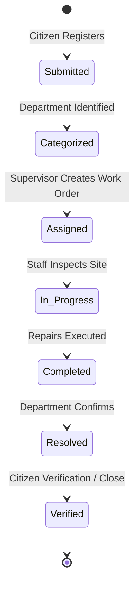

# Software Requirements Specification (SRS)

## Project: Municipal Complaint Management System (MCMS)

**Course Reference**: University of Karachi — BS Computer Science — Database Management Systems  
**Related Specifications**: [PRD.md](PRD.md) | [SDS.md](SDS.md) | [SYSTEM_DIAGRAMS.md](SYSTEM_DIAGRAMS.md)

---

### 1. Technology Stack
- **Frontend Presentation**: Next.js 15 (React 19, TypeScript, Vanilla Responsive CSS)
- **Application & API**: Django REST Framework (Python 3.12+, ViewSets, Serializers)
- **Relational Database**: PostgreSQL 16 (Relational DDL, Foreign Keys, Check Constraints, Serial Sequences)
- **Containerization**: Docker & Docker Compose

---

### 2. Functional Requirements (FR) & DFD Process Mapping

| FR ID | Feature Module | DFD Process Reference | Primary Data Store | Description & Validation Rules |
|---|---|---|---|---|
| **FR-01** | **Citizens** | `1.0 MANAGE CITIZENS` | `D1: CITIZEN` | Create and update citizen profile records (`Name`, unique `Phone`, `Address`). Validates phone format and enforces unique contact numbers. |
| **FR-02** | **Complaints Validation** | `2.2 VALIDATE CITIZEN & COMPLAINT DETAILS` | `D1: CITIZEN` | Validate citizen identity against `D1` and check complaint inputs. Emits `CORRECTION MESSAGE` if description is $< 10$ chars, location is missing, or citizen is unregistered. |
| **FR-03** | **Categorization** | `2.3 DETERMINE CATEGORY` & `2.4 IDENTIFY DEPT` | `D3: DEPARTMENT` | Normalizes incoming complaint narrative into official categories (e.g., Water, Sanitation, Roads) and matches responsible department ID. |
| **FR-04** | **Registration** | `2.5 SAVE RECORD` & `2.6 GENERATE ACK` | `D2: COMPLAINT` | Atomically commits complaint record in `D2`, assigns sequential `Complaint_ID`, sets status to `Submitted`, and returns `COMPLAINT NUMBER & ACKNOWLEDGMENT`. |
| **FR-05** | **Work Assignment** | `3.0 ASSIGN DEPT AND WORK` | `D5: WORK_ORDER` | Supervisor assigns qualified departmental staff (`D4`) to a pending complaint (`D2`), generating a new work order (`D5`) with initial status `Assigned`. |
| **FR-06** | **Status Updates** | `4.0 UPDATE COMPLAINT STATUS` | `D2: COMPLAINT`, `D5: WORK_ORDER` | Records field notes, actions taken, and completion timestamps. Synchronizes `WORK_ORDER.Work_Status` with `COMPLAINT.Status`. |
| **FR-07** | **Inquiry & Live Tracking** | `4.0 UPDATE COMPLAINT STATUS` | `D2: COMPLAINT`, `D5: WORK_ORDER` | Provides citizens with transparent inquiry response (`STATUS & RESOLUTION INFORMATION`) using tracking `Complaint_ID` or registered phone. |
| **FR-08** | **Reporting & Analytics** | `5.0 GENERATE REPORTS` | `D1` through `D5` | Aggregates municipal performance summaries, Mean Time To Resolution (MTTR), department workload distribution, and pending backlog counts. |
| **FR-09** | **Operational Alerts & Auditing** | Decision-Support Service | `DECISION_AUDIT_LOG` | Flags overdue complaints ($> 72$ hrs in queue), staff workload imbalances ($\ge 4$ active jobs), and geographic clusters. Enforces human supervisor sign-off. |

---

### 3. Detailed Functional Specifications

#### FR-01: Citizen Profile Management
- **Inputs**: `Name` (String, 1-100 chars), `Phone` (E.164 or standardized local format, 10-20 chars), `Address` (Text, mandatory).
- **Processing**: Enforces uniqueness constraint on `Phone`. Rejects duplicate registration attempts with `409 Conflict`.
- **Outputs**: `Citizen_ID` (Integer PK), registration timestamp.

#### FR-02 & FR-03: Input Validation and Categorization
- **Validation Criteria**:
  - `Phone`: Must exist in `D1: CITIZEN`.
  - `Description`: Must not be blank, minimum 10 characters, maximum 2000 characters.
  - `Location`: Street/ward name, minimum 5 characters.
- **Categorization Routing Table**:
  - `Water Supply & Sanitation` $\to$ Pipeline leaks, contamination, low pressure.
  - `Roads & Infrastructure Maintenance` $\to$ Potholes, damaged storm drains, street curbs.
  - `Solid Waste Management` $\to$ Garbage overflow, debris dumping.
  - `Street Lighting & Electricity` $\to$ Blacked-out lamps, exposed wires.
  - `Public Health & Vector Control` $\to$ Stagnant water, fumigation requests.
  - `Parks & Urban Forestry` $\to$ Fallen trees, damaged park equipment.

#### FR-04: Atomic Complaint Registration
- **Transaction Guarantee**: Complaint persistence executed in `READ COMMITTED` transaction.
- **Default State**: Initial `Status` set strictly to `'Submitted'`.
- **Response**: Immediate structured JSON acknowledgment with tracking URL and formatted ticket ID (e.g. `K101`).

#### FR-05 & FR-06: Work Order Dispatch & Lifecycle Transitions

- **Allowed State Transitions**:
  - `Submitted` $\to$ `Categorized` $\to$ `Assigned` $\to$ `In Progress` $\to$ `Resolved` $\to$ `Verified` / `Closed`.
  - Rejection allowed only at `Submitted` / `Categorized` stage with required administrative rationale.

#### FR-07: Citizen Inquiry Service
- **Query Endpoint**: `GET /api/complaints/track/?id={Complaint_ID}&phone={Phone}`
- **Security Check**: Enforces phone match or authorized session before disclosing citizen address or technician contact.

#### FR-08: Administrative Reports
- **Complaint Volume Breakdown**: Counts grouped by Category, Department, and Month.
- **Department Performance**: Ratio of Resolved to Total Complaints, Average Resolution Time (hours).
- **Pending Backlog**: Count of active tickets by aging bracket ($< 24\text{h}$, $24-72\text{h}$, $> 72\text{h}$).

#### FR-09: Decision-Support Agent & Alerts
- Evaluates operational conditions periodically or upon transaction commit.
- Records alerts into `DECISION_AUDIT_LOG`:
  - `alert_type`: `'Overdue'`, `'Workload Imbalance'`, `'Recurring Issue'`.
  - `suggested_action`: Plain-text recommendation for supervisor.
  - `supervisor_decision`: Default `'Pending'`; transitions to `'Approved'` or `'Rejected'`.

---

### 4. Requirements Traceability Matrix (RTM)

| Requirement | Process in DFD Level 1 | Sub-Process in Level 2 | Database Entity / Store | API Endpoint |
|---|---|---|---|---|
| **FR-01** | `1.0 MANAGE CITIZENS` | N/A | `D1: CITIZEN` | `POST /api/citizens/` |
| **FR-02** | `2.0 REGISTER COMPLAINTS` | `2.1, 2.2` | `D1: CITIZEN` | `POST /api/complaints/validate/` |
| **FR-03** | `2.0 REGISTER COMPLAINTS` | `2.3, 2.4` | `D3: DEPARTMENT` | `POST /api/complaints/categorize/` |
| **FR-04** | `2.0 REGISTER COMPLAINTS` | `2.5, 2.6` | `D2: COMPLAINT` | `POST /api/complaints/` |
| **FR-05** | `3.0 ASSIGN DEPT & WORK` | N/A | `D4: STAFF`, `D5: WORK_ORDER` | `POST /api/work-orders/` |
| **FR-06** | `4.0 UPDATE STATUS` | N/A | `D2: COMPLAINT`, `D5: WORK_ORDER` | `PATCH /api/work-orders/{id}/` |
| **FR-07** | `4.0 UPDATE STATUS` | N/A | `D2: COMPLAINT` | `GET /api/complaints/track/` |
| **FR-08** | `5.0 GENERATE REPORTS` | N/A | `D1`, `D2`, `D3`, `D4`, `D5` | `GET /api/reports/` |
| **FR-09** | Decision Engine | N/A | `DECISION_AUDIT_LOG` | `GET /api/agent/alerts/` |
