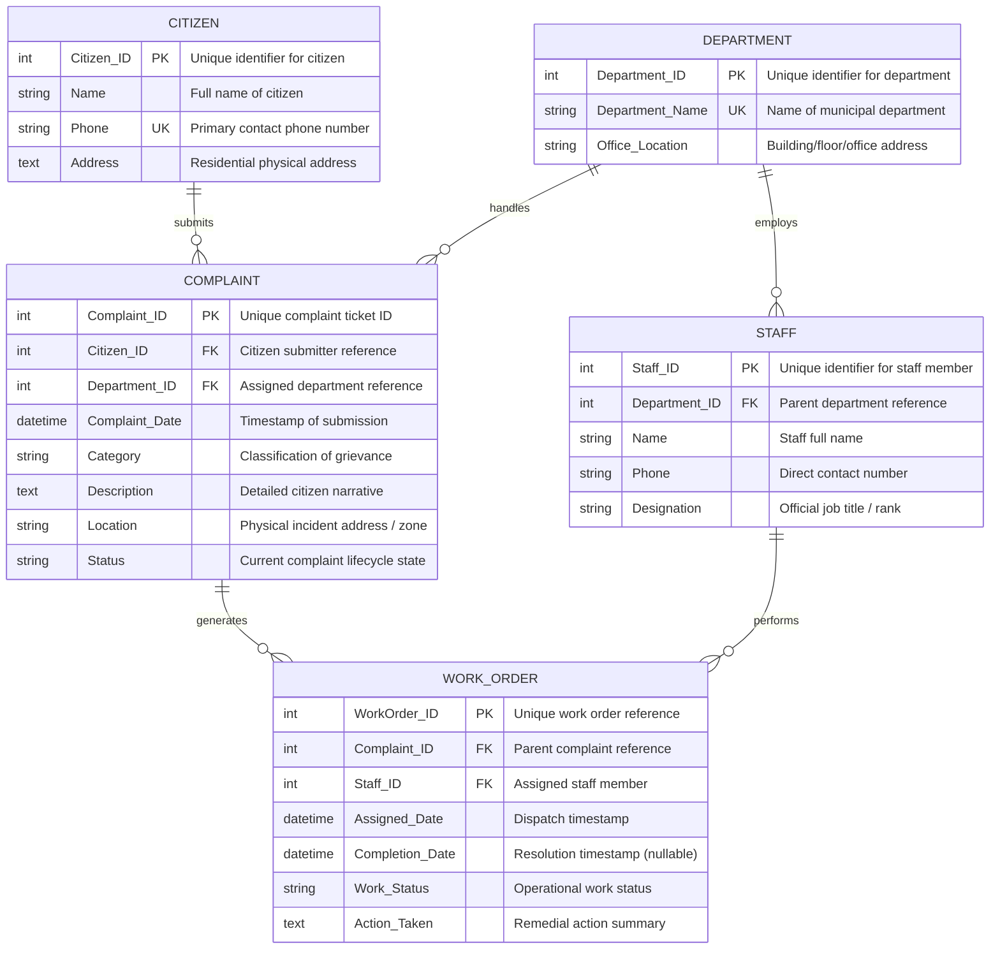
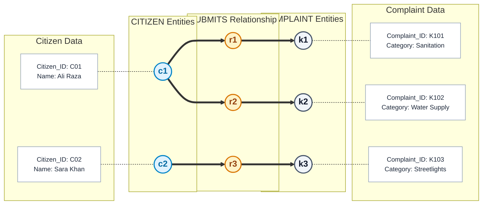
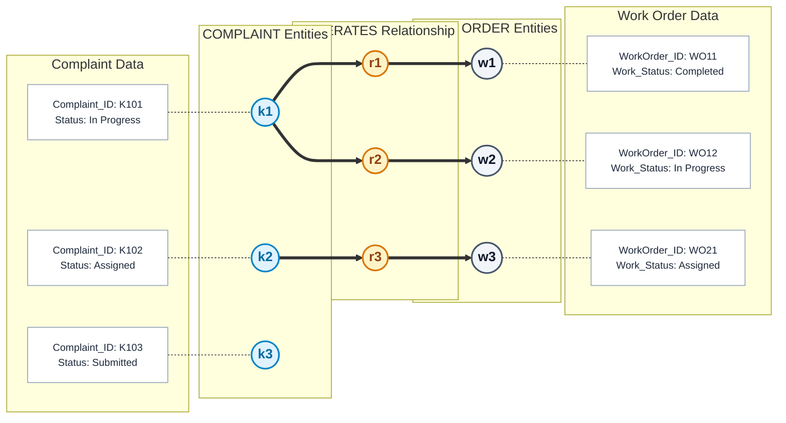
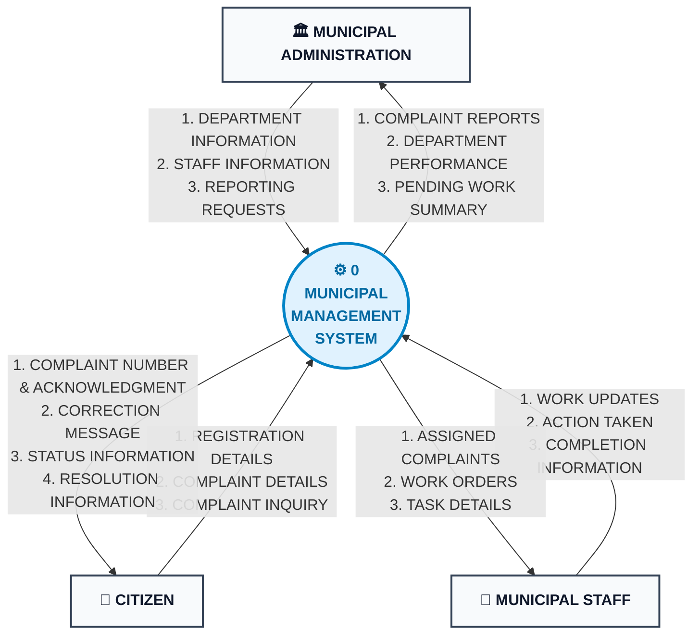
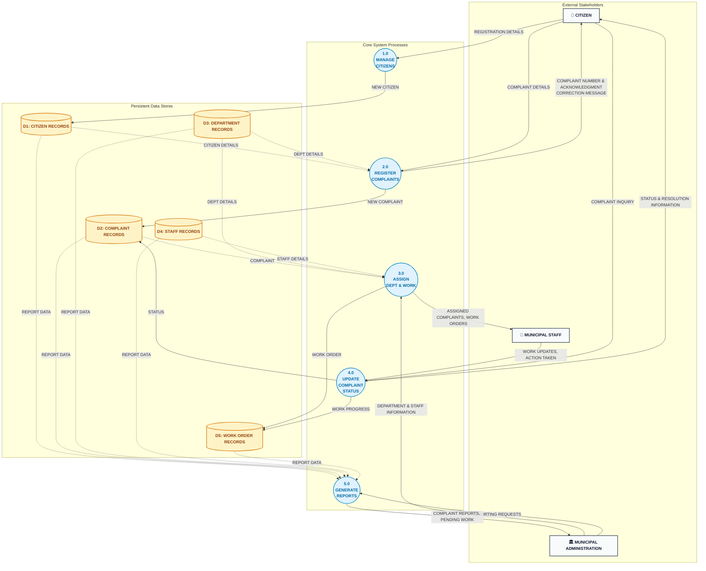
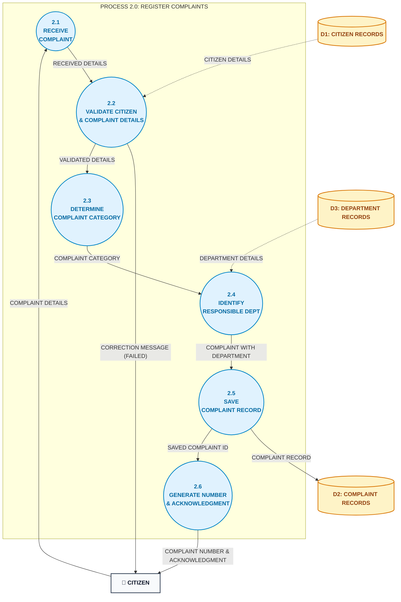

# Municipal Complaint Management System — System Diagrams & Modeling Specifications

**Course Reference**: University of Karachi — BS Computer Science — Database Management Systems (DBMS)  
**System**: Municipal Complaint Management System (MCMS)  
**Design Standard**: Crow's Foot Notation ERD, Occurrence-Level Semantic Net, and Gane-Sarson / Yourdon-DeMarco Data Flow Diagrams (Level 0, Level 1, Level 2).

---

## 📑 Individual Diagram Documents
For focused, in-depth study, each diagram is maintained in its own dedicated document with full attribute tables, mini-specifications, and formal semantics:

* 📊 **[Entity-Relationship Diagram (ERD)](erd.md)**: Full Crow's foot notation, cardinalities, attribute data types, and primary/foreign key definitions.
* 🕸️ **[Semantic Net (Occurrence Level)](semantic_net.md)**: Figures A & B depicting concrete entity instances, relationship paths, attribute valuation bindings, and relational formalization.
* 🌐 **[DFD Level 0 (Context Diagram)](dfd_level_0.md)**: Overall system boundary, external entities (`CITIZEN`, `ADMINISTRATION`, `STAFF`), and the 19 primary data flows.
* 🔀 **[DFD Level 1 (Diagram 0)](dfd_level_1.md)**: Main processes (`1.0` through `5.0`), persistent data stores (`D1` through `D5`), and Level 0 balancing verification.
* 🔍 **[DFD Level 2 (Process 2.0)](dfd_level_2.md)**: Detailed decomposition of `REGISTER COMPLAINTS` into sub-processes `2.1` to `2.6`, Structured English mini-specs, and error validation handling.

---

## Table of Contents
1. [Entity-Relationship Diagram (ERD)](#1-entity-relationship-diagram-erd)
   - [Visual Diagram](#11-erd-visual-diagram)
   - [Entity Definitions & Attribute Directory](#12-entity-definitions--attribute-directory)
   - [Cardinality & Relationship Rules](#13-cardinality--relationship-rules)
2. [Semantic Net (Occurrence Level)](#2-semantic-net-occurrence-level)
   - [Figure A: 1:N Submits Relationship](#21-figure-a-1n-submits-relationship)
   - [Figure B: 1:N Generates Relationship](#22-figure-b-1n-generates-relationship)
   - [Formal Relational Mappings & Valuation Tables](#23-formal-relational-mappings--valuation-tables)
3. [Data Flow Diagram (DFD) — Level 0 (Context Diagram)](#3-data-flow-diagram-dfd--level-0-context-diagram)
   - [Context Diagram Overview](#31-context-diagram-overview)
   - [Level 0 Flow Specification](#32-level-0-flow-specification)
4. [Data Flow Diagram (DFD) — Level 1 (Diagram 0)](#4-data-flow-diagram-dfd--level-1-diagram-0)
   - [Decomposition Architecture](#41-decomposition-architecture)
   - [Process Directory (1.0 - 5.0)](#42-process-directory-10---50)
   - [Data Store Directory (D1 - D5)](#43-data-store-directory-d1---d5)
   - [Level 1 Flow Specifications](#44-level-1-flow-specifications)
5. [Data Flow Diagram (DFD) — Level 2 (Process 2.0: Register Complaints)](#5-data-flow-diagram-dfd--level-2-process-20-register-complaints)
   - [Functional Decomposition (2.1 - 2.6)](#51-functional-decomposition-21---26)
   - [Level 2 Process Specifications (Mini-Specs)](#52-level-2-process-specifications-mini-specs)
   - [Balancing Proof with Level 1](#53-balancing-proof-with-level-1)
6. [Complete Data Dictionary](#6-complete-data-dictionary)

---

## 1. Entity-Relationship Diagram (ERD)

### 1.1 ERD Visual Diagram



### 1.2 Entity Definitions & Attribute Directory

| Entity | Attribute Name | Key | Type | Nullable | Description & Domain |
|---|---|---|---|---|---|
| **CITIZEN** | `Citizen_ID` | **PK** | Integer (Serial) | No | Unique surrogate key identifying each registered citizen. |
| | `Name` | | Varchar(100) | No | Full legal name of the resident. |
| | `Phone` | **UK** | Varchar(20) | No | Unique telephone/mobile number used for tracking lookups. |
| | `Address` | | Text | No | Physical street address, ward, or residence identifier. |
| **DEPARTMENT** | `Department_ID` | **PK** | Integer (Serial) | No | Unique surrogate key for each civic department. |
| | `Department_Name` | **UK** | Varchar(100) | No | E.g., Water Supply, Sanitation, Roads, Streetlights. |
| | `Office_Location` | | Varchar(200) | No | Office location (building, floor, depot number). |
| **STAFF** | `Staff_ID` | **PK** | Integer (Serial) | No | Unique surrogate key for each municipal employee. |
| | `Department_ID` | **FK** | Integer | No | Reference to `DEPARTMENT.Department_ID`. |
| | `Name` | | Varchar(100) | No | Staff member's full name. |
| | `Phone` | | Varchar(20) | No | Contact phone number for work dispatch. |
| | `Designation` | | Varchar(100) | No | Role title (e.g., Senior Inspector, Field Technician). |
| **COMPLAINT** | `Complaint_ID` | **PK** | Integer (Serial) | No | Unique tracking number issued upon complaint registration. |
| | `Citizen_ID` | **FK** | Integer | No | Reference to `CITIZEN.Citizen_ID` (mandatory ownership). |
| | `Department_ID` | **FK** | Integer | No | Reference to `DEPARTMENT.Department_ID` (routing). |
| | `Complaint_Date` | | Timestamp | No | Timestamp of submission (defaults to `CURRENT_TIMESTAMP`). |
| | `Category` | | Varchar(100) | No | Domain classification (e.g., Pothole, Water Burst, Trash). |
| | `Description` | | Text | No | Citizen-provided description of the incident. |
| | `Location` | | Varchar(255) | No | Geographical landmark, street name, or ward. |
| | `Status` | | Varchar(50) | No | `Submitted`, `Categorized`, `Assigned`, `In Progress`, `Resolved`, `Verified`, `Closed`. |
| **WORK_ORDER** | `WorkOrder_ID` | **PK** | Integer (Serial) | No | Unique job order ticket number. |
| | `Complaint_ID` | **FK** | Integer | No | Reference to `COMPLAINT.Complaint_ID`. |
| | `Staff_ID` | **FK** | Integer | No | Reference to `STAFF.Staff_ID` assigned to execute. |
| | `Assigned_Date` | | Timestamp | No | Work assignment and dispatch date. |
| | `Completion_Date` | | Timestamp | Yes | Nullable completion date, populated when status is `Completed`. |
| | `Work_Status` | | Varchar(50) | No | `Assigned`, `In Progress`, `Completed`, `On Hold`, `Cancelled`. |
| | `Action_Taken` | | Text | Yes | Summary of field diagnosis, materials used, and repairs made. |

### 1.3 Cardinality & Relationship Rules

```
Legend:
||       = Mandatory Exactly One (1..1)
|{ or >o = Optional Zero-or-Many (0..N)
```

1. **CITIZEN submits COMPLAINT (`1 : N`)**:
   - **Participation**: Mandatory on Complaint side (a complaint *must* be submitted by exactly 1 citizen).
   - **Optionality**: A citizen may register and have zero or many complaints ($0 \dots N$).
   - **Constraint**: `ON DELETE RESTRICT` (a citizen with active complaints cannot be deleted).
2. **DEPARTMENT handles COMPLAINT (`1 : N`)**:
   - **Participation**: Mandatory on Complaint side (every complaint *must* be assigned to exactly 1 department).
   - **Optionality**: A department handles zero or many complaints ($0 \dots N$).
   - **Constraint**: `ON DELETE RESTRICT`.
3. **DEPARTMENT employs STAFF (`1 : N`)**:
   - **Participation**: Mandatory on Staff side (staff member belongs to exactly 1 department).
   - **Optionality**: A department employs zero or many staff members ($0 \dots N$).
   - **Constraint**: `ON DELETE RESTRICT`.
4. **COMPLAINT generates WORK_ORDER (`1 : N`)**:
   - **Participation**: Mandatory on Work Order side (a work order is generated for exactly 1 complaint).
   - **Optionality**: A complaint has $0$ work orders upon initial submission; work orders exist only after supervisor assignment ($0 \dots N$).
   - **Constraint**: `ON DELETE CASCADE` (deleting a complaint purges linked work orders).
5. **STAFF performs WORK_ORDER (`1 : N`)**:
   - **Participation**: Mandatory on Work Order side (a work order is assigned to exactly 1 staff member).
   - **Optionality**: A staff member performs zero or many work orders ($0 \dots N$).
   - **Constraint**: `ON DELETE RESTRICT`.

---

## 2. Semantic Net (Occurrence Level)

The Semantic Network models concrete data occurrences (instances) rather than abstract types, illustrating how individual entities connect across relationship sets.

### 2.1 Figure A: 1:N Submits Relationship
*Sample occurrence demonstrating that citizen $c_1$ submits two complaints ($k_1, k_2$), while citizen $c_2$ submits complaint $k_3$. Each complaint belongs to exactly one citizen.*



---

### 2.2 Figure B: 1:N Generates Relationship
*Sample occurrence demonstrating that complaint $k_1$ has generated two work orders ($w_1, w_2$), complaint $k_2$ has generated one work order ($w_3$), and newly-submitted complaint $k_3$ has generated zero work orders.*



---

### 2.3 Formal Relational Mappings & Valuation Tables

#### Entity Instance Set 1: Citizen
| Occurrence | `Citizen_ID` | `Name` | `Phone` | `Address` |
|---|---|---|---|---|
| $c_1$ | `C01` | Ali Raza | +1-555-0101 | 14-B Clifton Block 5 |
| $c_2$ | `C02` | Sara Khan | +1-555-0102 | 88 Gulshan-e-Iqbal Block 10 |

#### Entity Instance Set 2: Complaint
| Occurrence | `Complaint_ID` | `Citizen_ID` | `Department_ID` | `Category` | `Status` | Description |
|---|---|---|---|---|---|---|
| $k_1$ | `K101` | `C01` | `D03` | Sanitation | In Progress | Overflowing commercial dumpster |
| $k_2$ | `K102` | `C01` | `D01` | Water Supply | Assigned | Main pipeline ruptured |
| $k_3$ | `K103` | `C02` | `D04` | Streetlights | Submitted | Non-functional streetlight |

#### Entity Instance Set 3: Work Order
| Occurrence | `WorkOrder_ID` | `Complaint_ID` | `Staff_ID` | `Work_Status` | `Action_Taken` |
|---|---|---|---|---|---|
| $w_1$ | `WO11` | `K101` | `S05` | Completed | Initial site cleared, extra bin placed |
| $w_2$ | `WO12` | `K101` | `S06` | In Progress | Daily monitoring route active |
| $w_3$ | `WO21` | `K102` | `S02` | Assigned | Excavation scheduled |

---

## 3. Data Flow Diagram (DFD) — Level 0 (Context Diagram)

### 3.1 Context Diagram Overview
The Level 0 Context Diagram establishes the global boundary of the system:
- **One single process**: `0 MUNICIPAL MANAGEMENT SYSTEM`.
- **External entities**: `CITIZEN`, `MUNICIPAL ADMINISTRATION`, `MUNICIPAL STAFF`.
- **No internal data stores** appear at this level.



---

## 4. Data Flow Diagram (DFD) — Level 1 (Diagram 0)

### 4.1 Decomposition Architecture
Level 1 decomposes the central system into five core functional processes and five persistent data stores while preserving exact balancing with Level 0 inputs and outputs.



---

## 5. Data Flow Diagram (DFD) — Level 2 (Process 2.0: Register Complaints)

### 5.1 Functional Decomposition (2.1 - 2.6)



---

## 6. Complete Data Dictionary

### 6.1 Data Flows
```
Data Flow Name: REGISTRATION DETAILS
Composition:    Citizen_Name + Citizen_Phone + Citizen_Address
Type:           Payload (Inbound)

Data Flow Name: COMPLAINT DETAILS
Composition:    Citizen_Phone + Complaint_Category + Description + Incident_Location
Type:           Payload (Inbound)

Data Flow Name: COMPLAINT NUMBER & ACKNOWLEDGMENT
Composition:    Complaint_ID + Submission_Date + Initial_Status + Responsible_Department + Acknowledgment_Text
Type:           Payload (Outbound)

Data Flow Name: CORRECTION MESSAGE
Composition:    Error_Code + Error_Field + User_Guidance_Message
Type:           Payload (Outbound)

Data Flow Name: WORK ORDER
Composition:    WorkOrder_ID + Complaint_ID + Staff_ID + Assigned_Date + Target_SLA + Work_Status
Type:           Record (Intersystem / Store)

Data Flow Name: WORK UPDATES
Composition:    WorkOrder_ID + New_Work_Status + Action_Taken_Summary + [Completion_Timestamp]
Type:           Payload (Inbound)

Data Flow Name: COMPLAINT INQUIRY
Composition:    Complaint_ID | Citizen_Phone
Type:           Query (Inbound)

Data Flow Name: STATUS & RESOLUTION INFORMATION
Composition:    Complaint_ID + Current_Status + Department_Name + Assigned_Staff_Name + Work_Status + Action_Taken + [Completion_Date]
Type:           Payload (Outbound)
```

### 6.2 Data Stores
- **D1: CITIZEN RECORDS** = $\{ \underline{\text{Citizen\_ID}} + \text{Name} + \text{Phone} + \text{Address} + \text{created\_at} \}$
- **D2: COMPLAINT RECORDS** = $\{ \underline{\text{Complaint\_ID}} + \text{Citizen\_ID} + \text{Department\_ID} + \text{Complaint\_Date} + \text{Category} + \text{Description} + \text{Location} + \text{Status} \}$
- **D3: DEPARTMENT RECORDS** = $\{ \underline{\text{Department\_ID}} + \text{Department\_Name} + \text{Office\_Location} \}$
- **D4: STAFF RECORDS** = $\{ \underline{\text{Staff\_ID}} + \text{Department\_ID} + \text{Name} + \text{Phone} + \text{Designation} + \text{is\_active} \}$
- **D5: WORK ORDER RECORDS** = $\{ \underline{\text{WorkOrder\_ID}} + \text{Complaint\_ID} + \text{Staff\_ID} + \text{Assigned\_Date} + \text{Completion\_Date} + \text{Work\_Status} + \text{Action\_Taken} \}$
