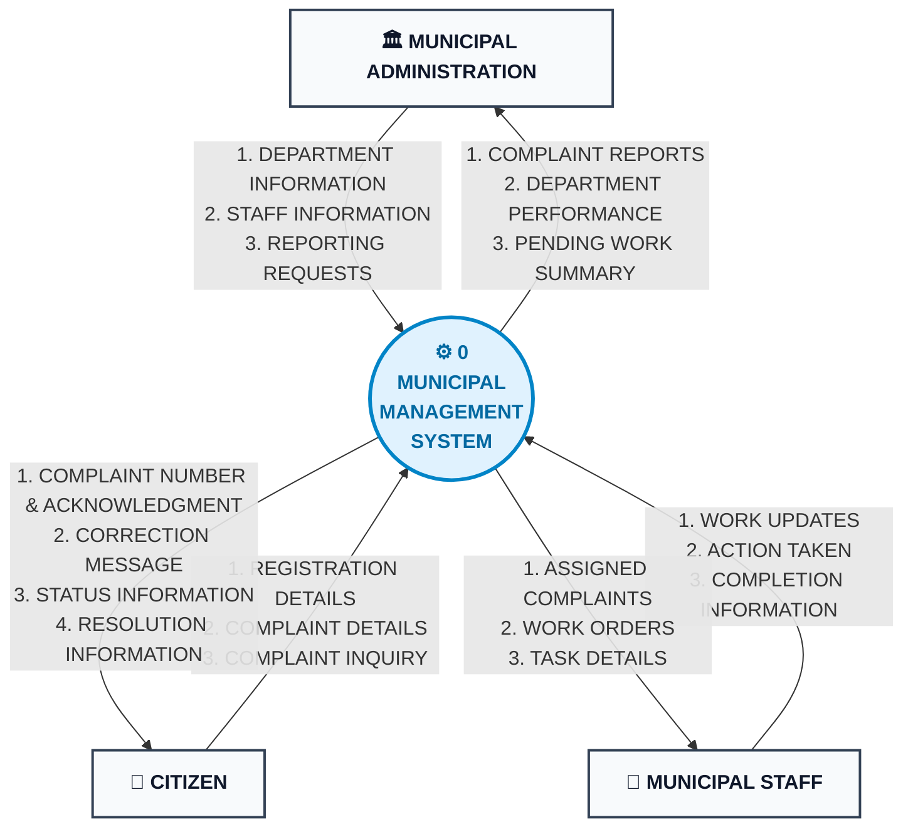

# Data Flow Diagram (DFD) — Level 0 (Context Diagram)

**Project**: Municipal Complaint Management System (MCMS)  
**Standard**: Gane-Sarson / Yourdon & Coad Context-Level Modeling  
**Course Reference**: University of Karachi — BS Computer Science — Database Management Systems (DBMS)

---

## 1. Overview & System Boundary

The **Level 0 Data Flow Diagram (Context Diagram)** defines the highest-level operational boundary of the Municipal Complaint Management System:
* **Single Central Process**: `0 MUNICIPAL MANAGEMENT SYSTEM` encapsulates all internal logic, database operations, and rule evaluations.
* **External Entities Only**: External actors (`CITIZEN`, `MUNICIPAL ADMINISTRATION`, `MUNICIPAL STAFF`) interact across the boundary via defined data flows.
* **No Internal Data Stores**: Internal persistence mechanisms are encapsulated within Process 0 and only surfaced during Level 1 decomposition.

---

## 2. Visual Context Diagram

---

## 3. Boundary Flow Specifications

### 3.1 CITIZEN Flows

| Flow Name | Direction | Payload Attributes | Purpose & Trigger |
|---|---|---|---|
| **REGISTRATION DETAILS** | Inbound | `Name`, `Phone`, `Address` | Citizen creates profile; system validates phone uniqueness. |
| **COMPLAINT DETAILS** | Inbound | `Citizen_Phone`, `Category`, `Description`, `Location` | Citizen submits civic grievance. |
| **COMPLAINT INQUIRY** | Inbound | `Complaint_ID` or `Citizen_Phone` | Citizen requests tracking update. |
| **COMPLAINT NUMBER & ACKNOWLEDGMENT** | Outbound | `Complaint_ID`, `Complaint_Date`, `Status`, `Dept_Name` | Instant receipt returned upon successful atomic registration. |
| **CORRECTION MESSAGE** | Outbound | `Error_Field`, `Error_Reason`, `Guidance_Text` | Validation feedback if inputs are incomplete, invalid, or short. |
| **STATUS INFORMATION** | Outbound | `Complaint_ID`, `Status`, `Assigned_Dept`, `Last_Updated` | Response to status inquiry. |
| **RESOLUTION INFORMATION** | Outbound | `Complaint_ID`, `Completion_Date`, `Action_Taken` | Final verified notification confirming civic remediation. |

---

### 3.2 MUNICIPAL ADMINISTRATION Flows

| Flow Name | Direction | Payload Attributes | Purpose & Trigger |
|---|---|---|---|
| **DEPARTMENT INFORMATION** | Inbound | `Department_Name`, `Office_Location` | Admin defines or updates civic department master data. |
| **STAFF INFORMATION** | Inbound | `Name`, `Department_ID`, `Phone`, `Designation` | Admin registers staff members or reassigns roles. |
| **REPORTING REQUESTS** | Inbound | `Date_Range`, `Department_ID`, `Status_Filter` | Admin initiates analytical report query. |
| **COMPLAINT REPORTS** | Outbound | Aggregate volume, monthly trends, category breakdown | Executive operational reporting. |
| **DEPARTMENT PERFORMANCE** | Outbound | Average resolution time (hours), SLA compliance % | Efficiency evaluation across departments. |
| **PENDING WORK SUMMARY** | Outbound | Overdue tickets, backlog count, workload imbalance flags | Escalation and capacity planning. |

---

### 3.3 MUNICIPAL STAFF Flows

| Flow Name | Direction | Payload Attributes | Purpose & Trigger |
|---|---|---|---|
| **WORK UPDATES** | Inbound | `WorkOrder_ID`, `Work_Status`, `Timestamp` | Field technician logs progress (`In Progress`, `On Hold`). |
| **ACTION TAKEN** | Inbound | `WorkOrder_ID`, `Action_Taken` text | Summary of field diagnosis and repairs executed. |
| **COMPLETION INFORMATION** | Inbound | `WorkOrder_ID`, `Completion_Date`, `Final_Remarks` | Technician certifies work completion. |
| **ASSIGNED COMPLAINTS** | Outbound | `Complaint_ID`, `Description`, `Location` | Context provided to technician for field visit. |
| **WORK ORDERS** | Outbound | `WorkOrder_ID`, `Assigned_Date`, `Target_SLA` | Official work assignment dispatch. |
| **TASK DETAILS** | Outbound | Priority, safety instructions, contact references | Granular job instructions. |

---

## Related Diagrams
- [Entity-Relationship Diagram (ERD)](erd.md)
- [Semantic Net (Occurrence Level)](semantic_net.md)
- [DFD Level 1 (Diagram 0)](dfd_level_1.md)
- [DFD Level 2 (Process 2.0)](dfd_level_2.md)
