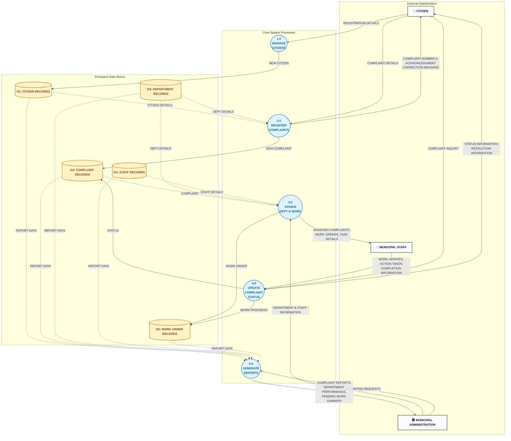

# Data Flow Diagram (DFD) — Level 1 (Diagram 0)

**Project**: Municipal Complaint Management System (MCMS)  
**Standard**: Gane-Sarson / Yourdon-DeMarco Decomposition Modeling  
**Course Reference**: University of Karachi — BS Computer Science — Database Management Systems (DBMS)

---

## 1. Overview & Decomposition

The **Level 1 Data Flow Diagram (Diagram 0)** decomposes the central system (`Process 0`) into five specialized core processes and introduces the five persistent relational data stores (`D1` through `D5`). All external inputs and outputs strictly balance with the Level 0 Context Diagram.

---

## 2. Visual Level 1 Diagram

---

## 3. Process Directory (1.0 - 5.0)

| Process ID | Process Name | Objectives & Core Responsibilities | Inbound Flows | Outbound Flows | Data Stores Accessed |
|---|---|---|---|---|---|
| **1.0** | **MANAGE CITIZENS** | Validates and registers new citizen profiles; prevents duplicate mobile accounts. | `REGISTRATION DETAILS` (from Citizen) | `NEW CITIZEN` | **Writes** `D1: CITIZEN RECORDS` |
| **2.0** | **REGISTER COMPLAINTS** | Validates complaint narrative, determines category, binds department, issues tracking ticket ID. | `COMPLAINT DETAILS`, `CITIZEN DETAILS`, `DEPT DETAILS` | `NEW COMPLAINT`, `COMPLAINT NUMBER & ACKNOWLEDGMENT`, `CORRECTION MESSAGE` | **Reads** `D1`, `D3` **Writes** `D2: COMPLAINT RECORDS` |
| **3.0** | **ASSIGN DEPARTMENT AND WORK** | Evaluates pending complaints, matches qualified technician, generates work orders, updates staff roster. | `COMPLAINT`, `DEPT DETAILS`, `STAFF DETAILS`, `ADMIN INFO` | `WORK ORDER`, `ASSIGNED COMPLAINTS`, `WORK ORDERS`, `TASK DETAILS` | **Reads** `D2`, `D3`, `D4` **Writes** `D5: WORK ORDER RECORDS` |
| **4.0** | **UPDATE COMPLAINT STATUS** | Logs field progress, records actions taken, completes tickets, answers citizen live tracking requests. | `WORK UPDATES`, `ACTION TAKEN`, `COMPLETION INFO`, `COMPLAINT INQUIRY` | `STATUS`, `WORK PROGRESS`, `STATUS INFORMATION`, `RESOLUTION INFORMATION` | **Reads/Writes** `D2`, `D5` |
| **5.0** | **GENERATE REPORTS** | Aggregates municipal performance, SLA compliance, pending work backlogs, and departmental metrics. | `REPORTING REQUESTS`, records from `D1` through `D5` | `COMPLAINT REPORTS`, `DEPARTMENT PERFORMANCE`, `PENDING WORK SUMMARY` | **Reads** `D1`, `D2`, `D3`, `D4`, `D5` |

---

## 4. Data Store Directory (D1 - D5)

| Store ID | Physical Entity Name | Description | Key Attributes Stored | Accessing Processes |
|---|---|---|---|---|
| **D1** | `CITIZEN` | Master registry of verified municipal citizens. | `Citizen_ID (PK)`, `Name`, `Phone (UK)`, `Address`, `created_at` | Written by `1.0`; Read by `2.0`, `5.0` |
| **D2** | `COMPLAINT` | Primary transaction store of citizen complaints and lifecycle states. | `Complaint_ID (PK)`, `Citizen_ID`, `Department_ID`, `Complaint_Date`, `Category`, `Description`, `Location`, `Status` | Written by `2.0`; Read/Updated by `3.0`, `4.0`, `5.0` |
| **D3** | `DEPARTMENT` | Official municipal department definitions and physical locations. | `Department_ID (PK)`, `Department_Name (UK)`, `Office_Location` | Updated by `3.0`; Read by `2.0`, `3.0`, `5.0` |
| **D4** | `STAFF` | Directory of departmental personnel, roles, and status. | `Staff_ID (PK)`, `Department_ID`, `Name`, `Phone`, `Designation`, `is_active` | Updated by `3.0`; Read by `3.0`, `5.0` |
| **D5** | `WORK_ORDER` | Operational work orders dispatched to field crews. | `WorkOrder_ID (PK)`, `Complaint_ID`, `Staff_ID`, `Assigned_Date`, `Completion_Date`, `Work_Status`, `Action_Taken` | Written by `3.0`; Read/Updated by `4.0`, `5.0` |

---

## 5. Balancing Verification with Level 0

| Level 0 Boundary Flow | Source → Destination (Level 0) | Level 1 Implementation | Balancing Status |
|---|---|---|---|
| `REGISTRATION DETAILS` | `CITIZEN` → Process 0 | `CITIZEN` → Process `1.0` | **BALANCED** |
| `COMPLAINT DETAILS` | `CITIZEN` → Process 0 | `CITIZEN` → Process `2.0` | **BALANCED** |
| `COMPLAINT INQUIRY` | `CITIZEN` → Process 0 | `CITIZEN` → Process `4.0` | **BALANCED** |
| `COMPLAINT NUMBER & ACKNOWLEDGMENT` | Process 0 → `CITIZEN` | Process `2.0` → `CITIZEN` | **BALANCED** |
| `CORRECTION MESSAGE` | Process 0 → `CITIZEN` | Process `2.0` → `CITIZEN` | **BALANCED** |
| `STATUS INFORMATION` | Process 0 → `CITIZEN` | Process `4.0` → `CITIZEN` | **BALANCED** |
| `RESOLUTION INFORMATION` | Process 0 → `CITIZEN` | Process `4.0` → `CITIZEN` | **BALANCED** |
| `DEPARTMENT INFORMATION` | `ADMIN` → Process 0 | `ADMIN` → Process `3.0` | **BALANCED** |
| `STAFF INFORMATION` | `ADMIN` → Process 0 | `ADMIN` → Process `3.0` | **BALANCED** |
| `REPORTING REQUESTS` | `ADMIN` → Process 0 | `ADMIN` → Process `5.0` | **BALANCED** |
| `COMPLAINT REPORTS` | Process 0 → `ADMIN` | Process `5.0` → `ADMIN` | **BALANCED** |
| `DEPARTMENT PERFORMANCE` | Process 0 → `ADMIN` | Process `5.0` → `ADMIN` | **BALANCED** |
| `PENDING WORK SUMMARY` | Process 0 → `ADMIN` | Process `5.0` → `ADMIN` | **BALANCED** |
| `WORK UPDATES` | `STAFF` → Process 0 | `STAFF` → Process `4.0` | **BALANCED** |
| `ACTION TAKEN` | `STAFF` → Process 0 | `STAFF` → Process `4.0` | **BALANCED** |
| `COMPLETION INFORMATION` | `STAFF` → Process 0 | `STAFF` → Process `4.0` | **BALANCED** |
| `ASSIGNED COMPLAINTS` | Process 0 → `STAFF` | Process `3.0` → `STAFF` | **BALANCED** |
| `WORK ORDERS` | Process 0 → `STAFF` | Process `3.0` → `STAFF` | **BALANCED** |
| `TASK DETAILS` | Process 0 → `STAFF` | Process `3.0` → `STAFF` | **BALANCED** |

---

## Related Diagrams
- [Entity-Relationship Diagram (ERD)](erd.md)
- [Semantic Net (Occurrence Level)](semantic_net.md)
- [DFD Level 0 (Context Diagram)](dfd_level_0.md)
- [DFD Level 2 (Process 2.0)](dfd_level_2.md)
