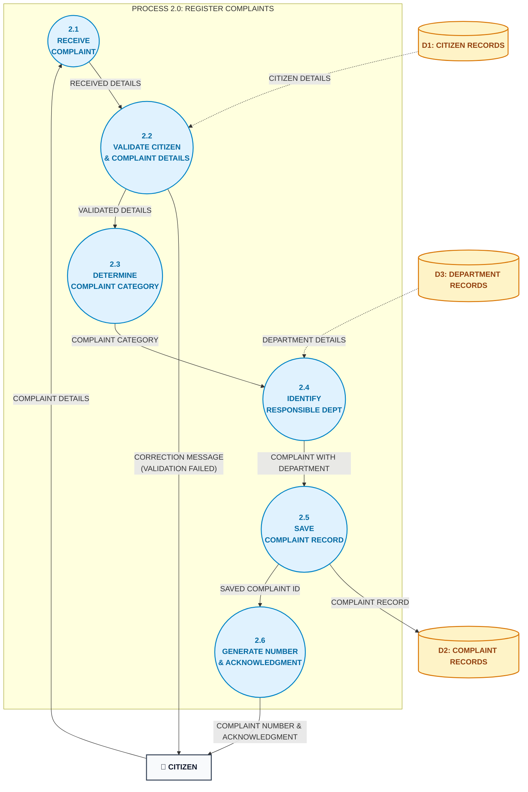

# Data Flow Diagram (DFD) — Level 2 (Process 2.0: Register Complaints)

**Project**: Municipal Complaint Management System (MCMS)  
**Standard**: Detailed Functional Decomposition | Process Mini-Specifications  
**Course Reference**: University of Karachi — BS Computer Science — Database Management Systems (DBMS)

---

## 1. Overview & Scope

The **Level 2 Data Flow Diagram** decomposes **Process 2.0 (REGISTER COMPLAINTS)** into its constituent sub-processes (`2.1` through `2.6`). It explicitly documents the data validation checkpoint, the error correction feedback loop, taxonomy classification, department binding, atomic persistence, and acknowledgment generation.

---

## 2. Visual Level 2 Diagram



---

## 3. Sub-Process Mini-Specifications (Structured English)

### 3.1 Process 2.1: RECEIVE COMPLAINT
```
PROCESS 2.1: RECEIVE COMPLAINT
INPUT:
    Complaint_Details FROM CITIZEN
OUTPUT:
    Received_Details TO Process 2.2
LOGIC:
    1. Parse incoming payload: Citizen_Phone, Category_Raw, Description, Location.
    2. Attach system receipt timestamp = CURRENT_TIMESTAMP.
    3. Forward unvalidated packet as Received_Details to Process 2.2.
```

### 3.2 Process 2.2: VALIDATE CITIZEN & COMPLAINT DETAILS
```
PROCESS 2.2: VALIDATE CITIZEN & COMPLAINT DETAILS
INPUT:
    Received_Details FROM Process 2.1
    Citizen_Details FROM D1: CITIZEN RECORDS
OUTPUT:
    Correction_Message TO CITIZEN (On Validation Failure)
    Validated_Details TO Process 2.3 (On Validation Success)
LOGIC:
    1. Lookup Citizen_Phone in D1.
       IF NOT FOUND:
           RETURN Correction_Message("Citizen phone not registered. Please create a citizen profile first.")
           HALT
    2. Check Description:
       IF LENGTH(TRIM(Description)) < 10:
           RETURN Correction_Message("Description must be at least 10 characters long.")
           HALT
    3. Check Location:
       IF TRIM(Location) IS EMPTY:
           RETURN Correction_Message("Incident location is mandatory.")
           HALT
    4. Pass Validated_Details(Citizen_ID, Category_Raw, Description, Location) to Process 2.3.
```

### 3.3 Process 2.3: DETERMINE COMPLAINT CATEGORY
```
PROCESS 2.3: DETERMINE COMPLAINT CATEGORY
INPUT:
    Validated_Details FROM Process 2.2
OUTPUT:
    Complaint_Category TO Process 2.4
LOGIC:
    1. Evaluate Category_Raw against municipal standard taxonomy:
       MATCH Category_Raw:
           "Water Leak" | "Pipeline Burst" | "Contaminated Water" -> "Water Supply & Sanitation"
           "Pothole" | "Damaged Road" | "Broken Curb"             -> "Roads & Infrastructure Maintenance"
           "Garbage Dumpster" | "Illegal Dumping"                 -> "Solid Waste Management"
           "Streetlight Out" | "Exposed Wiring"                   -> "Street Lighting & Electricity"
           "Mosquito Breeding" | "Open Sewer Drain"               -> "Public Health & Vector Control"
           "Fallen Tree" | "Damaged Park Bench"                   -> "Parks & Urban Forestry"
           DEFAULT                                                -> Category_Raw
    2. Output standardized Complaint_Category to Process 2.4.
```

### 3.4 Process 2.4: IDENTIFY RESPONSIBLE DEPARTMENT
```
PROCESS 2.4: IDENTIFY RESPONSIBLE DEPARTMENT
INPUT:
    Complaint_Category FROM Process 2.3
    Department_Details FROM D3: DEPARTMENT RECORDS
OUTPUT:
    Complaint_With_Department TO Process 2.5
LOGIC:
    1. Query D3: DEPARTMENT RECORDS for department_name == Complaint_Category.
    2. IF match found:
           Set Target_Department_ID = matched.department_id
       ELSE:
           Set Target_Department_ID = 1 (General Municipal Administration)
    3. Assemble Complaint_With_Department packet and forward to Process 2.5.
```

### 3.5 Process 2.5: SAVE COMPLAINT RECORD
```
PROCESS 2.5: SAVE COMPLAINT RECORD
INPUT:
    Complaint_With_Department FROM Process 2.4
OUTPUT:
    Complaint_Record TO D2: COMPLAINT RECORDS
    Saved_Complaint_ID TO Process 2.6
LOGIC:
    1. Begin Database Transaction (ATOMIC).
    2. INSERT INTO D2: COMPLAINT RECORDS:
           Citizen_ID      = packet.Citizen_ID
           Department_ID   = packet.Target_Department_ID
           Complaint_Date  = CURRENT_TIMESTAMP
           Category        = packet.Category
           Description     = packet.Description
           Location        = packet.Location
           Status          = 'Submitted'
    3. RETRIEVE generated primary key AS Saved_Complaint_ID.
    4. Commit Database Transaction.
    5. Pass Saved_Complaint_ID to Process 2.6.
```

### 3.6 Process 2.6: GENERATE NUMBER & ACKNOWLEDGMENT
```
PROCESS 2.6: GENERATE NUMBER & ACKNOWLEDGMENT
INPUT:
    Saved_Complaint_ID FROM Process 2.5
OUTPUT:
    Complaint_Number_And_Acknowledgment TO CITIZEN
LOGIC:
    1. Build formatted tracking confirmation ticket:
           Complaint_Number = "K" + LPAD(Saved_Complaint_ID, 4, '0')
           Status           = "Submitted"
           Message          = "Your complaint has been successfully registered and routed to the responsible department."
    2. Transmit immediate HTTP 201 Created acknowledgment payload to CITIZEN.
```

---

## 4. Balancing Verification with Level 1

| Balancing Criterion | Process 2.0 (Level 1) | Process 2.0 Decomposed (Level 2) | Status |
|---|---|---|---|
| **Inbound External Flow** | `COMPLAINT DETAILS` from `CITIZEN` | Enters `2.1 RECEIVE COMPLAINT` from `CITIZEN` | **BALANCED** |
| **Outbound External Flow (Success)** | `COMPLAINT NUMBER & ACKNOWLEDGMENT` to `CITIZEN` | Exits `2.6 GENERATE NUMBER & ACKNOWLEDGMENT` to `CITIZEN` | **BALANCED** |
| **Outbound External Flow (Error)** | `CORRECTION MESSAGE` to `CITIZEN` | Exits `2.2 VALIDATE CITIZEN & COMPLAINT DETAILS` to `CITIZEN` | **BALANCED** |
| **Data Store Read 1** | Reads `D1: CITIZEN RECORDS` | Read by `2.2 VALIDATE CITIZEN & COMPLAINT DETAILS` | **BALANCED** |
| **Data Store Read 2** | Reads `D3: DEPARTMENT RECORDS` | Read by `2.4 IDENTIFY RESPONSIBLE DEPARTMENT` | **BALANCED** |
| **Data Store Write** | Writes `D2: COMPLAINT RECORDS` (`NEW COMPLAINT`) | Written by `2.5 SAVE COMPLAINT RECORD` (`COMPLAINT RECORD`) | **BALANCED** |

---

## Related Diagrams
- [Entity-Relationship Diagram (ERD)](erd.md)
- [Semantic Net (Occurrence Level)](semantic_net.md)
- [DFD Level 0 (Context Diagram)](dfd_level_0.md)
- [DFD Level 1 (Diagram 0)](dfd_level_1.md)
