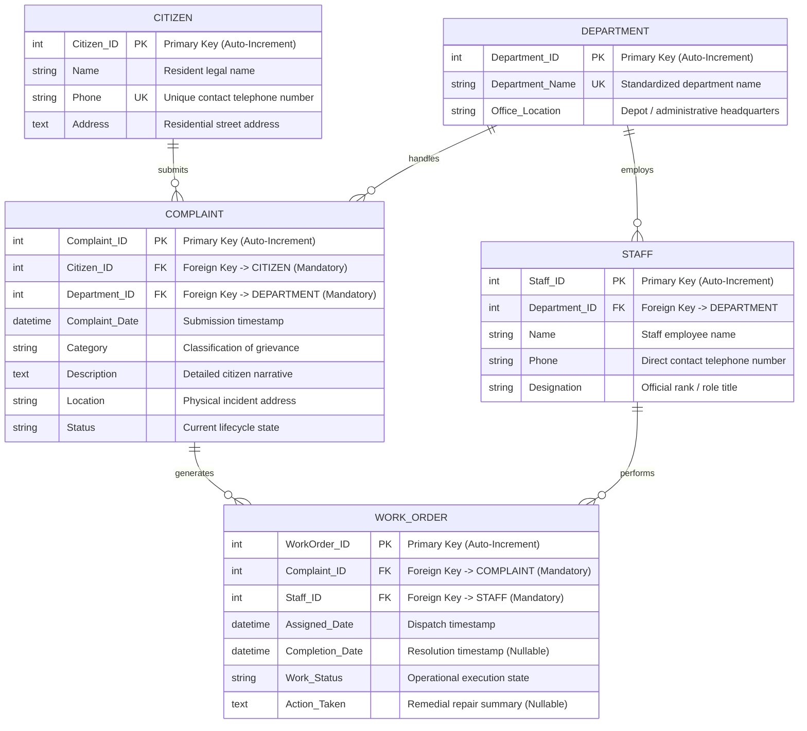
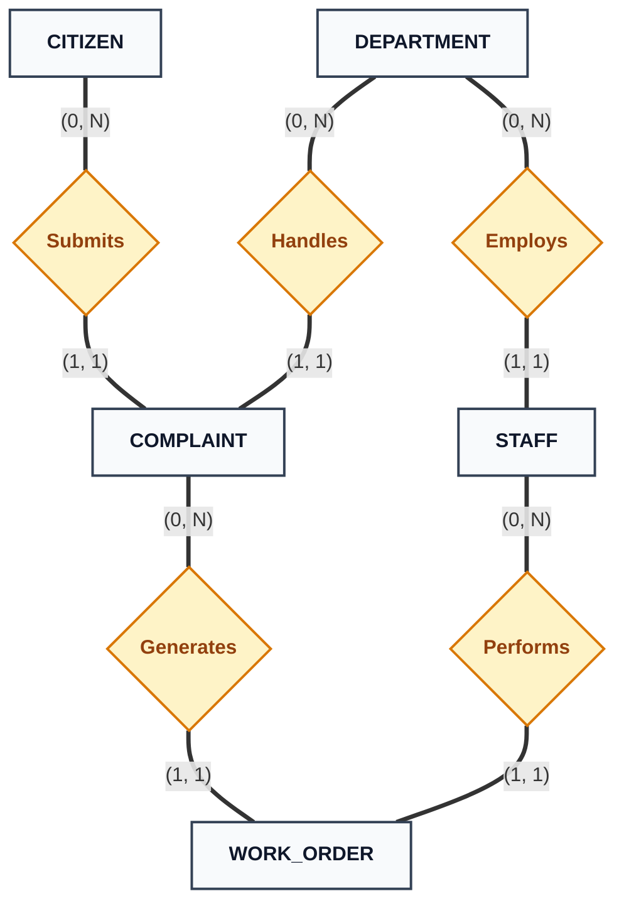
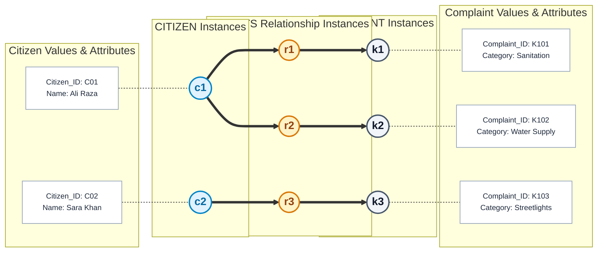
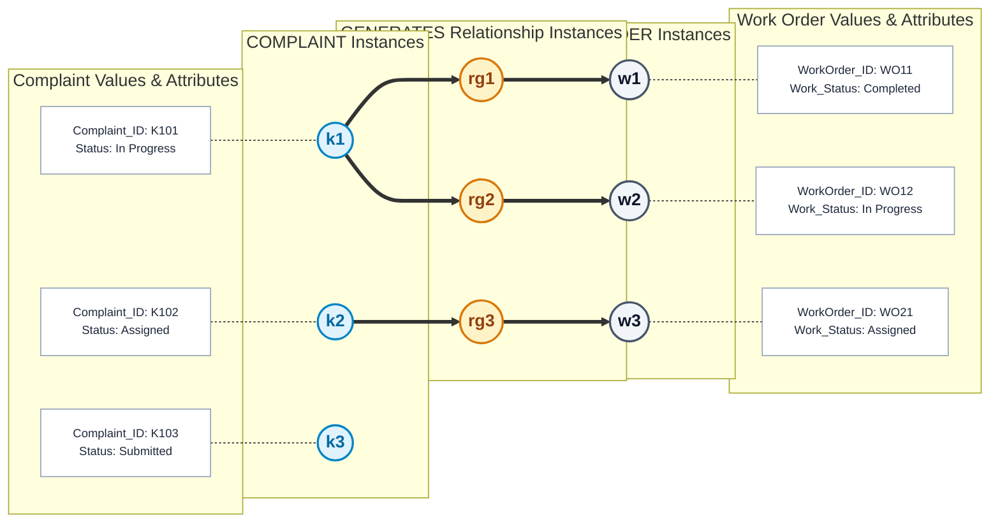
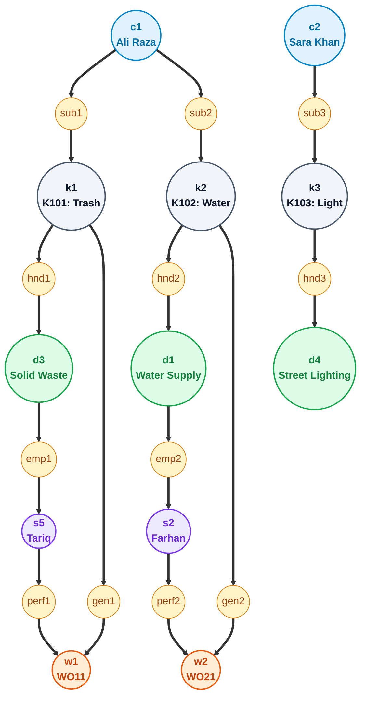
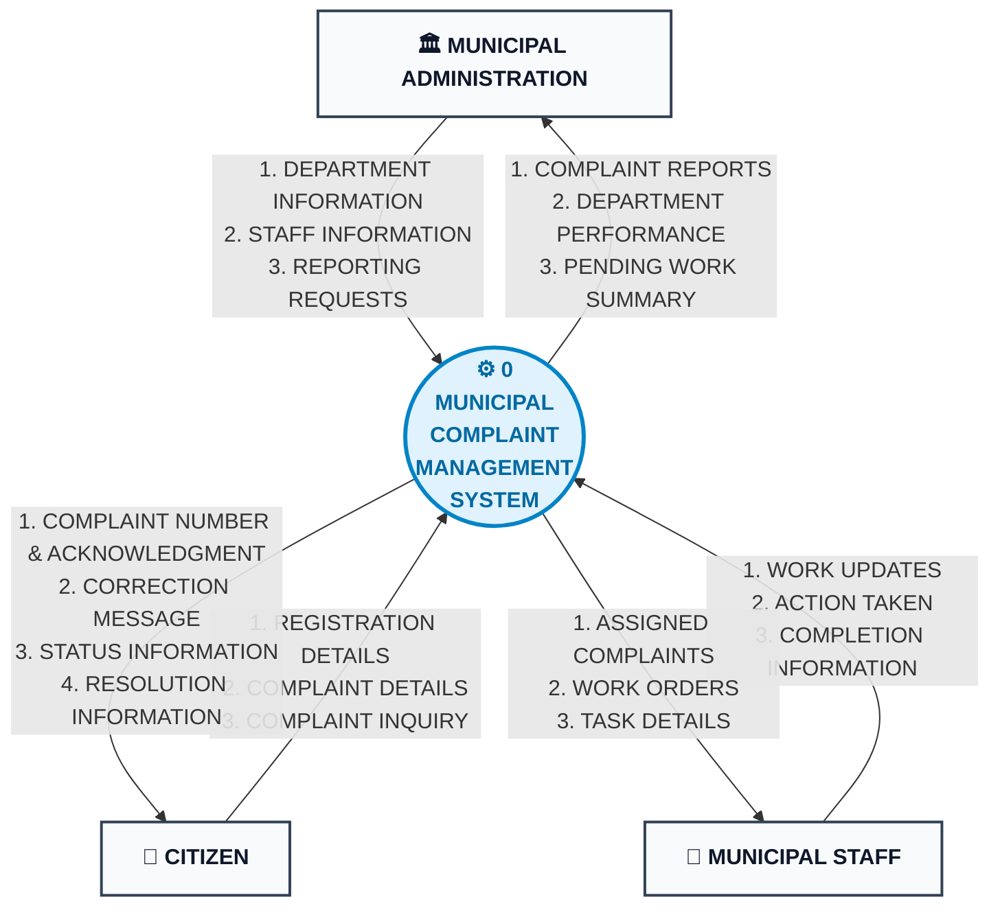
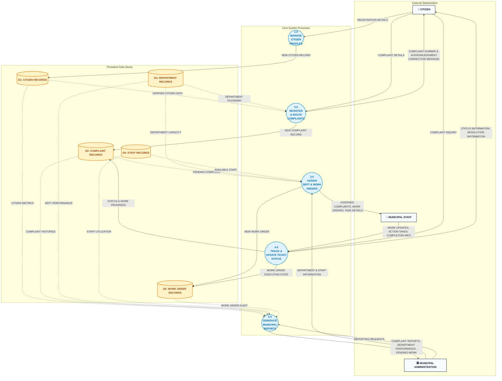
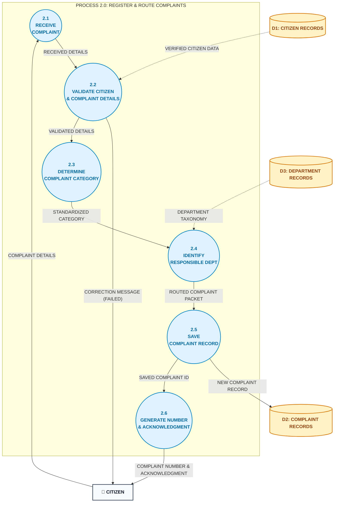

# Municipal Complaint Management System — System Diagrams & Modeling Specifications

**University of Karachi — Department of Computer Science (UBIT)**  
**Degree Program**: BS Computer Science  
**Course Title**: Database Management Systems (DBMS)  
**Instructor & Course Material Compiler**: Dr. S. M. Khalid  
**Course Textbook**: *Database Systems Textbook*, Chapter 4 (Database Design)  
**System Application**: Municipal Complaint Management System (MCMS)

---

## 📑 Individual Diagram Specifications & Deliverables

Each system diagram is maintained in its own dedicated, thoroughly documented artifact containing full attribute catalogs, formal relational predicates, and Structured English mini-specifications:

* 📊 **[Entity-Relationship Diagram (ERD)](erd.md)**: Full Crow's Foot / Information Engineering (IE) notation and Chen-style conceptual modeling, attribute data types, primary/foreign keys, structural constraints `(min, max)`, weak entities, and connection traps audit.
* 🕸️ **[Semantic Net (Occurrence Level)](semantic_net.md)**: Occurrence-level reasoning per Section 4.5; Figures A, B, and C depicting concrete entity instances, relationship paths, attribute valuation bindings, partial participation demonstrations, and diagnostic query traversals.
* 🌐 **[DFD Level 0 (Context Diagram)](dfd_level_0.md)**: Global system boundary, external entities (`CITIZEN`, `MUNICIPAL ADMINISTRATION`, `MUNICIPAL STAFF`), and 19 primary boundary data flows. Strict exclusion of internal data stores per Section 4.2.5.1.
* 🔀 **[DFD Level 1 (Diagram 0)](dfd_level_1.md)**: Core functional processes (`1.0` through `5.0`), five persistent data stores (`D1` through `D5`), quality rules (no direct entity-to-store flows), and complete parent-child balancing proofs.
* 🔍 **[DFD Level 2 (Process 2.0)](dfd_level_2.md)**: Controlled explosion of `2.0 REGISTER & ROUTE COMPLAINTS` into sub-processes `2.1` to `2.6`, Structured English mini-specifications, validation error feedback loops, and balancing verification.
* 📚 **[Course Work & Handouts Master Guide](../../course-work/README.md)**: Master syllabus, lecture notes index, and chapter summaries (`Chapter #1` to `Chapter #4`).

---

## Table of Contents
1. [Entity-Relationship Conceptual Design (ERD)](#1-entity-relationship-conceptual-design-erd)
   - [Visual ER Diagram (Crow's Foot)](#11-visual-er-diagram-crows-foot-notation)
   - [Conceptual Chen-Style Representation](#12-conceptual-chen-style-representation)
   - [Entity Definitions & Attribute Directory](#13-entity-definitions--attribute-directory)
   - [Structural Constraints & Business Invariants](#14-structural-constraints--business-invariants)
2. [Connection Traps Audit (Fan Trap & Chasm Trap)](#2-connection-traps-audit-fan-trap--chasm-trap)
   - [Fan Trap Audit & Resolution](#21-fan-trap-audit--resolution-section-475)
   - [Chasm Trap Audit & Resolution](#22-chasm-trap-audit--resolution-section-476)
3. [Semantic Net (Occurrence Level)](#3-semantic-net-occurrence-level)
   - [Figure A: 1:N Submits Relationship](#31-figure-a-1n-submits-relationship)
   - [Figure B: 1:N Generates Relationship & Partial Participation](#32-figure-b-1n-generates-relationship--partial-participation)
   - [Figure C: Master Multi-Entity Occurrence Network](#33-figure-c-master-multi-entity-occurrence-network)
   - [Diagnostic Query Path Validations](#34-diagnostic-query-path-validations)
4. [Data Flow Diagrams (DFDs)](#4-data-flow-diagrams-dfds)
   - [Level 0 (Context Diagram)](#41-level-0-context-diagram)
   - [Level 1 (Diagram 0)](#42-level-1-diagram-0)
   - [Level 2 (Process 2.0: Register & Route Complaints)](#43-level-2-process-20-register--route-complaints)
   - [Parent-Child Balancing Verification](#44-parent-child-balancing-verification)
5. [Complete System Data Dictionary](#5-complete-system-data-dictionary)
   - [Data Flow Compositions](#51-data-flow-compositions)
   - [Data Store Specifications](#52-data-store-specifications)

---

## 1. Entity-Relationship Conceptual Design (ERD)

### 1.1 Visual ER Diagram (Crow's Foot Notation)



---

### 1.2 Conceptual Chen-Style Representation



---

### 1.3 Entity Definitions & Attribute Directory

| Entity | Attribute Name | Key | Data Type | Nullable | Description & Domain |
|---|---|---|---|---|---|
| **CITIZEN** | `Citizen_ID` | **PK** | Integer (Serial) | No | Surrogate primary key identifying each resident. |
| | `Name` | | Varchar(100) | No | Resident full legal name. |
| | `Phone` | **UK** | Varchar(20) | No | Unique contact mobile number used for tracking. |
| | `Address` | | Text | No | Physical residential street address, landmark, or ward. |
| **DEPARTMENT** | `Department_ID` | **PK** | Integer (Serial) | No | Surrogate primary key for municipal service branch. |
| | `Department_Name` | **UK** | Varchar(100) | No | E.g., Water Supply, Sanitation, Roads, Street Lighting. |
| | `Office_Location` | | Varchar(200) | No | Physical depot or administrative headquarters address. |
| **STAFF** | `Staff_ID` | **PK** | Integer (Serial) | No | Surrogate primary key for municipal personnel. |
| | `Department_ID` | **FK** | Integer | No | Foreign key referencing parent `DEPARTMENT(Department_ID)`. |
| | `Name` | | Varchar(100) | No | Employee full name. |
| | `Phone` | | Varchar(20) | No | Direct staff telephone number for dispatch. |
| | `Designation` | | Varchar(100) | No | Official role title (e.g., Senior Inspector, Field Technician). |
| **COMPLAINT** | `Complaint_ID` | **PK** | Integer (Serial) | No | Unique tracking ticket number issued upon submission. |
| | `Citizen_ID` | **FK** | Integer | No | Mandatory foreign key referencing `CITIZEN(Citizen_ID)`. |
| | `Department_ID` | **FK** | Integer | No | Mandatory foreign key referencing `DEPARTMENT(Department_ID)`. |
| | `Complaint_Date` | | Timestamp | No | Submission timestamp (defaults to `CURRENT_TIMESTAMP`). |
| | `Category` | | Varchar(100) | No | Civic category (e.g., Pothole, Water Leak, Garbage Dumpster). |
| | `Description` | | Text | No | Detailed narrative describing the grievance (>= 10 chars). |
| | `Location` | | Varchar(255) | No | Physical street, intersection, or landmark of incident. |
| | `Status` | | Varchar(50) | No | `Submitted`, `Categorized`, `Assigned`, `In Progress`, `Resolved`, `Closed`. |
| **WORK_ORDER** | `WorkOrder_ID` | **PK** | Integer (Serial) | No | Unique field job ticket number. |
| | `Complaint_ID` | **FK** | Integer | No | Mandatory foreign key referencing `COMPLAINT(Complaint_ID)`. |
| | `Staff_ID` | **FK** | Integer | No | Mandatory foreign key referencing assigned `STAFF(Staff_ID)`. |
| | `Assigned_Date` | | Timestamp | No | Dispatch timestamp. |
| | `Completion_Date` | | Timestamp | Yes | Nullable timestamp populated upon physical resolution. |
| | `Work_Status` | | Varchar(50) | No | `Assigned`, `In Progress`, `Completed`, `On Hold`, `Cancelled`. |
| | `Action_Taken` | | Text | Yes | Summary of diagnostic findings, parts replaced, and repairs. |

---

### 1.4 Structural Constraints & Business Invariants

1. **Mandatory Submitter Ownership (`CITIZEN 1:N COMPLAINT`)**:
   - `(0, N)` on Citizen side; `(1, 1)` on Complaint side. Every complaint must trace back to exactly one registered resident. `ON DELETE RESTRICT` prevents accidental profile deletion.
2. **Mandatory Department Routing (`DEPARTMENT 1:N COMPLAINT`)**:
   - `(0, N)` on Department side; `(1, 1)` on Complaint side. Every complaint must belong to an authoritative municipal department.
3. **Mandatory Employment (`DEPARTMENT 1:N STAFF`)**:
   - `(0, N)` on Department side; `(1, 1)` on Staff side. Every staff member belongs to exactly one department.
4. **Deferred Work Order Generation (`COMPLAINT 1:N WORK_ORDER`)**:
   - `(0, N)` on Complaint side; `(1, 1)` on Work Order side. Newly registered complaints have `0` work orders. `ON DELETE CASCADE` ensures that purging a complaint cleans up subordinate job tickets.
5. **Mandatory Staff Assignment (`STAFF 1:N WORK_ORDER`)**:
   - `(0, N)` on Staff side; `(1, 1)` on Work Order side. Every dispatched work order is assigned to exactly one field technician.

---

## 2. Connection Traps Audit (Fan Trap & Chasm Trap)

Per Section 4.7 of Dr. S. M. Khalid's textbook, connection traps represent subtle semantic flaws where relationship pathways are ambiguous or broken:

### 2.1 Fan Trap Audit & Resolution (Section 4.7.5)
- **Structural Hazard**: Two `1:M` relationships fanning out from a common entity (`STAFF <--- 1:M --- DEPARTMENT --- 1:M ---> COMPLAINT`) create ambiguity when querying which staff member worked on which complaint.
- **Proof of Immunity in MCMS**: MCMS does **not** rely on `DEPARTMENT` to determine staff assignment. Instead, staff is directly associated with complaints through `WORK_ORDER`:
  $$\text{COMPLAINT} \xrightarrow{1:N} \text{WORK\_ORDER} \xleftarrow{1:N} \text{STAFF}$$
  Every work order explicitly pairs a specific complaint with a specific technician, eliminating all pathway ambiguity.

### 2.2 Chasm Trap Audit & Resolution (Section 4.7.6)
- **Structural Hazard**: An intermediate relationship with optional participation (`0..N`) breaks an expected relationship pathway for valid unassigned occurrences.
- **Proof of Immunity in MCMS**: If a complaint's department was only discoverable through its assigned work order (`COMPLAINT -> WORK_ORDER -> STAFF -> DEPARTMENT`), newly submitted tickets (which have `0` work orders) would be marooned without a department!
- MCMS resolves this by establishing an **independent, direct relationship**:
  $$\text{COMPLAINT} \xrightarrow{\text{handles (1:1)}} \text{DEPARTMENT}$$
  Even when `WorkOrders = ∅`, the complaint's department is immediately and authoritatively known.

---

## 3. Semantic Net (Occurrence Level)

### 3.1 Figure A: 1:N Submits Relationship



---

### 3.2 Figure B: 1:N Generates Relationship & Partial Participation

Demonstrates that complaint `k3` has **zero work orders**, proving `0..N` optional participation:



---

### 3.3 Figure C: Master Multi-Entity Occurrence Network



---

### 3.4 Diagnostic Query Path Validations (Section 4.7.4)
1. **Department Resolution for Ticket K101**:
   $$\text{c1} \xrightarrow{\text{sub1}} \text{k1} \xrightarrow{\text{hnd1}} \text{d3} \quad (\text{Solid Waste Management})$$
2. **Technician Resolution for Dispatched Work Order WO11**:
   $$\text{k1} \xrightarrow{\text{gen1}} \text{w1} \xleftarrow{\text{perf1}} \text{s5} \quad (\text{Tariq - Field Technician})$$
3. **Department Discovery for Unassigned Ticket K103**:
   $$\text{k3} \xrightarrow{\text{hnd3}} \text{d4} \quad (\text{Street Lighting})$$
   Proves the pathway remains unbroken even with `0` work orders.

---

## 4. Data Flow Diagrams (DFDs)

### 4.1 Level 0 (Context Diagram)



---

### 4.2 Level 1 (Diagram 0)



---

### 4.3 Level 2 (Process 2.0: Register & Route Complaints)



---

### 4.4 Parent-Child Balancing Verification

* Every boundary input to `Process 0` is conserved across Level 1 processes `1.0` through `5.0`.
* Every boundary output from `Process 0` is emitted by a specific Level 1 process.
* Sub-processes `2.1` to `2.6` collectively conserve the inputs, store reads (`D1`, `D3`), store writes (`D2`), and external outputs of parent process `2.0`.
* Zero direct store-to-entity, store-to-store, or entity-to-store connections exist.
* Zero Black Holes, Miracles, or Gray Holes exist.

---

## 5. Complete System Data Dictionary

### 5.1 Data Flow Compositions
```
Data Flow Name: REGISTRATION DETAILS
Composition:    Citizen_Name + Citizen_Phone + Citizen_Address
Type:           Payload (Inbound)

Data Flow Name: COMPLAINT DETAILS
Composition:    Citizen_Phone + Category_Raw + Description + Incident_Location
Type:           Payload (Inbound)

Data Flow Name: COMPLAINT NUMBER & ACKNOWLEDGMENT
Composition:    Complaint_Number + Submission_Date + Initial_Status + Responsible_Department + Receipt_Text
Type:           Payload (Outbound)

Data Flow Name: CORRECTION MESSAGE
Composition:    Error_Code + Error_Field + User_Guidance_Text
Type:           Payload (Outbound)

Data Flow Name: NEW WORK ORDER
Composition:    WorkOrder_ID + Complaint_ID + Staff_ID + Assigned_Date + Target_SLA + Initial_Status
Type:           Record (Intersystem / Store Write)

Data Flow Name: WORK UPDATES
Composition:    WorkOrder_ID + New_Work_Status + Action_Taken_Summary + [Completion_Timestamp]
Type:           Payload (Inbound)

Data Flow Name: COMPLAINT INQUIRY
Composition:    Complaint_ID | Citizen_Phone
Type:           Query (Inbound)

Data Flow Name: STATUS INFORMATION & RESOLUTION INFORMATION
Composition:    Complaint_ID + Current_Status + Department_Name + Assigned_Staff_Name + Work_Status + Action_Taken + [Completion_Date]
Type:           Payload (Outbound)
```

### 5.2 Data Store Specifications
* **`D1: CITIZEN RECORDS`**: `{ <u>Citizen_ID</u>, Name, Phone [UK], Address, created_at }`
* **`D2: COMPLAINT RECORDS`**: `{ <u>Complaint_ID</u>, Citizen_ID [FK], Department_ID [FK], Complaint_Date, Category, Description, Location, Status }`
* **`D3: DEPARTMENT RECORDS`**: `{ <u>Department_ID</u>, Department_Name [UK], Office_Location }`
* **`D4: STAFF RECORDS`**: `{ <u>Staff_ID</u>, Department_ID [FK], Name, Phone, Designation, is_active }`
* **`D5: WORK ORDER RECORDS`**: `{ <u>WorkOrder_ID</u>, Complaint_ID [FK], Staff_ID [FK], Assigned_Date, Completion_Date, Work_Status, Action_Taken }`

---

## 6. Implementation Traceability
All conceptual diagram constructs map directly to production software artifacts:
* **ERD Relations ➔ Django ORM Models**: [`backend/complaints/models.py`](../../backend/complaints/models.py)
* **DFD Process 2.0 ➔ ViewSet & Serializers**: [`backend/complaints/views.py`](../../backend/complaints/views.py) & [`serializers.py`](../../backend/complaints/serializers.py)
* **DFD Inquiries & Portal Views ➔ Next.js Pages**: [`frontend/src/app/page.tsx`](../../frontend/src/app/page.tsx)
