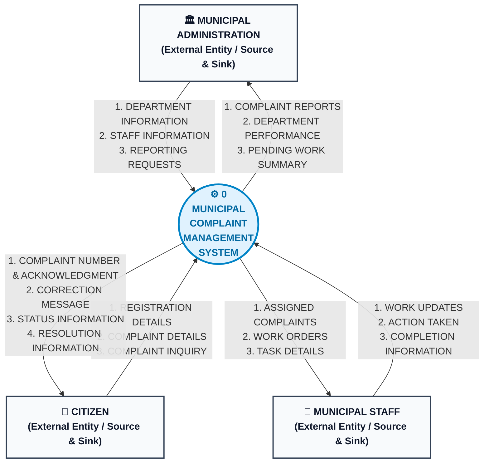

# Data Flow Diagram (DFD) — Level 0 (Context Diagram)

**Project**: Municipal Complaint Management System (MCMS)  
**Course**: Database Management Systems (DBMS) — University of Karachi (BSCS)  
**Course Textbook**: *Database Systems Textbook*, Chapter 4 (Database Design), Section 4.2  
**Author & Compiler**: Dr. S. M. Khalid  
**Standard**: Gane-Sarson / Yourdon-DeMarco Structured Systems Analysis

---

## 1. Overview & System Boundary (Textbook Section 4.2.5.1 & 4.2.6.1)

The **Level 0 Data Flow Diagram (Context Diagram)** establishes the global operational boundary of the Municipal Complaint Management System:

* **Single Central Process**: Exactly one system-level process, `0 MUNICIPAL COMPLAINT MANAGEMENT SYSTEM`, represents the entire automated and procedural domain.
* **External Entities Only (Sources and Sinks)**: All actors interacting with the system across its operational perimeter (`CITIZEN`, `MUNICIPAL ADMINISTRATION`, `MUNICIPAL STAFF`) are represented as external entities. Per Section 4.2.2.1, external entities are defined by logical externality (their internal behavior is not decomposed within this model).
* **Strict Exclusion of Internal Data Stores**: In strict adherence to Section 4.2.5.1, internal data stores (`D1` through `D5`) are **deliberately omitted** from the context diagram; internal storage is encapsulated within Process 0 and only surfaced during Level 1 functional decomposition.
* **Flow Directionality & Semantics**: Directed arrows denote data packets crossing the boundary. Per Section 4.2.2.3, arrows denote data movement, not programmatic execution sequence or timing.

---

## 2. Visual Context Diagram

---

## 3. Boundary Flow Specifications (Textbook Section 4.2.9.1)

### 3.1 CITIZEN Boundary Flows

| Flow Name | Direction | Payload Composition (Data Dictionary) | Purpose & Operational Trigger |
|---|---|---|---|
| **REGISTRATION DETAILS** | Inbound | `Citizen_Name + Phone + Address` | Resident submits personal details to create a municipal profile; system validates phone uniqueness. |
| **COMPLAINT DETAILS** | Inbound | `Citizen_Phone + Category_Raw + Description + Incident_Location` | Citizen logs a new civic grievance (e.g., water burst, road pothole, refuse accumulation). |
| **COMPLAINT INQUIRY** | Inbound | `Complaint_ID \| Citizen_Phone` | Citizen requests tracking information and live status updates on previously lodged complaints. |
| **COMPLAINT NUMBER & ACKNOWLEDGMENT** | Outbound | `Complaint_ID + Submission_Date + Initial_Status + Dept_Name` | Instant confirmation receipt returned to resident containing unique tracking ticket number upon atomic registration. |
| **CORRECTION MESSAGE** | Outbound | `Error_Code + Error_Field + User_Guidance_Text` | Validation feedback returned if submitted payload has missing fields, invalid phone, or text < 10 characters. |
| **STATUS INFORMATION** | Outbound | `Complaint_ID + Status + Assigned_Dept + Last_Updated_Time` | Real-time response to citizen tracking query showing current lifecycle milestone. |
| **RESOLUTION INFORMATION** | Outbound | `Complaint_ID + Completion_Date + Action_Taken + Staff_Designation` | Final verified closure notification confirming physical remediation of the reported civic issue. |

---

### 3.2 MUNICIPAL ADMINISTRATION Boundary Flows

| Flow Name | Direction | Payload Composition (Data Dictionary) | Purpose & Operational Trigger |
|---|---|---|---|
| **DEPARTMENT INFORMATION** | Inbound | `Department_Name + Office_Location + Depot_Contact` | Administrator registers or updates municipal operating departments and maintenance divisions. |
| **STAFF INFORMATION** | Inbound | `Staff_Name + Department_ID + Phone + Designation + is_active` | Administrator creates personnel accounts, sets operational roles, or reassigns field workers. |
| **REPORTING REQUESTS** | Inbound | `Date_Range + Department_ID + Status_Filter + Metric_Type` | Administrator initiates analytical query to monitor civic response metrics and workload backlogs. |
| **COMPLAINT REPORTS** | Outbound | `{Complaint_ID, Category, Dept, Date, Status, Duration}` | Aggregate analytical reports detailing ticket volume, category distribution, and resolution ratios. |
| **DEPARTMENT PERFORMANCE** | Outbound | `Dept_ID + Total_Tickets + Resolved_Count + Avg_Resolution_Hours + SLA_Compliance_Pct` | Departmental performance scorecard evaluating response times and SLA conformity. |
| **PENDING WORK SUMMARY** | Outbound | `Backlog_Count + Overdue_Tickets_List + Unassigned_Queue_Count` | Operational escalation summary identifying bottlenecks and unallocated complaints. |

---

### 3.3 MUNICIPAL STAFF Boundary Flows

| Flow Name | Direction | Payload Composition (Data Dictionary) | Purpose & Operational Trigger |
|---|---|---|---|
| **WORK UPDATES** | Inbound | `WorkOrder_ID + Work_Status + Field_Notes + Update_Timestamp` | Field technician or supervisor submits operational status change (`In Progress`, `On Hold`). |
| **ACTION TAKEN** | Inbound | `WorkOrder_ID + Remedial_Description + Materials_Used` | Detailed summary of physical repairs, parts replaced, or maintenance executed on-site. |
| **COMPLETION INFORMATION** | Inbound | `WorkOrder_ID + Completion_Date + Technician_Signoff + Verification_Photos` | Official certification submitted by field crew marking job ticket physical completion. |
| **ASSIGNED COMPLAINTS** | Outbound | `Complaint_ID + Category + Incident_Location + Description + Citizen_Phone` | Contextual complaint dossier dispatched to staff technician for field diagnosis. |
| **WORK ORDERS** | Outbound | `WorkOrder_ID + Complaint_ID + Staff_ID + Assigned_Date + Target_SLA` | Official municipal work order authorizing maintenance crew deployment. |
| **TASK DETAILS** | Outbound | `Safety_Instructions + Priority_Level + Access_Notes + Depot_Tools` | Specific operational guidelines, equipment requirements, and site safety instructions. |

---

## 4. Quality & Compliance Audit (Textbook Section 4.2.7 & 4.2.10)

| Chapter 4 Quality Rule | Textbook Criterion | MCMS Context Diagram Compliance | Status |
|---|---|---|---|
| **Boundary Scope** | Single process representing the entire system | Process `0` encapsulates all municipal complaint workflows. | **COMPLIANT** |
| **No Premature Storage** | Internal data stores omitted from Context DFD (Section 4.2.5.1) | Zero data stores appear; persistence is strictly deferred to Level 1. | **COMPLIANT** |
| **Valid Connections** | External entities must connect only to processes (Section 4.2.7.2) | All 19 data flows connect an external entity to Process 0. | **COMPLIANT** |
| **No Direct Entity-Entity Flows** | System boundary excludes external actor-to-actor communication | No direct citizen-to-admin or staff-to-citizen flows outside Process 0. | **COMPLIANT** |
| **No Black Hole / Miracle** | Process 0 must have both balanced inputs and outputs (Section 4.2.10) | Process 0 receives 9 inbound flows and delivers 10 outbound flows. | **COMPLIANT** |

---

## 5. Related Modeling Deliverables
* 🔀 **[DFD Level 1 (Diagram 0)](dfd_level_1.md)** — Functional decomposition into processes `1.0` through `5.0` with data stores `D1` to `D5`.
* 🔍 **[DFD Level 2 (Process 2.0)](dfd_level_2.md)** — Detailed explosion of complaint registration with mini-specifications.
* 📊 **[Entity-Relationship Diagram (ERD)](erd.md)** — Conceptual schema and structural constraints.
* 🕸️ **[Semantic Net (Occurrence Level)](semantic_net.md)** — Instance-level validation and connection trap audit.
* 📑 **[Master Modeling README](README.md)** — Consolidated system documentation and data dictionary.
