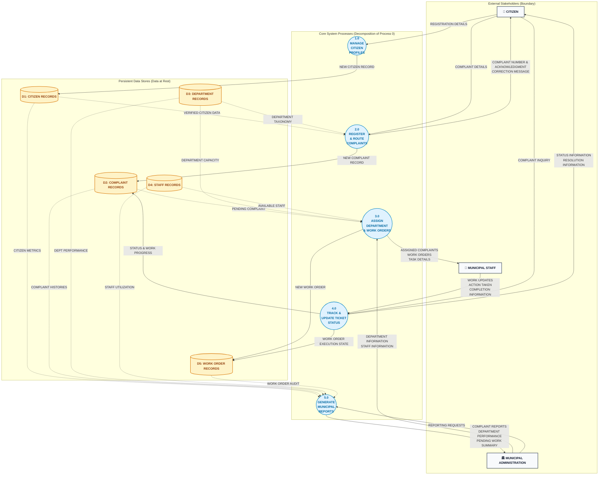

# Data Flow Diagram (DFD) — Level 1 (Diagram 0)

**Project**: Municipal Complaint Management System (MCMS)  
**Course**: Database Management Systems (DBMS) — University of Karachi (BSCS)  
**Course Textbook**: *Database Systems Textbook*, Chapter 4 (Database Design), Section 4.2.5.2 & 4.2.8  
**Author & Compiler**: Dr. S. M. Khalid  
**Standard**: Gane-Sarson / Yourdon-DeMarco Functional Decomposition & Balancing

---

## 1. Overview & Decomposition Architecture (Textbook Section 4.2.5.2)

The **Level 1 Data Flow Diagram (Diagram 0)** opens the operational perimeter established in the Context Diagram by decomposing `Process 0` into five core functional subsystems (`Processes 1.0` through `5.0`) and introducing the five persistent relational data stores (`D1` through `D5`).

### Fundamental Principles of Level 1 Modeling
1. **Conservation of Boundary Flows (Section 4.2.8)**: Every external flow entering or leaving the system in the Context Diagram must map to a specific functional process in Diagram 0.
2. **Introduction of Persistent Storage (Section 4.2.2.4)**: Data stores represent data at rest between transformations. External entities are forbidden from accessing data stores directly; all reads and writes are mediated by processes.
3. **No Direct Entity-to-Store or Store-to-Store Flows (Section 4.2.7.2)**: A process must always serve as the transformer between actors and stored data.
4. **Hierarchical Numbering (Section 4.2.5.4)**: Major processes are assigned single-decimal identifiers (`1.0`, `2.0`, `3.0`, `4.0`, `5.0`) establishing ancestry for subsequent Level 2 explosions.

---

## 2. Visual Level 1 Diagram

---

## 3. Core Process Directory (1.0 – 5.0)

| Process ID | Process Name | Objectives & Core Transformation Responsibilities | Inbound Flows | Outbound Flows | Data Stores Accessed | Quality Check (No Holes) |
|---|---|---|---|---|---|---|
| **1.0** | **MANAGE CITIZEN PROFILES** | Validates resident registration details, performs uniqueness checks on mobile numbers, and registers verified resident profiles. | `REGISTRATION DETAILS` (from Citizen) | `NEW CITIZEN RECORD` (to D1) | **Writes**: `D1: CITIZEN RECORDS` | Normal (Inbound converted to storage write) |
| **2.0** | **REGISTER & ROUTE COMPLAINTS** | Validates grievance narrative, matches reporting phone against D1, maps incident category to responsible department in D3, creates atomic ticket, and returns receipt. | `COMPLAINT DETAILS` (from Citizen), `VERIFIED CITIZEN DATA` (from D1), `DEPARTMENT TAXONOMY` (from D3) | `NEW COMPLAINT RECORD` (to D2), `COMPLAINT NUMBER & ACKNOWLEDGMENT` (to Citizen), `CORRECTION MESSAGE` (to Citizen) | **Reads**: `D1`, `D3` **Writes**: `D2: COMPLAINT RECORDS` | Normal (Subsumed by Level 2 decomposition) |
| **3.0** | **ASSIGN DEPARTMENT & WORK ORDERS** | Evaluates pending complaints, matches work scope to qualified departmental staff, dispatches field work orders, and maintains staff/dept rosters. | `PENDING COMPLAINT` (from D2), `DEPARTMENT CAPACITY` (from D3), `AVAILABLE STAFF` (from D4), `DEPT & STAFF INFO` (from Admin) | `NEW WORK ORDER` (to D5), `ASSIGNED COMPLAINTS`, `WORK ORDERS`, `TASK DETAILS` (to Staff) | **Reads**: `D2`, `D3`, `D4` **Writes**: `D5: WORK ORDER RECORDS` | Normal (Validates and dispatches job orders) |
| **4.0** | **TRACK & UPDATE TICKET STATUS** | Ingests field progress reports, logs physical remedial actions taken, updates ticket lifecycle states, and answers citizen live status inquiries. | `WORK UPDATES`, `ACTION TAKEN`, `COMPLETION INFO` (from Staff), `COMPLAINT INQUIRY` (from Citizen) | `STATUS & WORK PROGRESS` (to D2), `WORK ORDER EXECUTION STATE` (to D5), `STATUS INFO`, `RESOLUTION INFO` (to Citizen) | **Reads/Writes**: `D2`, `D5` | Normal (Bi-directional store update and inquiry feedback) |
| **5.0** | **GENERATE MUNICIPAL REPORTS** | Aggregates operational complaint logs, computes departmental SLA compliance percentages, highlights overdue backlogs, and generates executive summaries. | `REPORTING REQUESTS` (from Admin), cross-table audit reads from `D1`, `D2`, `D3`, `D4`, `D5` | `COMPLAINT REPORTS`, `DEPARTMENT PERFORMANCE`, `PENDING WORK SUMMARY` (to Admin) | **Reads**: `D1`, `D2`, `D3`, `D4`, `D5` | Normal (Cross-store aggregation to management) |

---

## 4. Persistent Data Store Directory (D1 – D5)

Per Section 4.2.2.4 of the textbook, data stores represent data at rest between transformations. Each logical store maps to a 3NF relational table:

| Store ID | Physical Relation Name | Conceptual Content & Role | Primary Key | Foreign Keys & Unique Constraints | Consuming Processes |
|---|---|---|---|---|---|
| **D1** | `CITIZEN` | Master registry of verified municipal residents. | `Citizen_ID` (PK) | `Phone` (UK) | Written by `1.0`; Read by `2.0`, `5.0` |
| **D2** | `COMPLAINT` | Master transactional ledger of all lodged civic grievances. | `Complaint_ID` (PK) | `Citizen_ID` (FK), `Department_ID` (FK) | Written by `2.0`; Updated by `4.0`; Read by `3.0`, `5.0` |
| **D3** | `DEPARTMENT` | Master directory of municipal departments and depot locations. | `Department_ID` (PK) | `Department_Name` (UK) | Maintained by `3.0`; Read by `2.0`, `3.0`, `5.0` |
| **D4** | `STAFF` | Roster of municipal supervisors and field technicians. | `Staff_ID` (PK) | `Department_ID` (FK) | Maintained by `3.0`; Read by `3.0`, `5.0` |
| **D5** | `WORK_ORDER` | Operational job orders dispatched to field maintenance crews. | `WorkOrder_ID` (PK) | `Complaint_ID` (FK), `Staff_ID` (FK) | Written by `3.0`; Updated by `4.0`; Read by `5.0` |

---

## 5. Formal Parent-Child Balancing Proof (Textbook Section 4.2.8)

Section 4.2.8 mandates that every data flow crossing the boundary of `Process 0` in the Context Diagram must be accounted for across the decomposed processes in Diagram 0.

### 5.1 Inbound Boundary Balancing

| # | Context DFD Inbound Flow | Source Entity | Diagram 0 Receiving Process | Balancing Status | Verification Evidence |
|---|---|---|---|---|---|
| 1 | `REGISTRATION DETAILS` | `CITIZEN` | `1.0 MANAGE CITIZEN PROFILES` | **BALANCED** | Consumed to create new citizen records in `D1`. |
| 2 | `COMPLAINT DETAILS` | `CITIZEN` | `2.0 REGISTER & ROUTE COMPLAINTS` | **BALANCED** | Ingested to initiate grievance registration in `D2`. |
| 3 | `COMPLAINT INQUIRY` | `CITIZEN` | `4.0 TRACK & UPDATE TICKET STATUS` | **BALANCED** | Direct input to status retrieval handler. |
| 4 | `DEPARTMENT INFORMATION` | `ADMIN` | `3.0 ASSIGN DEPARTMENT & WORK` | **BALANCED** | Admin master data management input for `D3`. |
| 5 | `STAFF INFORMATION` | `ADMIN` | `3.0 ASSIGN DEPARTMENT & WORK` | **BALANCED** | Admin personnel roster input for `D4`. |
| 6 | `REPORTING REQUESTS` | `ADMIN` | `5.0 GENERATE MUNICIPAL REPORTS` | **BALANCED** | Parameters driving executive reporting engine. |
| 7 | `WORK UPDATES` | `STAFF` | `4.0 TRACK & UPDATE TICKET STATUS` | **BALANCED** | Field technician status updates for `D5`. |
| 8 | `ACTION TAKEN` | `STAFF` | `4.0 TRACK & UPDATE TICKET STATUS` | **BALANCED** | Repair logs recorded against ticket in `D5`. |
| 9 | `COMPLETION INFORMATION` | `STAFF` | `4.0 TRACK & UPDATE TICKET STATUS` | **BALANCED** | Job completion certification for `D2`/`D5`. |

---

### 5.2 Outbound Boundary Balancing

| # | Context DFD Outbound Flow | Destination Entity | Diagram 0 Originating Process | Balancing Status | Verification Evidence |
|---|---|---|---|---|---|
| 1 | `COMPLAINT NUMBER & ACKNOWLEDGMENT` | `CITIZEN` | `2.0 REGISTER & ROUTE COMPLAINTS` | **BALANCED** | Emitted upon successful ticket persistence. |
| 2 | `CORRECTION MESSAGE` | `CITIZEN` | `2.0 REGISTER & ROUTE COMPLAINTS` | **BALANCED** | Emitted when validation rules fail. |
| 3 | `STATUS INFORMATION` | `CITIZEN` | `4.0 TRACK & UPDATE TICKET STATUS` | **BALANCED** | Live tracking payload returned to citizen. |
| 4 | `RESOLUTION INFORMATION` | `CITIZEN` | `4.0 TRACK & UPDATE TICKET STATUS` | **BALANCED** | Remediation notification on ticket closure. |
| 5 | `COMPLAINT REPORTS` | `ADMIN` | `5.0 GENERATE MUNICIPAL REPORTS` | **BALANCED** | Multi-table operational report delivered. |
| 6 | `DEPARTMENT PERFORMANCE` | `ADMIN` | `5.0 GENERATE MUNICIPAL REPORTS` | **BALANCED** | SLA compliance report delivered. |
| 7 | `PENDING WORK SUMMARY` | `ADMIN` | `5.0 GENERATE MUNICIPAL REPORTS` | **BALANCED** | Escalation report for backlog tickets. |
| 8 | `ASSIGNED COMPLAINTS` | `STAFF` | `3.0 ASSIGN DEPARTMENT & WORK` | **BALANCED** | Field ticket dossier dispatched to technician. |
| 9 | `WORK ORDERS` | `STAFF` | `3.0 ASSIGN DEPARTMENT & WORK` | **BALANCED** | Official maintenance authorization dispatched. |
| 10 | `TASK DETAILS` | `STAFF` | `3.0 ASSIGN DEPARTMENT & WORK` | **BALANCED** | Safety guidelines and tool requirements sent. |

**Conclusion**: All 9 inbound and 10 outbound flows are conserved with 100% semantic and directional balance.

---

## 6. Quality & Defect Prevention Checklist (Textbook Section 4.2.7 & 4.2.10)

* [x] **No Direct Entity-to-Store Connections**: Every citizen, admin, or staff input enters a numbered process before updating a data store.
* [x] **No Direct Store-to-Entity Connections**: All citizen tracking lookups and admin reports are generated by processes reading from data stores.
* [x] **No Direct Store-to-Store Connections**: Data never transfers between tables without intermediate process evaluation.
* [x] **No Black Holes**: Every process (`1.0` through `5.0`) produces at least one outbound data flow or data store write.
* [x] **No Miracles**: Every process receives sufficient inbound data flows or data store reads to produce its outputs.
* [x] **No Gray Holes**: Inbound payloads provide all constituent attributes required by output calculations.

---

## 7. Related Modeling Deliverables
* 🌐 **[DFD Level 0 (Context Diagram)](dfd_level_0.md)** — Highest-level operational boundary.
* 🔍 **[DFD Level 2 (Process 2.0)](dfd_level_2.md)** — Child explosion of `Process 2.0` with mini-specs.
* 📊 **[Entity-Relationship Diagram (ERD)](erd.md)** — Conceptual schema and structural constraints.
* 🕸️ **[Semantic Net (Occurrence Level)](semantic_net.md)** — Occurrence-level validation and connection trap audit.
* 📑 **[Master Modeling README](README.md)** — Consolidated system documentation and data dictionary.
