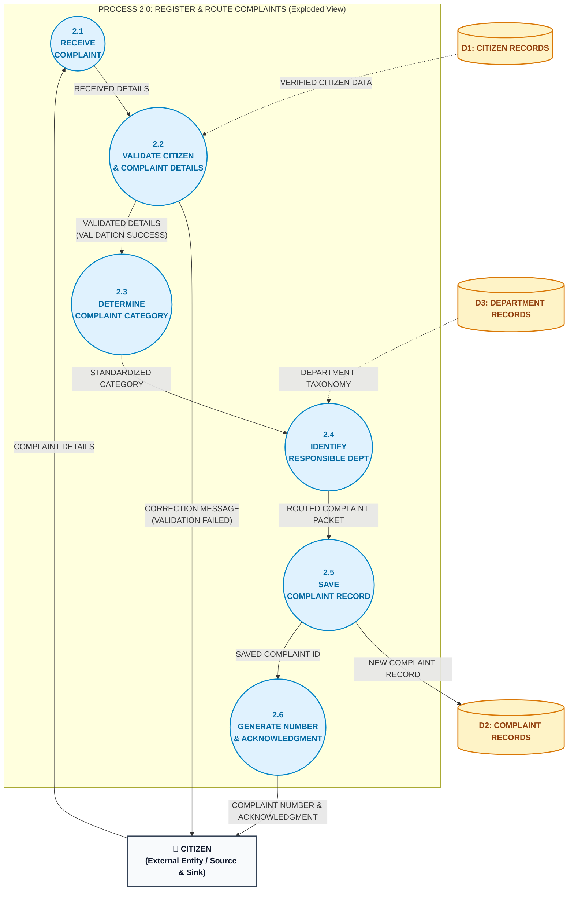

# Data Flow Diagram (DFD) — Level 2 (Process 2.0: Register & Route Complaints)

**Project**: Municipal Complaint Management System (MCMS)  
**Course**: Database Management Systems (DBMS) — University of Karachi (BSCS)  
**Course Textbook**: *Database Systems Textbook*, Chapter 4 (Database Design), Section 4.2.5.3 & 4.2.9.2  
**Author & Compiler**: Dr. S. M. Khalid  
**Standard**: Detailed Functional Decomposition & Structured English Mini-Specifications

---

## 1. Overview & Process Explosion Scope (Textbook Section 4.2.5.3)

The **Level 2 Data Flow Diagram** performs a controlled process explosion of parent process **`2.0 REGISTER & ROUTE COMPLAINTS`** into its six constituent sub-processes (`2.1` through `2.6`).

### Modeling Principles of Level 2 Functional Decomposition
1. **Ancestry & Traceability (Section 4.2.5.4)**: Sub-processes are numbered hierarchically (`2.1`, `2.2`, ..., `2.6`), explicitly indicating their lineage under parent process `2.0`. Decimal numbering signifies functional decomposition, not sequential program instruction counter.
2. **Conservation of Parent Boundary (Section 4.2.8)**: All inbound external flows (`COMPLAINT DETAILS`), inbound store reads (`D1`, `D3`), outbound store writes (`D2`), and outbound external flows (`COMPLAINT NUMBER & ACKNOWLEDGMENT`, `CORRECTION MESSAGE`) crossing `Process 2.0` in Level 1 must be strictly accounted for across the sub-processes.
3. **Structured English Mini-Specifications (Section 4.2.9.2)**: Each elementary sub-process is accompanied by an unambiguous procedural specification describing input consumption, decision rules, database transactions, and output production.

---

## 2. Visual Level 2 Diagram



---

## 3. Sub-Process Mini-Specifications (Structured English — Textbook Section 4.2.9.2)

### 3.1 Process 2.1: RECEIVE COMPLAINT
```
PROCESS 2.1: RECEIVE COMPLAINT
INPUT:
    Complaint_Details FROM CITIZEN
OUTPUT:
    Received_Details TO Process 2.2
PRECONDITION:
    Resident initiates grievance submission via web portal or API endpoint.
LOGIC:
    1. Parse inbound HTTP payload extracting:
       - Citizen_Phone
       - Category_Raw
       - Description
       - Incident_Location
    2. Attach system ingestion timestamp = CURRENT_TIMESTAMP.
    3. Package unvalidated data as Received_Details and forward to Process 2.2.
POSTCONDITION:
    Payload safely ingested into processing pipeline memory without modification.
```

---

### 3.2 Process 2.2: VALIDATE CITIZEN & COMPLAINT DETAILS
```
PROCESS 2.2: VALIDATE CITIZEN & COMPLAINT DETAILS
INPUT:
    Received_Details FROM Process 2.1
    Verified_Citizen_Data FROM D1: CITIZEN RECORDS
OUTPUT:
    Correction_Message TO CITIZEN (On Validation Failure)
    Validated_Details TO Process 2.3 (On Validation Success)
LOGIC:
    1. Lookup Citizen_Phone in D1: CITIZEN RECORDS:
       IF phone not found in D1 THEN
           EMIT Correction_Message(
               Error_Code = "ERR_CITIZEN_NOT_FOUND",
               Error_Field = "Citizen_Phone",
               Guidance_Text = "Phone number is not registered. Please create a citizen profile first."
           ) TO CITIZEN
           HALT SUB-PROCESS
       ENDIF
    2. Validate Description text:
       IF LENGTH(TRIM(Description)) < 10 THEN
           EMIT Correction_Message(
               Error_Code = "ERR_DESC_TOO_SHORT",
               Error_Field = "Description",
               Guidance_Text = "Complaint description must contain at least 10 characters."
           ) TO CITIZEN
           HALT SUB-PROCESS
       ENDIF
    3. Validate Incident_Location:
       IF TRIM(Incident_Location) IS EMPTY THEN
           EMIT Correction_Message(
               Error_Code = "ERR_LOCATION_REQUIRED",
               Error_Field = "Location",
               Guidance_Text = "Incident physical landmark or street address is mandatory."
           ) TO CITIZEN
           HALT SUB-PROCESS
       ENDIF
    4. Assemble Validated_Details(Citizen_ID, Category_Raw, Description, Incident_Location)
       and forward to Process 2.3.
POSTCONDITION:
    Resident verified against D1 and narrative conforms to municipal validation rules.
```

---

### 3.3 Process 2.3: DETERMINE COMPLAINT CATEGORY
```
PROCESS 2.3: DETERMINE COMPLAINT CATEGORY
INPUT:
    Validated_Details FROM Process 2.2
OUTPUT:
    Standardized_Category TO Process 2.4
LOGIC:
    1. Match Category_Raw against standardized municipal service taxonomy:
       EVALUATE Category_Raw:
           CASE "Water Leak", "Pipeline Burst", "Low Pressure", "Contaminated Water":
               Standardized_Category = "Water Supply & Sanitation"
           CASE "Pothole", "Broken Road", "Curb Damage", "Sidewalk Hazard":
               Standardized_Category = "Roads & Infrastructure Maintenance"
           CASE "Garbage Dumpster", "Illegal Refuse", "Dead Animal", "Drain Clogged":
               Standardized_Category = "Solid Waste Management"
           CASE "Streetlight Out", "Dark Corridor", "Exposed Cable", "Transformer Fault":
               Standardized_Category = "Street Lighting & Electricity"
           CASE "Mosquito Infestation", "Open Sewage", "Stagnant Water":
               Standardized_Category = "Public Health & Vector Control"
           CASE "Fallen Tree", "Park Bench Damaged", "Overgrown Shrubbery":
               Standardized_Category = "Parks & Urban Forestry"
           DEFAULT:
               Standardized_Category = TRIM(Category_Raw)
       END EVALUATE
    2. Forward Standardized_Category along with validated attributes to Process 2.4.
POSTCONDITION:
    Raw grievance classified under official municipal service taxonomy.
```

---

### 3.4 Process 2.4: IDENTIFY RESPONSIBLE DEPARTMENT
```
PROCESS 2.4: IDENTIFY RESPONSIBLE DEPARTMENT
INPUT:
    Standardized_Category FROM Process 2.3
    Department_Taxonomy FROM D3: DEPARTMENT RECORDS
OUTPUT:
    Routed_Complaint_Packet TO Process 2.5
LOGIC:
    1. Query D3: DEPARTMENT RECORDS WHERE Department_Name == Standardized_Category:
       IF matching record found THEN
           Set Target_Department_ID = matched.Department_ID
       ELSE
           Set Target_Department_ID = 1  // Default to General Municipal Administration
       ENDIF
    2. Assemble Routed_Complaint_Packet containing:
       - Citizen_ID
       - Target_Department_ID
       - Standardized_Category
       - Description
       - Incident_Location
    3. Forward Routed_Complaint_Packet to Process 2.5.
POSTCONDITION:
    Target department identifier bound to complaint packet.
```

---

### 3.5 Process 2.5: SAVE COMPLAINT RECORD
```
PROCESS 2.5: SAVE COMPLAINT RECORD
INPUT:
    Routed_Complaint_Packet FROM Process 2.4
OUTPUT:
    New_Complaint_Record TO D2: COMPLAINT RECORDS
    Saved_Complaint_ID TO Process 2.6
LOGIC:
    1. BEGIN DATABASE TRANSACTION (ACID ATOMIC):
       INSERT INTO D2: COMPLAINT RECORDS (
           Citizen_ID,
           Department_ID,
           Complaint_Date,
           Category,
           Description,
           Location,
           Status
       ) VALUES (
           packet.Citizen_ID,
           packet.Target_Department_ID,
           CURRENT_TIMESTAMP,
           packet.Standardized_Category,
           packet.Description,
           packet.Incident_Location,
           'Submitted'
       );
    2. RETRIEVE generated surrogate primary key AS Saved_Complaint_ID.
    3. COMMIT DATABASE TRANSACTION.
    4. Forward Saved_Complaint_ID to Process 2.6.
POSTCONDITION:
    Complaint permanently persisted in D2 with initial status 'Submitted'.
```

---

### 3.6 Process 2.6: GENERATE NUMBER & ACKNOWLEDGMENT
```
PROCESS 2.6: GENERATE NUMBER & ACKNOWLEDGMENT
INPUT:
    Saved_Complaint_ID FROM Process 2.5
OUTPUT:
    Complaint_Number_And_Acknowledgment TO CITIZEN
LOGIC:
    1. Construct citizen tracking reference:
       Complaint_Number = "K" + LPAD(Saved_Complaint_ID, 4, '0')
    2. Build official receipt payload:
       - Tracking_Ticket_Number = Complaint_Number
       - Status = "Submitted"
       - Submission_Date = CURRENT_TIMESTAMP
       - Message = "Your civic complaint has been registered and routed to the responsible department."
    3. Transmit HTTP 201 Created response to CITIZEN.
POSTCONDITION:
    Resident receives official tracking receipt.
```

---

## 4. Balancing Proof with Level 1 (Textbook Section 4.2.8)

Section 4.2.8 requires that all external flows and data store connections entering or leaving `Process 2.0` in Level 1 are conserved without loss or arbitrary additions.

| Level 1 Boundary Element of Process 2.0 | Level 2 Child Implementation | Balancing Status | Verification Evidence |
|---|---|---|---|
| **Inbound Flow**: `COMPLAINT DETAILS` (from Citizen) | Enters `2.1 RECEIVE COMPLAINT` from `CITIZEN` | **BALANCED** | Raw input consumed at pipeline entry. |
| **Inbound Store Read**: `VERIFIED CITIZEN DATA` (from D1) | Read by `2.2 VALIDATE CITIZEN & COMPLAINT DETAILS` from `D1` | **BALANCED** | Used for resident phone verification. |
| **Inbound Store Read**: `DEPARTMENT TAXONOMY` (from D3) | Read by `2.4 IDENTIFY RESPONSIBLE DEPT` from `D3` | **BALANCED** | Used for automated department matching. |
| **Outbound Store Write**: `NEW COMPLAINT RECORD` (to D2) | Written by `2.5 SAVE COMPLAINT RECORD` to `D2` | **BALANCED** | Atomic INSERT into transactional ledger. |
| **Outbound Flow**: `COMPLAINT NUMBER & ACKNOWLEDGMENT` (to Citizen) | Emitted by `2.6 GENERATE NUMBER & ACKNOWLEDGMENT` to `CITIZEN` | **BALANCED** | Instant tracking receipt returned upon success. |
| **Outbound Flow**: `CORRECTION MESSAGE` (to Citizen) | Emitted by `2.2 VALIDATE CITIZEN & COMPLAINT DETAILS` to `CITIZEN` | **BALANCED** | Validation failure feedback returned to resident. |

---

## 5. Quality & Defect Prevention Checklist (Textbook Section 4.2.7 & 4.2.10)

* [x] **No Black Holes**: Every sub-process (`2.1` to `2.6`) produces either an outbound flow to the next step, a data store write, or feedback to the external entity.
* [x] **No Miracles**: Every sub-process receives input from its preceding sibling or an authoritative data store read.
* [x] **No Gray Holes**: Sub-process `2.5` has all required fields (`Citizen_ID`, `Target_Department_ID`, `Category`, `Description`, `Location`) supplied by `2.4` to generate the complete `D2` record.
* [x] **No Store-to-Store Violations**: No data moves directly between `D1`, `D3`, and `D2`; all persistence is driven by intervening sub-processes.

---

## 6. Related Modeling Deliverables
* 🌐 **[DFD Level 0 (Context Diagram)](dfd_level_0.md)** — Highest-level operational boundary.
* 🔀 **[DFD Level 1 (Diagram 0)](dfd_level_1.md)** — Functional decomposition into processes `1.0` to `5.0`.
* 📊 **[Entity-Relationship Diagram (ERD)](erd.md)** — Conceptual schema and structural constraints.
* 🕸️ **[Semantic Net (Occurrence Level)](semantic_net.md)** — Occurrence-level validation and connection trap audit.
* 📑 **[Master Modeling README](README.md)** — Consolidated system documentation and data dictionary.
