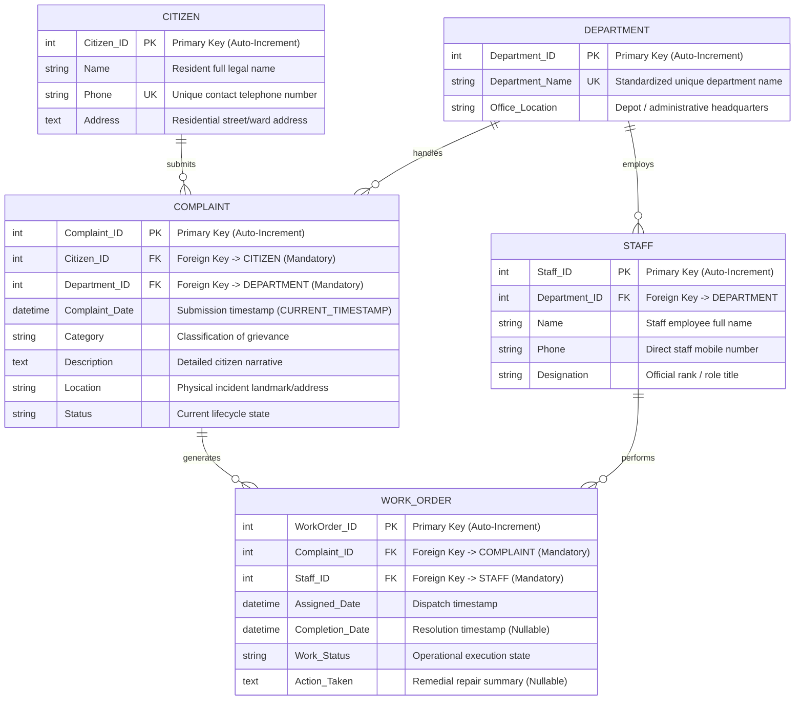
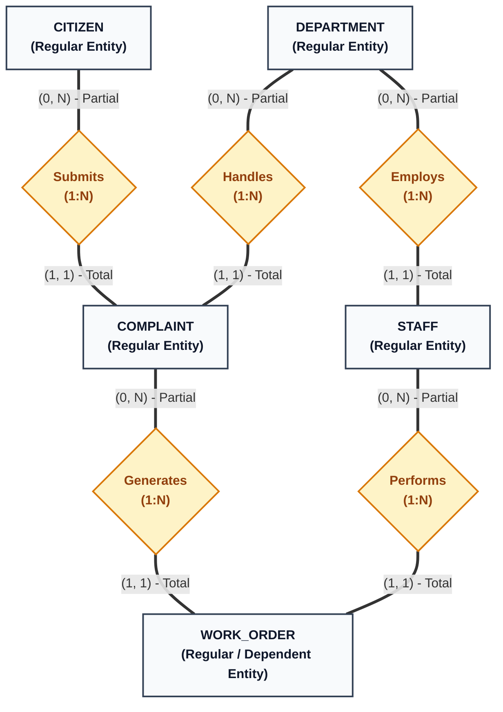
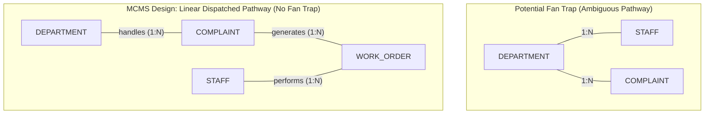
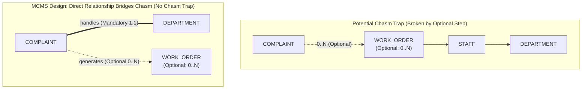

# Entity-Relationship Diagram (ERD) & Conceptual Modeling

**Project**: Municipal Complaint Management System (MCMS)  
**Course**: Database Management Systems (DBMS) — University of Karachi (BSCS)  
**Course Textbook**: *Database Systems Textbook*, Chapter 4 (Database Design), Sections 4.3, 4.4, 4.6, 4.7, 4.9, 4.10  
**Author & Compiler**: Dr. S. M. Khalid  
**Design Standards**: Crow's Foot / Information Engineering (IE) Notation, Chen-Style Conceptual Semantics, 3rd Normal Form (3NF)

---

## 1. Visual ER Diagrams (Textbook Section 4.9)

### 1.1 Primary Representation: Crow's Foot / Information Engineering (IE) Notation

---

### 1.2 Conceptual Representation: Chen-Style ER Notation (Textbook Section 4.9.2)

Per Section 4.9.2 of the textbook, Chen notation gives conceptual relationships an explicit first-class visual object (diamonds), isolates entities (rectangles), attributes (ovals with primary keys underlined), and structural constraints:

---

## 2. Notation & Symbol Crosswalk (Textbook Section 4.9.5)

| Semantic Meaning | Chen / Source Style | Crow's Foot / IE | Barker Notation | UML Multiplicity | MCMS Implementation |
|---|---|---|---|---|---|
| **Mandatory Exactly One** | `(1, 1)` / Double line to diamond | `\|\|` (One and Only One) | Solid segment ending at bar | `1` or `1..1` | Parent link for Complaint/WorkOrder |
| **Optional Zero or Many** | `(0, N)` / Single line to diamond | `o{` (Zero or Many) | Dashed segment ending at crow's foot | `0..*` or `*` | Citizen submitting complaints |
| **Mandatory One or Many** | `(1, N)` / Double line to diamond | `\|{` (One or Many) | Solid segment ending at crow's foot | `1..*` | Not used (avoids insertion locks) |
| **Primary Key** | Underlined attribute name | `PK` marker | `#` prefix | `{id}` or underlined | Unique surrogate row identifier |
| **Foreign Key** | Role label / FK notation | `FK` marker | `(FK)` indicator | Association endpoint | Referential integrity constraint |
| **Unique Key** | `(UK)` label | `UK` marker | `unique` constraint | `{unique}` | Candidate key enforcement |

---

## 3. Entity & Attribute Specifications (Textbook Section 4.3.4 & 4.3.5)

### 3.1 CITIZEN (Regular / Strong Entity)
Represents verified residents lodging civic grievances within the municipal jurisdiction.
* **`Citizen_ID`** `[PK, INT, AUTO_INCREMENT]`: Unique surrogate primary key.
* **`Name`** `[VARCHAR(100), NOT NULL]`: Full legal name of the resident.
* **`Phone`** `[UK, VARCHAR(20), NOT NULL]`: Unique contact number used for authentication and status inquiries.
* **`Address`** `[TEXT, NOT NULL]`: Physical residential street address, landmark, or ward.

### 3.2 DEPARTMENT (Regular / Strong Entity)
Represents official municipal administrative and maintenance branches.
* **`Department_ID`** `[PK, INT, AUTO_INCREMENT]`: Unique surrogate primary key.
* **`Department_Name`** `[UK, VARCHAR(100), NOT NULL]`: Standardized department title (e.g., *Water Supply & Sanitation*, *Roads & Infrastructure Maintenance*, *Solid Waste Management*).
* **`Office_Location`** `[VARCHAR(200), NOT NULL]`: Physical depot, building, or regional headquarters address.

### 3.3 STAFF (Regular / Strong Entity)
Represents municipal departmental employees, supervisors, and field technicians.
* **`Staff_ID`** `[PK, INT, AUTO_INCREMENT]`: Unique employee surrogate primary key.
* **`Department_ID`** `[FK, INT, NOT NULL]`: Foreign key referencing parent `DEPARTMENT(Department_ID)`.
* **`Name`** `[VARCHAR(100), NOT NULL]`: Full legal employee name.
* **`Phone`** `[VARCHAR(20), NOT NULL]`: Contact telephone number for dispatch communications.
* **`Designation`** `[VARCHAR(100), NOT NULL]`: Official organizational rank (e.g., *Lead Inspector*, *Field Technician*).

### 3.4 COMPLAINT (Regular / Strong Entity)
Represents official civic grievances submitted by residents.
* **`Complaint_ID`** `[PK, INT, AUTO_INCREMENT]`: Unique tracking ticket number.
* **`Citizen_ID`** `[FK, INT, NOT NULL]`: Mandatory foreign key referencing submitter `CITIZEN(Citizen_ID)`.
* **`Department_ID`** `[FK, INT, NOT NULL]`: Mandatory foreign key referencing assigned `DEPARTMENT(Department_ID)`.
* **`Complaint_Date`** `[DATETIME, NOT NULL]`: Automatic submission timestamp (`CURRENT_TIMESTAMP`).
* **`Category`** `[VARCHAR(100), NOT NULL]`: Classification of grievance.
* **`Description`** `[TEXT, NOT NULL]`: Narrative text detailing the civic issue (minimum 10 characters).
* **`Location`** `[VARCHAR(255), NOT NULL]`: Physical location or landmark where the incident occurred.
* **`Status`** `[VARCHAR(50), NOT NULL]`: Lifecycle state (`'Submitted'`, `'Categorized'`, `'Assigned'`, `'In Progress'`, `'Resolved'`, `'Verified'`, `'Closed'`, `'Rejected'`).

### 3.5 WORK_ORDER (Existence-Dependent Entity)
Represents concrete field job orders dispatched to departmental technicians to remediate a complaint.
* **`WorkOrder_ID`** `[PK, INT, AUTO_INCREMENT]`: Unique job ticket primary key.
* **`Complaint_ID`** `[FK, INT, NOT NULL]`: Mandatory parent foreign key referencing `COMPLAINT(Complaint_ID)`.
* **`Staff_ID`** `[FK, INT, NOT NULL]`: Mandatory foreign key referencing assigned technician `STAFF(Staff_ID)`.
* **`Assigned_Date`** `[DATETIME, NOT NULL]`: Timestamp when work order was dispatched.
* **`Completion_Date`** `[DATETIME, NULL]`: Timestamp when technician finished repairs on-site (nullable until completed).
* **`Work_Status`** `[VARCHAR(50), NOT NULL]`: Lifecycle state (`'Assigned'`, `'In Progress'`, `'Completed'`, `'On Hold'`, `'Cancelled'`).
* **`Action_Taken`** `[TEXT, NULL]`: Summary of diagnostic findings and physical repairs executed (nullable until updated).

---

## 4. Structural Constraints & Business Rules (Textbook Section 4.4)

| Parent Entity | Relationship Verb | Child Entity | Cardinality Ratio | Structural Constraint `(min, max)` | Delete Rule | Referential Semantics |
|---|---|---|---|---|---|---|
| **CITIZEN** | *submits* | **COMPLAINT** | `1 : N` | Citizen: `(0, N)` Complaint: `(1, 1)` | `ON DELETE RESTRICT` | A citizen may submit 0 or many complaints. Every complaint must be owned by exactly 1 citizen. Registered residents with active complaints cannot be deleted. |
| **DEPARTMENT** | *handles* | **COMPLAINT** | `1 : N` | Dept: `(0, N)` Complaint: `(1, 1)` | `ON DELETE RESTRICT` | A department handles 0 or many complaints. Every complaint must be routed to exactly 1 department. Active departments cannot be dropped. |
| **DEPARTMENT** | *employs* | **STAFF** | `1 : N` | Dept: `(0, N)` Staff: `(1, 1)` | `ON DELETE RESTRICT` | A department employs 0 or many staff members. Every staff member belongs to exactly 1 department. |
| **COMPLAINT** | *generates* | **WORK_ORDER** | `1 : N` | Complaint: `(0, N)` WorkOrder: `(1, 1)` | `ON DELETE CASCADE` | A complaint initially has 0 work orders upon submission; work orders exist only after supervisor dispatch. Deleting a test complaint cascades to purge linked work orders. |
| **STAFF** | *performs* | **WORK_ORDER** | `1 : N` | Staff: `(0, N)` WorkOrder: `(1, 1)` | `ON DELETE RESTRICT` | A staff member performs 0 or many work orders. Every work order is assigned to exactly 1 technician. Technicians with assigned active work cannot be deleted. |

---

## 5. Weak Entities & Existence Dependency (Textbook Section 4.6)

Section 4.6 distinguishes between **Existence Dependency** and **Identifier Dependency**:
- **Existence Dependency (Section 4.6.1)**: An entity `WORK_ORDER` is existence-dependent on `COMPLAINT` because a work order cannot exist without a parent complaint. If the complaint ceases to exist, the work order is meaningless.
- **Identifier Dependency vs. Surrogate Key (Section 4.6.2 & 4.6.5)**:
  - In pure classical weak entity modeling, a child entity lacks its own primary key and borrows the parent's key as a composite key (`(Complaint_ID, Order_Seq_No)`).
  - In modern transactional systems (Section 4.6.5: *"Existence-dependent does not necessarily mean weak"*), assigning a surrogate primary key (`WorkOrder_ID`) is the recommended engineering standard. It preserves existence dependency through a mandatory foreign key constraint (`Complaint_ID NOT NULL REFERENCES COMPLAINT ON DELETE CASCADE`) while facilitating efficient foreign key referencing and indexing.

---

## 6. Connection Traps Audit (Textbook Section 4.7)

Section 4.7 of Dr. S. M. Khalid's textbook identifies two critical semantic traps that can render a database design ambiguous or incapable of answering valid enterprise questions: the **Fan Trap** (Section 4.7.5) and the **Chasm Trap** (Section 4.7.6).

### 6.1 Fan Trap Audit (Textbook Section 4.7.5)

* **The Fan Trap Threat**: Occurs when two `1:M` relationships fan out from a single common central entity (`STAFF <--- 1:N --- DEPARTMENT --- 1:N ---> COMPLAINT`). If an analyst attempts to determine which staff member worked on which complaint through `DEPARTMENT`, the path is ambiguous because one department employs many staff and handles many complaints.
* **MCMS Resolution**: In MCMS, staff assignment is **never inferred** through `DEPARTMENT`. Instead, staff is explicitly linked to complaints through the associative entity `WORK_ORDER`:
  $$\text{COMPLAINT} \xrightarrow{1:N} \text{WORK\_ORDER} \xleftarrow{1:N} \text{STAFF}$$
  This creates an unambiguous linear path: each work order identifies both the exact complaint ticket and the specific assigned technician. Thus, **no Fan Trap exists**.

---

### 6.2 Chasm Trap Audit (Textbook Section 4.7.6)

* **The Chasm Trap Threat**: Occurs when a model suggests that a pathway exists between two entity types, but the pathway traverses an intermediate relationship with **optional/partial participation (`0..N`)**, breaking the connection for valid unassigned occurrences.
* If a complaint's department was only discoverable through its assigned work order technician (`COMPLAINT -> WORK_ORDER -> STAFF -> DEPARTMENT`), newly submitted tickets (which have `0` work orders) would suffer a broken pathway and could never determine their department!
* **MCMS Resolution**: In strict adherence to Section 4.7.6.3 ("*Adding the Missing Direct Relationship*"), MCMS maintains a direct, mandatory relationship between `COMPLAINT` and `DEPARTMENT`:
  $$\text{COMPLAINT} \xrightarrow{\text{handles (1:1)}} \text{DEPARTMENT}$$
  Even when a complaint has zero work orders (`WorkOrders(k) = ∅`), its department is immediately and authoritatively known. Thus, **no Chasm Trap exists**.

---

## 7. Relational Mapping & Transformation (Textbook Section 4.10)

Applying the 3NF transformation rules from Section 4.10 yields five relations:

1. **`CITIZEN`** (`Citizen_ID` [PK], `Name`, `Phone` [UK], `Address`)
2. **`DEPARTMENT`** (`Department_ID` [PK], `Department_Name` [UK], `Office_Location`)
3. **`STAFF`** (`Staff_ID` [PK], *`Department_ID`* [FK], `Name`, `Phone`, `Designation`)
4. **`COMPLAINT`** (`Complaint_ID` [PK], *`Citizen_ID`* [FK], *`Department_ID`* [FK], `Complaint_Date`, `Category`, `Description`, `Location`, `Status`)
5. **`WORK_ORDER`** (`WorkOrder_ID` [PK], *`Complaint_ID`* [FK], *`Staff_ID`* [FK], `Assigned_Date`, `Completion_Date`, `Work_Status`, `Action_Taken`)

All foreign keys enforce strict referential integrity with declarative delete behaviors matching organizational governance.

---

## 8. Related Modeling Deliverables
* 🌐 **[DFD Level 0 (Context Diagram)](dfd_level_0.md)** — Highest-level operational boundary.
* 🔀 **[DFD Level 1 (Diagram 0)](dfd_level_1.md)** — Functional decomposition into processes `1.0` to `5.0`.
* 🔍 **[DFD Level 2 (Process 2.0)](dfd_level_2.md)** — Child explosion of `Process 2.0` with mini-specs.
* 🕸️ **[Semantic Net (Occurrence Level)](semantic_net.md)** — Occurrence-level validation and connection trap audit.
* 📑 **[Master Modeling README](README.md)** — Consolidated system documentation and data dictionary.
