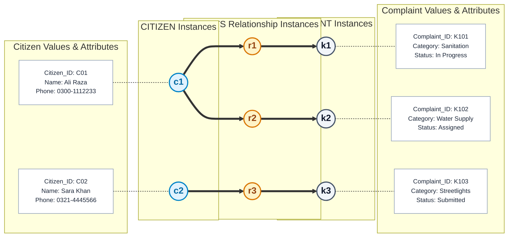
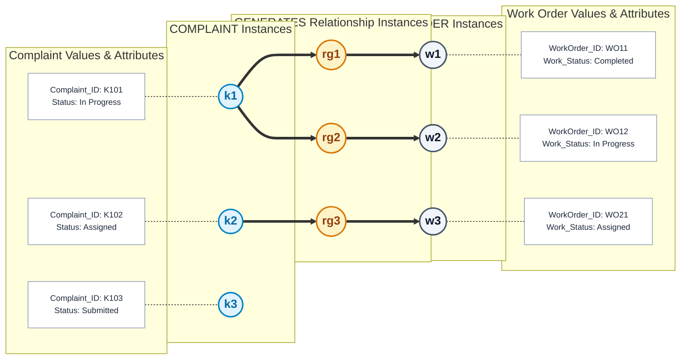
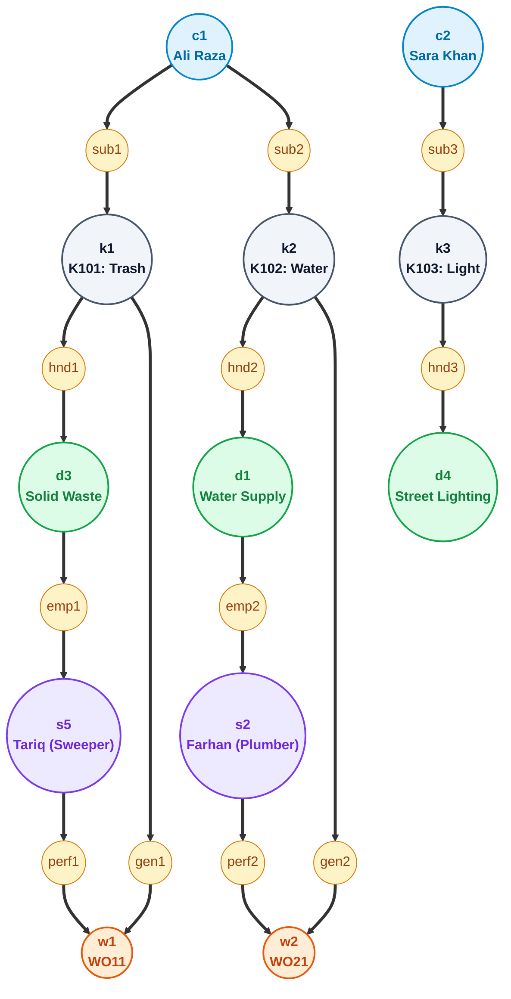

# Semantic Net (Occurrence Level) & Diagnostic Validation

**Project**: Municipal Complaint Management System (MCMS)  
**Course**: Database Management Systems (DBMS) — University of Karachi (BSCS)  
**Course Textbook**: *Database Systems Textbook*, Chapter 4 (Database Design), Section 4.5 & 4.7.4  
**Author & Compiler**: Dr. S. M. Khalid  
**Standard**: Occurrence-Level Semantic Modeling & Diagnostic Query Path Validation

---

## 1. Conceptual Foundation (Textbook Section 4.5.1)

While an **Entity-Relationship Diagram (ERD)** defines schema-level abstractions and invariants (**intension**), a **Semantic Net at the occurrence level** visualizes a concrete sample population (**extension**).

Per Section 4.5 of Dr. S. M. Khalid's textbook:
* **Pedagogical & Diagnostic Role (Section 4.5.1.4 & 4.7.4)**: An occurrence-level network allows modelers and stakeholders to test whether declared structural constraints (cardinality ratios and participation rules) hold true when real-world instances are populated, and whether enterprise queries can be answered without ambiguity.
* **Textbook Multi-Column Architecture (Section 4.5.2 & Figures 4.18–4.21)**:
  - **Entity Occurrences**: Distinct oval nodes (`c1`, `k1`, `d1`, `s1`, `w1`) representing discrete entity instances.
  - **Relationship Occurrences**: Dedicated intermediate nodes (`r1`, `r2`, ...) representing specific relationship instances.
  - **Attribute Valuation**: Attribute names and concrete values displayed adjacent to entity instances.
  - **Participant Paths**: Directed vectors traversing `Entity Occurrence ➔ Relationship Occurrence ➔ Entity Occurrence`.
  - **Demonstration of Partial Participation (Section 4.5.6)**: Non-participating entity instances remain visible inside the entity oval with **zero connecting edges**, providing concrete visual proof of optional `(0, N)` participation.

---

## 2. Figure A: 1:N Submits Relationship (Textbook Figure 4.20 Standard)

### 2.1 Description & Rules Illustrated
Demonstrates that resident `c1` (*Ali Raza*) submits two distinct complaints (`k1` and `k2`), while resident `c2` (*Sara Khan*) submits complaint `k3`.
* **Cardinality (`1 : N`)**: Multiple paths diverge from `c1`, but each complaint node (`k1`, `k2`, `k3`) has an indegree of exactly `1`.
* **Total Participation on Complaint Side (`1, 1`)**: Every complaint node is connected to exactly one relationship occurrence. No orphaned complaints can exist.

### 2.2 Visual Semantic Network (Figure A)

### 2.3 Occurrence Mapping Table (Figure A)

| Path ID | Citizen Instance (`ci`) | Citizen Values | Relationship (`ri`) | Complaint Instance (`ki`) | Complaint Values | Rule Validated |
|---|---|---|---|---|---|---|
| **Path 1** | `c1` | `C01`, Ali Raza | `r1` | `k1` | `K101`, Sanitation | Citizen submits first complaint |
| **Path 2** | `c1` | `C01`, Ali Raza | `r2` | `k2` | `K102`, Water Supply | Same citizen `c1` submits second complaint (`1 → N`) |
| **Path 3** | `c2` | `C02`, Sara Khan | `r3` | `k3` | `K103`, Streetlights | Citizen `c2` submits third complaint |

---

## 3. Figure B: 1:N Generates Relationship & Partial Participation (Textbook Section 4.5.6)

### 3.1 Description & Rules Illustrated
Demonstrates that complaint `k1` (*Sanitation*) has generated two work orders (`w1` and `w2`), complaint `k2` (*Water Supply*) has generated one work order (`w3`), while complaint `k3` (*Submitted*) has generated **zero work orders**.
* **Optional / Partial Participation on Complaint Side (`0..N`)**: Entity instance `k3` appears inside the Complaint set with **zero outgoing relationship edges**, visually illustrating that complaints exist in the initial submission state without requiring work orders.
* **Mandatory Participation on Work Order Side (`1..1`)**: Every work order node (`w1`, `w2`, `w3`) connects to exactly one parent complaint.

### 3.2 Visual Semantic Network (Figure B)

### 3.3 Occurrence Mapping Table (Figure B)

| Path ID | Complaint Instance (`ki`) | Complaint Status | Relationship (`ri`) | Work Order (`wi`) | Work Order Status | Rule Validated |
|---|---|---|---|---|---|---|
| **Path 1** | `k1` | `K101`, In Progress | `rg1` | `w1` | `WO11`, Completed | Initial remediation task completed |
| **Path 2** | `k1` | `K101`, In Progress | `rg2` | `w2` | `WO12`, In Progress | Second active task on same ticket (`1 → N`) |
| **Path 3** | `k2` | `K102`, Assigned | `rg3` | `w3` | `WO21`, Assigned | Single field job order assigned |
| **(None)** | `k3` | `K103`, Submitted | *(None)* | *(None)* | *(None)* | **Zero work orders**: Validates `0..N` partial participation |

---

## 4. Figure C: Master Multi-Entity Occurrence Network (Textbook Section 4.5.9)

Figure C integrates all five database entities across the enterprise domain, illustrating concrete inter-entity connectivity and validating complex multi-hop queries:

---

## 5. Diagnostic Query Traversals & Trap Audit (Textbook Section 4.7.4, 4.7.5, 4.7.6)

Section 4.7 mandates testing the conceptual model against representative business questions using occurrence paths:

### 5.1 Query 1: Department Attribution for Citizen Grievance
* **Question**: *"Which municipal department is responsible for complaint K101 submitted by citizen Ali Raza (c1)?"*
* **Occurrence Path**:
  $$\text{c1} \xrightarrow{\text{sub1}} \text{k1} \xrightarrow{\text{hnd1}} \text{d3} \quad (\text{Solid Waste Management})$$
* **Outcome**: Single unambiguous path. Resolves directly in 2 hops without guessing.

### 5.2 Query 2: Technician Identification for Dispatched Ticket
* **Question**: *"Which technician executed work order WO11 for complaint K101?"*
* **Occurrence Path**:
  $$\text{k1} \xrightarrow{\text{gen1}} \text{w1} \xleftarrow{\text{perf1}} \text{s5} \quad (\text{Tariq - Field Technician})$$
* **Outcome**: Resolves unambiguously through the `WORK_ORDER` associative entity.

### 5.3 Diagnostic Proof: Absence of Fan Trap (Section 4.7.5)
* **Trap Scenario**: If technician assignment were queried through department (`k1 -> d3 -> s5`), a Fan Trap would exist because department `d3` employs multiple staff members.
* **Occurrence Evidence**: In Figure C, `k1` connects to `s5` **only through work order `w1`**, not through `d3`. The model guarantees an unambiguous pairing between technician and ticket.

### 5.4 Diagnostic Proof: Absence of Chasm Trap (Section 4.7.6)
* **Trap Scenario**: If a complaint's department was discovered through staff/work orders (`k3 -> w? -> s? -> d?`), unassigned ticket `k3` would be marooned with no path to a department because it has `0` work orders.
* **Occurrence Evidence**: In Figure C, complaint `k3` has a direct, unbroken relationship path `k3 ==> hnd3 ==> d4` (*Street Lighting*), proving that department routing is independent of staff allocation. **No Chasm Trap exists.**

---

## 6. Formal Relational Semantics (Textbook Section 4.5.3 & 4.10)

### 6.1 Submits Mapping
$$\text{Submits} \subseteq \text{CITIZEN} \times \text{COMPLAINT}$$
$$\forall k \in \text{COMPLAINT}, \quad \exists! c \in \text{CITIZEN} \quad \text{such that} \quad (c, k) \in \text{Submits}$$
* **Functional Dependency**: $\text{Complaint\_ID} \rightarrow \text{Citizen\_ID}$

### 6.2 Handles Mapping
$$\text{Handles} \subseteq \text{DEPARTMENT} \times \text{COMPLAINT}$$
$$\forall k \in \text{COMPLAINT}, \quad \exists! d \in \text{DEPARTMENT} \quad \text{such that} \quad (d, k) \in \text{Handles}$$
* **Functional Dependency**: $\text{Complaint\_ID} \rightarrow \text{Department\_ID}$

### 6.3 Generates Mapping
$$\text{Generates} \subseteq \text{COMPLAINT} \times \text{WORK\_ORDER}$$
$$\forall w \in \text{WORK\_ORDER}, \quad \exists! k \in \text{COMPLAINT} \quad \text{such that} \quad (k, w) \in \text{Generates}$$
* **Functional Dependency**: $\text{WorkOrder\_ID} \rightarrow \text{Complaint\_ID}$

---

## 7. Related Modeling Deliverables
* 🌐 **[DFD Level 0 (Context Diagram)](dfd_level_0.md)** — Highest-level operational boundary.
* 🔀 **[DFD Level 1 (Diagram 0)](dfd_level_1.md)** — Functional decomposition into processes `1.0` to `5.0`.
* 🔍 **[DFD Level 2 (Process 2.0)](dfd_level_2.md)** — Child explosion of `Process 2.0` with mini-specs.
* 📊 **[Entity-Relationship Diagram (ERD)](erd.md)** — Conceptual schema and structural constraints.
* 📑 **[Master Modeling README](README.md)** — Consolidated system documentation and data dictionary.
