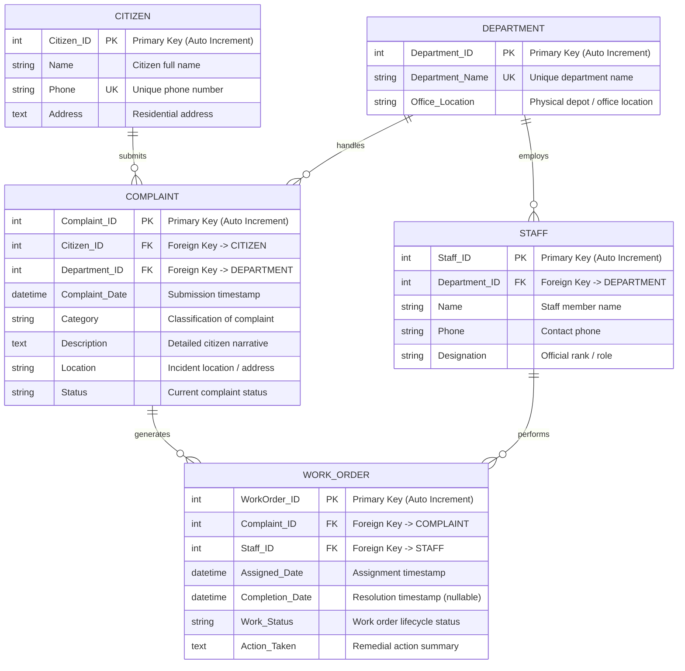

# Entity-Relationship Diagram (ERD)

**Project**: Municipal Complaint Management System (MCMS)  
**Standard**: Crow's Foot Notation | 3rd Normal Form (3NF)  
**Course Reference**: University of Karachi — BS Computer Science — Database Management Systems (DBMS)

---

## 1. Visual ER Diagram

---

## 2. Notation & Symbol Legend

| Symbol | Syntax | Meaning | Cardinality / Modality |
|---|---|---|---|
| `\|\|` | Exactly One | Mandatory entity participation | $1..1$ |
| `o{` or `>o` | Zero or Many | Optional entity participation (Crow's foot) | $0..N$ |
| `\|{` | One or Many | Mandatory entity participation with multiple rows | $1..N$ |
| **PK** | Primary Key | Unique, non-null row identifier | Unique |
| **FK** | Foreign Key | References primary key of a parent entity | Referential |
| **UK** | Unique Key | Unique constraint across table rows | Unique |

---

## 3. Entity & Attribute Specifications

### 3.1 CITIZEN
Represents individual residents submitting civic issues.
* **`Citizen_ID`** `[PK, INT, AUTO_INCREMENT]`: Unique surrogate key for each registered citizen.
* **`Name`** `[VARCHAR(100), NOT NULL]`: Full name of the resident.
* **`Phone`** `[UK, VARCHAR(20), NOT NULL]`: Unique telephone/mobile number used for authentication and tracking.
* **`Address`** `[TEXT, NOT NULL]`: Residential physical address.

### 3.2 DEPARTMENT
Represents official municipal branches managing civic services.
* **`Department_ID`** `[PK, INT, AUTO_INCREMENT]`: Unique identifier for each municipal department.
* **`Department_Name`** `[UK, VARCHAR(100), NOT NULL]`: Standardized department name (e.g., *Water Supply & Sanitation*, *Roads & Infrastructure Maintenance*).
* **`Office_Location`** `[VARCHAR(200), NOT NULL]`: Headquarters, office building, or depot address.

### 3.3 STAFF
Represents departmental supervisors and field technicians.
* **`Staff_ID`** `[PK, INT, AUTO_INCREMENT]`: Unique employee identifier.
* **`Department_ID`** `[FK, INT, NOT NULL]`: Foreign key referencing `DEPARTMENT(Department_ID)`.
* **`Name`** `[VARCHAR(100), NOT NULL]`: Employee's full name.
* **`Phone`** `[VARCHAR(20), NOT NULL]`: Direct contact number.
* **`Designation`** `[VARCHAR(100), NOT NULL]`: Official title (e.g., *Lead Inspector*, *Field Technician*).

### 3.4 COMPLAINT
Represents grievances registered by citizens.
* **`Complaint_ID`** `[PK, INT, AUTO_INCREMENT]`: Unique complaint tracking ID.
* **`Citizen_ID`** `[FK, INT, NOT NULL]`: Mandatory link to the reporting `CITIZEN(Citizen_ID)`.
* **`Department_ID`** `[FK, INT, NOT NULL]`: Mandatory link to the responsible `DEPARTMENT(Department_ID)`.
* **`Complaint_Date`** `[TIMESTAMP, NOT NULL]`: Automatic timestamp upon submission.
* **`Category`** `[VARCHAR(100), NOT NULL]`: Complaint classification.
* **`Description`** `[TEXT, NOT NULL]`: Detailed explanation of the grievance.
* **`Location`** `[VARCHAR(255), NOT NULL]`: Landmark, street address, or ward.
* **`Status`** `[VARCHAR(50), NOT NULL]`: Allowed values: `'Submitted'`, `'Categorized'`, `'Assigned'`, `'In Progress'`, `'Resolved'`, `'Verified'`, `'Closed'`, `'Rejected'`.

### 3.5 WORK_ORDER
Represents job tickets dispatched to field staff.
* **`WorkOrder_ID`** `[PK, INT, AUTO_INCREMENT]`: Unique job ticket reference.
* **`Complaint_ID`** `[FK, INT, NOT NULL]`: Mandatory parent link to `COMPLAINT(Complaint_ID)`.
* **`Staff_ID`** `[FK, INT, NOT NULL]`: Mandatory technician link to `STAFF(Staff_ID)`.
* **`Assigned_Date`** `[TIMESTAMP, NOT NULL]`: Dispatch date.
* **`Completion_Date`** `[TIMESTAMP, NULL]`: Completion date, set when work is finished.
* **`Work_Status`** `[VARCHAR(50), NOT NULL]`: Allowed values: `'Assigned'`, `'In Progress'`, `'Completed'`, `'On Hold'`, `'Cancelled'`.
* **`Action_Taken`** `[TEXT, NULL]`: Summary of repair actions executed on site.

---

## 4. Relationship & Cardinality Rules

| Parent Entity | Verb | Child Entity | Cardinality | Parent Participation | Child Participation | Delete Rule |
|---|---|---|---|---|---|---|
| **CITIZEN** | *submits* | **COMPLAINT** | `1 : N` | Optional ($0..N$) | Mandatory ($1..1$) | `ON DELETE RESTRICT` |
| **DEPARTMENT** | *handles* | **COMPLAINT** | `1 : N` | Optional ($0..N$) | Mandatory ($1..1$) | `ON DELETE RESTRICT` |
| **DEPARTMENT** | *employs* | **STAFF** | `1 : N` | Optional ($0..N$) | Mandatory ($1..1$) | `ON DELETE RESTRICT` |
| **COMPLAINT** | *generates* | **WORK_ORDER** | `1 : N` | Optional ($0..N$) | Mandatory ($1..1$) | `ON DELETE CASCADE` |
| **STAFF** | *performs* | **WORK_ORDER** | `1 : N` | Optional ($0..N$) | Mandatory ($1..1$) | `ON DELETE RESTRICT` |

### Key Invariants
1. **Mandatory Ownership**: Every complaint must trace back to exactly one registered citizen.
2. **Mandatory Department Routing**: Every complaint must be assigned to exactly one municipal department.
3. **Deferred Work Order Generation**: A complaint initially has zero work orders; work orders exist only after a department supervisor assigns staff.
4. **Referential Integrity**: Citizens and Departments with active complaints or staff cannot be deleted (`ON DELETE RESTRICT`). Deleting a complaint automatically purges linked work orders (`ON DELETE CASCADE`).

---

## Related Diagrams
- [Semantic Net (Occurrence Level)](semantic_net.md)
- [DFD Level 0 (Context Diagram)](dfd_level_0.md)
- [DFD Level 1 (Diagram 0)](dfd_level_1.md)
- [DFD Level 2 (Process 2.0)](dfd_level_2.md)
