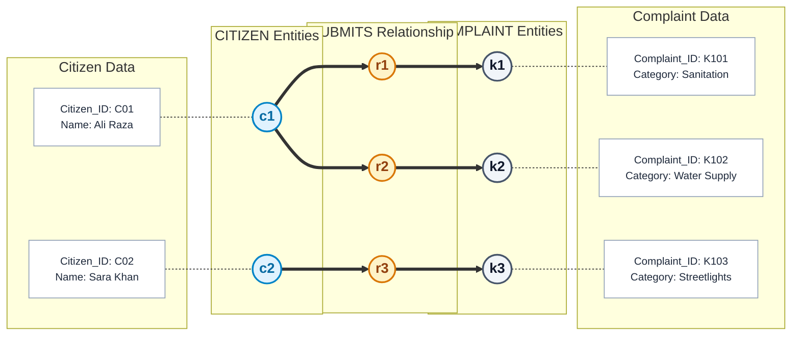
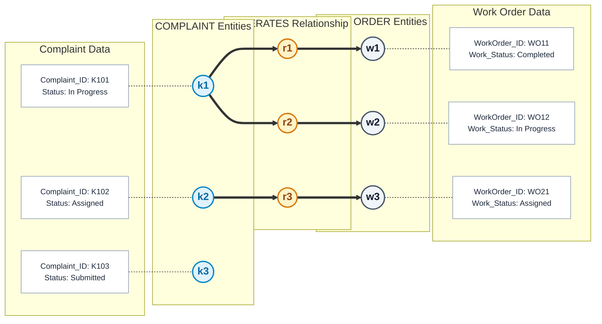

# Semantic Net (Occurrence Level)

**Project**: Municipal Complaint Management System (MCMS)  
**Standard**: Occurrence-Level Semantic Modeling | Binary Relationship Populations  
**Course Reference**: University of Karachi — BS Computer Science — Database Management Systems (DBMS)

---

## 1. Conceptual Foundation

While an Entity-Relationship Diagram (ERD) defines the **schema-level rules** (intension), a **Semantic Net at the occurrence level** visualizes a **sample population** (extension). It validates declared $1:N$ relationships by mapping concrete entity instances and relationship occurrences:

* **Oval / Boundary**: Represents a set of occurrences (e.g., all citizen instances or all relationship instances).
* **Dot / Node**: Represents one discrete occurrence (entity or relationship).
* **Path (Entity $\to$ Relationship $\to$ Entity)**: Represents one discrete relationship occurrence.

---

## 2. Figure A: 1:N Submits Relationship

### 2.1 Description
Illustrates that citizen $c_1$ (`Ali Raza`) submits two complaints ($k_1, k_2$), while citizen $c_2$ (`Sara Khan`) submits complaint $k_3$. Each complaint is connected to **exactly one** citizen.

### 2.2 Visual Semantic Network

### 2.3 Occurrence Mapping Table (Figure A)

| Path ID | Citizen Entity ($c_i$) | Citizen Values | Relationship ($r_i$) | Complaint Entity ($k_i$) | Complaint Values | Rule Demonstrated |
|---|---|---|---|---|---|---|
| **Path 1** | $c_1$ | `C01`, Ali Raza | $r_1$ | $k_1$ | `K101`, Sanitation | One citizen submits first complaint |
| **Path 2** | $c_1$ | `C01`, Ali Raza | $r_2$ | $k_2$ | `K102`, Water Supply | Same citizen ($c_1$) submits second complaint |
| **Path 3** | $c_2$ | `C02`, Sara Khan | $r_3$ | $k_3$ | `K103`, Streetlights | Citizen $c_2$ submits third complaint |

**Conclusion**: Multiple edges emanate from $c_1$ ($1 \to N$), but each complaint node ($k_1, k_2, k_3$) has indegree $= 1$, proving **mandatory single-citizen ownership** ($N \to 1$).

---

## 3. Figure B: 1:N Generates Relationship

### 3.1 Description
Illustrates that complaint $k_1$ (`In Progress`) has generated two work orders ($w_1, w_2$), complaint $k_2$ (`Assigned`) has generated one work order ($w_3$), and newly registered complaint $k_3$ (`Submitted`) has generated zero work orders.

### 3.2 Visual Semantic Network

### 3.3 Occurrence Mapping Table (Figure B)

| Path ID | Complaint Entity ($k_i$) | Complaint Status | Relationship ($r_i$) | Work Order ($w_i$) | Work Order Status | Rule Demonstrated |
|---|---|---|---|---|---|---|
| **Path 1** | $k_1$ | `K101`, In Progress | $r_1$ | $w_1$ | `WO11`, Completed | Initial phase completed |
| **Path 2** | $k_1$ | `K101`, In Progress | $r_2$ | $w_2$ | `WO12`, In Progress | Second phase active for same ticket |
| **Path 3** | $k_2$ | `K102`, Assigned | $r_3$ | $w_3$ | `WO21`, Assigned | Single work order assigned |
| **(None)** | $k_3$ | `K103`, Submitted | *(None)* | *(None)* | *(None)* | **Zero work orders** (queue stage) |

**Conclusion**: Demonstrates the **optionality ($0..N$)** of work orders on the complaint side. A complaint exists as soon as submitted, while work orders exist **only after work is assigned**.

---

## 4. Formal Relational Semantics

1. **Relation $\text{Submits} \subseteq \text{CITIZEN} \times \text{COMPLAINT}$**:
   $$\forall k \in \text{COMPLAINT}, \quad \exists ! c \in \text{CITIZEN} \quad \text{such that } (c, k) \in \text{Submits}$$
   Each complaint maps to a unique citizen (functional dependency: $\text{Complaint\_ID} \to \text{Citizen\_ID}$).

2. **Relation $\text{Generates} \subseteq \text{COMPLAINT} \times \text{WORK\_ORDER}$**:
   $$\forall w \in \text{WORK\_ORDER}, \quad \exists ! k \in \text{COMPLAINT} \quad \text{such that } (k, w) \in \text{Generates}$$
   Each work order maps to a unique complaint ($\text{WorkOrder\_ID} \to \text{Complaint\_ID}$), but complaints may have an empty work order set ($\emptyset$).

---

## Related Diagrams
- [Entity-Relationship Diagram (ERD)](erd.md)
- [DFD Level 0 (Context Diagram)](dfd_level_0.md)
- [DFD Level 1 (Diagram 0)](dfd_level_1.md)
- [DFD Level 2 (Process 2.0)](dfd_level_2.md)
